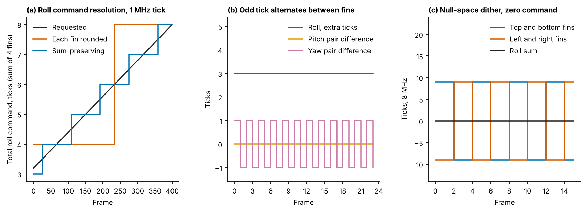
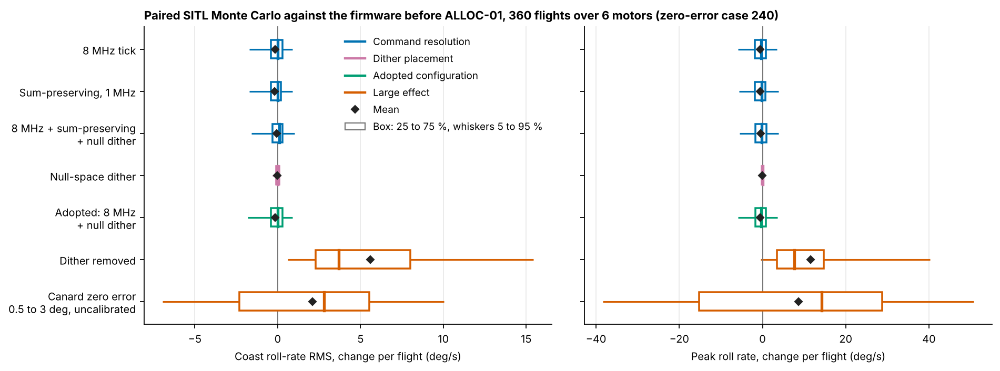

# ALLOC-01 — Canard control allocation and PWM resolution

**Status:** implemented and simulated, 9 Nov 2026. The bench items in §7 are still open. This supersedes the dither placement in ADR-004 §3.6. The amplitude and frequency are unchanged, but the dither now goes on the null axis.

**Question.** Would finer roll resolution improve control? The two ideas tested were staggering the tick commands across opposite pairs and a single canard, and a faster PWM tick. What else can an allocation layer give?

**Answer.**
- **Resolution is not what limits roll control on this vehicle (SITL, 360 paired flights).** Neither the 8 MHz tick nor sum-preserving staggering changes coast roll RMS. The median change per flight is 0.0 deg/s, and peak roll changes by −0.3 deg/s.
- **What does matter in the same model:**
  - **the dead-band dither.** Removing it costs +3.7 deg/s of coast roll RMS per flight (median) and +7.6 deg/s of peak roll.
  - **per-fin zero calibration.** An uncalibrated 0.5–3° zero error on one canard raises the coast roll RMS p95 from 32.8 to 41.6 deg/s. The worst peak roll reaches 304 deg/s, beyond the 240 deg/s requirement.
- **Adopted configuration:**
  - 8 MHz tick;
  - null-space dither;
  - per-fin zero offsets applied in the PWM driver;
  - staggering kept in the code but switched off.

Figures: `Images/alloc01/alloc01_mechanism.png` and `alloc01_results.png`. Both are generated by `Tools/sitl/alloc_figures.py`.

## 1. Numbers that frame the question (from the code and SITL constants)

| Quantity | Value | Source |
|---|---|---|
| Servo scale | 10.34 µs/deg (1200 µs over 116°, measured: BENCH-02 §11) since 15 Nov; 8.889 µs/deg (the maker's figure) 10–15 Nov. This study ran at 6.667 µs/deg (REVIEW-01 F1) | `board.h` |
| One tick at 1 MHz (old) | 1 µs = 0.11° (0.15° = 2.6 mrad as studied) | — |
| One tick at 8 MHz (new) | 0.125 µs = 0.012° at 10.34 µs/° (0.019° as studied) | — |
| Servo dead band | 1.96 mrad nominal (0.11°). MC samples 1–4 mrad. | `sim_params.json`, assumed, **not measured** |
| Servo internal resolution | 0.51 mrad (0.029°) | `sim_params.json`, assumed |
| Roll moment per canard per 1 MHz tick | q̄ × 8.0e-8 N·m/Pa. That is 0.5 mN·m at 6 kPa. | `kf_can` 7.88e-4 m²/rad, CP 0.039 m |
| Fin-can bearing friction | 3–12 mN·m (MC range) | ADR-004 F4 |
| q̄ max over the six G motors | 4.7–8.8 kPa (p95 per motor) | SITL |

At these dynamic pressures, one tick on all four canards (about 2 mN·m) is already below the bearing friction. The servo dead band is about as large as the old tick. So once the dead band is broken, finer commands have little left to resolve.

## 2. The allocation layer (`Core/hyades/gnc/alloc.c`)

The allocator runs in `Flight_Step` after `Ctrl_Update` and before the shadow and PWM stages.

1. **Virtual axes.** The four law outputs become roll r, pitch p, yaw y and the null axis n, where n = (f0+f2−f1−f3)/4. The null axis has no net force or moment.
2. **Null-space dither** (`CTRL_DITHER_NULL 1`). This is the same ±1.5 × dead band, 50 Hz square wave as before. It goes on n (top and bottom +a, left and right −a) instead of on the roll command.
   - Each servo is dithered exactly as before, so dead-band breaking is unchanged.
   - The canards add no net roll, pitch or yaw moment from the dither.
   - SITL shows no penalty, and in the low-disturbance set the coast RMS p95 falls from 2.8 to 1.2 deg/s.
3. **Priority saturation.** Roll keeps priority. Pitch and yaw are scaled together, so their direction is kept, and the dither goes last.
   - In Flight 1 nothing reaches the limit (`sat_frac` 0 in every run).
   - This is the structure Flight 2 needs when pitch and yaw control are enabled.
4. **Sum-preserving quantisation** (`CTRL_ALLOC_STAGGER`, default 0).
   - Each fin is rounded to a whole tick, while the sum of the four is kept to the nearest tick.
   - Extra ticks go to an opposite pair first (pure roll). The odd tick alternates between the fins of a pair frame by frame, so its pitch moment averages to zero (figure panel b).
   - This gives 4× finer roll resolution at a cost of at most one tick (0.005° RMS in SITL) of pitch or yaw difference.
   - At 8 MHz it is redundant, because the tick (0.014°) is already finer than the servo's own resolution (0.029°).
5. **Per-fin zero offsets.** These are applied in `PWM_SetFin` and `PWM_CentreFins` in whole ticks, so they never disturb the quantisation. Since CAL-01 they are measured with the `cal` alignment commands and stored in a flash journal, not set in `board.h`.
   - They correct servo spline indexing and linkage error.
   - PLAN-01 G4 measures them with the CAL-01 procedure.

`PWM_SetFin`, the allocator and the SITL all quantise through the same `Alloc_NormToTicks`.

## 3. Method

- **Plant and code:** the SITL 6DOF (MC-01) running the real flight code. The servo model includes dead band, lash, internal quantisation, rate limit and delay.
- **New in the SITL:** fin commands are quantised to the PWM tick exactly as `PWM_SetFin` does (`pwm_quant=1`).
  - Earlier MC-01 runs used continuous commands. Variant A0 reproduces that, and it matches A1 (median change 0.0 deg/s), so the MC-01 results stand.
- **Pairing:** every variant ran the same seeds and dispersions. Changes are reported per flight against A1, which is the firmware before this change (1 MHz tick, common-mode dither).
- **New metrics:**
  - `p_rms_boost`;
  - `wl_rms_coast`;
  - `pyd_rms`, the RMS pitch and yaw difference between canards;
  - `sv_act`, the mean servo travel rate.

Scripts: `alloc_campaign.sh`, `alloc_extra.sh`, `alloc_analyse.py` (Wilcoxon signed-rank test with bootstrap intervals) and `alloc_figures.py`.

| Set | Flights per variant | Conditions |
|---|---|---|
| Main | 360 (60 × 6 motors) | Full MC-01 dispersions |
| Quiet | 240 | No wind or gusts, 1 mN·m friction, no misalignments: isolates quantisation |
| High q̄ | 240 | Thrust × 1.8, q̄ p95 25 kPa. **Outside the flight envelope:** a stress test only. |
| Zero error | 240 + 240 | One canard with a 0.5–3° zero error from launch, against none |
| Hard-over | 120 + 120 | Servo hard-over fault, adopted configuration against A1 |

## 4. Results (main set unless stated)

| Variant | Coast RMS p50 / p95 (deg/s) | Peak p95 (deg/s) | Median change, coast / peak | All requirements pass |
|---|---|---|---|---|
| A0 continuous commands (old SITL) | 15.2 / 32.4 | 201.1 | 0.0 / −0.3 | 96.7 % |
| **A1 1 MHz, common dither (before)** | 15.3 / 32.3 | 199.5 | — | 96.7 % |
| B1 8 MHz tick | 15.3 / 32.4 | 201.1 | 0.0 / −0.3 | 96.7 % |
| C1 1 MHz, sum-preserving | 15.1 / 32.0 | 200.7 | 0.0 / −0.2 | 96.7 % |
| D1 1 MHz, null dither | 15.3 / 32.5 | 199.3 | 0.0 / 0.0 | 96.7 % |
| E1 8 MHz, sum-preserving, null dither | 15.4 / 32.4 | 201.4 | +0.1 / −0.2 | 96.7 % |
| **H1 8 MHz, null dither (adopted)** | 15.2 / 32.4 | 201.5 | 0.0 / −0.3 | 96.7 % |
| F1 8 MHz, sum-preserving, no dither | 20.4 / 40.3 | 208.9 | **+3.7 / +7.6** | 94.7 % |
| G1 1 MHz, no dither | 21.3 / 41.7 | 208.0 | **+3.7 / +7.6** | 94.2 % |
| H1 with an uncalibrated canard zero error | 16.7 / 41.6 | 220.5 | **+2.8 / +14.3** | 93.8 % (calibrated: 96.2 %) |

Some changes are statistically detectable without mattering. B1, C1, E1 and H1 show 0.1–0.3 deg/s changes with p < 0.05, against 15–200 deg/s levels.

**Other sets**
- **Quiet set.** Every variant gives coast RMS p95 below 3 deg/s. The adopted configuration gives 1.2 deg/s against 2.8 for A1. Removing the dither drops it to 0.1 deg/s here, because with almost no disturbance the dither itself is the main excitation. This is the only condition where that is true.
- **High-q̄ stress.**
  - Command resolution again does not matter: the 8 MHz tick changes coast RMS by −0.5 deg/s on a level of 75 deg/s.
  - The dither matters more than in the main set: removing it costs +12 deg/s coast RMS and +46 deg/s peak.
  - Only 17–19 % of runs pass all requirements in any variant. The q̂ estimator fails R9 in half the runs. This envelope belongs to larger motors and is outside this study. NAV-01 would need revisiting before such motors are flown.
- **Hard-over fault.** Unchanged: 20 % pass in both A1 and H1, with peak boost p95 546 against 553 deg/s. With no servo feedback, the allocator cannot know which canard has failed (§6).
- **Pitch and yaw side effects:**
  - The lateral rate RMS (`wl_rms_coast`) is unchanged in every variant.
  - Sum-preserving quantisation leaves 0.005° RMS pitch and yaw difference between canards at 1 MHz, and 0.002° at 8 MHz. That is negligible: it trims the vehicle by about 0.005° per tick of AoA (inference, from the SITL CNα and static margin).

## 5. Why the predicted 4× resolution gain does not appear (inference from the model)

The servo model's dead band acts on the servo's own position error. A command step smaller than the dead band leaves the canard where it is. With the dead band sampled at 0.06–0.23° against a 0.15° tick, the true canard position wanders within ±(dead band) of the command whatever the command resolution. The dither is what turns that dead band into an average proportional response, so it carries the benefit, and finer commands add nothing on top.

At 5–9 kPa the residual roll is set by bearing friction and gusts, not by a torque step of 2 mN·m. This conclusion depends on the assumed servo dead band and resolution, which have not been measured. If the bench shows a dead band well below 0.15°, re-run C1/E1 (one flag each).

## 6. What an allocation layer gives beyond resolution

| Benefit | Status | Evidence |
|---|---|---|
| Per-fin zero calibration | Implemented: CAL-01 alignment commands and flash journal, READY held until stored | Largest effect found: coast RMS p95 +27 %, peak p95 +24 deg/s uncalibrated |
| Dither with no net canard moment | Implemented, default | No penalty, removes the only moment the dither created |
| Roll-priority saturation for pitch and yaw control (Flight 2) | Implemented | Unit test. Not exercised in Flight 1. |
| One quantiser shared by the firmware, the PWM driver and the SITL | Implemented | SITL now reproduces the PWM tick exactly |
| Fault reconfiguration (drop a failed canard, fly roll on the opposite pair) | **Not possible yet** | Needs servo position or current feedback to detect the fault. The hard-over campaign is unchanged. V6 option. |
| Per-fin effectiveness weighting (damaged or mismatched canards) | Not implemented | Needs measured per-fin effectiveness first |

## 7. Firmware changes and verification

- **New:** `alloc.c` / `alloc.h`.
- **`flight.c`:** calls `Alloc_Apply`. `fin_cmd` is the law output and `fin` is the allocated command.
- **`control.c`:** the roll law no longer adds the dither when `CTRL_DITHER_NULL` is set.
- **`pwm.c`:**
  - PSC and ARR come from `PWM_TICK_HZ`, giving PSC 11 and ARR 47 999 at 8 MHz;
  - compile-time checks that the tick divides 96 MHz and that ARR fits TIM3's 16 bits;
  - per-fin zero offsets, applied in whole ticks.
- **`board.h`:** `PWM_TICK_HZ 8000000u`, `CTRL_DITHER_NULL 1`, `CTRL_ALLOC_STAGGER 0`. The zero table moved to the CAL-01 flash journal.
- **Host tests:** all suites pass, including the new `test_alloc`:
  - the sum is kept within one tick over a ramp;
  - pair first, odd tick alternating;
  - the null dither has zero net moment;
  - inactive commands pass through;
  - roll priority holds;
  - NaN and out-of-range inputs are safe.

  `test_dither` now builds the legacy mode explicitly.
- **Target build:**
  - arm-none-eabi -O2 with -Wall -Wextra -Werror -Wundef -Wshadow -Wdouble-promotion: clean;
  - text 91 224 B (+64 B);
  - `Alloc_Apply` is 588 B with a 120 B stack;
  - WCET not measured, estimated at a few µs at 96 MHz.
- **Equivalence:** the default SITL build reproduces H1 exactly over all 360 flights.
- **HITL not run.** The HITL link carries normalised fin commands over USB, not PWM pulses, so it cannot check the timer change. The allocator's logic is already covered by the SITL and the unit tests.

**Bench checks before flight (PLAN-01 G1, G4 and G17):**
1. Scope one fin output and check:
   - centre 1520 µs;
   - steps of 0.125 µs;
   - the 6 ms fallback period;
   - all four pulses starting together.
2. Align each canard against a jig with the CAL-01 procedure and save.
3. Measure the servo dead band and resolution with a slow ramp, as in BP-01. If the dead band is below 0.15°, re-run variant E1.
   - **Done 10 Nov (BENCH-01 rev 2, REVIEW-01 §3).** The servo takes a new target only after a 2.0 µs command change: 16 ticks at 8 MHz, 0.225° at the canard (0.30° in the commanded units of the time). That is above 0.15°, so E1 needs no re-run. With this input stage in the SITL (`mc.py --servo bench01`) the adopted configuration is unchanged (96.7 %), and removing the dither costs +5.9 °/s of coast RMS, against +3.8 with the legacy model.
   - **Scale corrected 10 Nov (REVIEW-01 rev 2).** The firmware now commands 8.889 µs/°. The adopted configuration re-run at that scale is unchanged (96.7 %, coast RMS 15.2 / 32.3 °/s, peak p95 201 °/s), so the conclusions of this study stand.
   - **Scale measured 15 Nov (BENCH-02 §11):** 10.34 µs/°, `SERVO_RANGE_DEG 116`. With the BENCH-02 servo at that scale: Build tolerances, 600 flights, paired seeds: **600/600**, coast roll RMS p50/p95/max 9.4/19.1/34.0 °/s, peak roll p95/max 106/220 °/s; worst motor G104T 22.9 / 115 °/s, so G1 and G2 hold for every motor. Against the as-built 135 (599/600, 21.5, 118): paired median −1.1 °/s coast RMS, −4.9 °/s peak (MC-01 §2).
