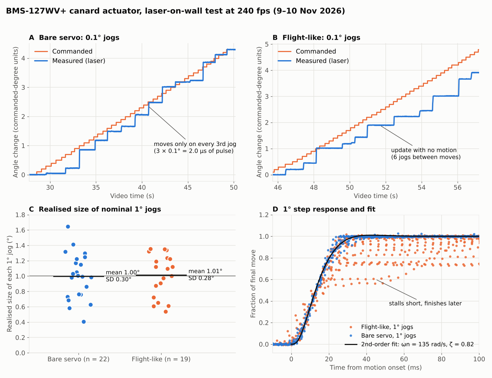

# BENCH-01 — Canard jog test with a laser on the canard (first servo bench data)

**Rev 3, 10 Nov 2026.** Rev 2 plus the scale result (§3.7), true-angle values (§4) and the re-run at the corrected scale (§5). Rev 2 replaced rev 1 (same day) and absorbed the BENCH-01a re-analysis; §8 lists what changed and why.
**Recorded:** 10 Nov 2026, 00:15–00:19. **Firmware:** `9c3cd54` (CAL-01 ALIGN phase), confirmed from the console log.
**Data:** two 240 fps phone videos (not in the repo), the console log, and dot tracks, click times and scripts in `Firmware/FC-V4/Tools/bench/jog_laser/reanalysis/` (`README.md` there gives the run order). The rev 1 pipeline one level up is kept but superseded.
**Closes in part:** PLAN-01 G1 and G4, MC-01 A17–A21. REVIEW-01 carries the knock-on findings.

**Units.** Angles are *commanded degrees*: pixels are scaled by the servo's own response to 1° and 10° jogs at `board.h`'s 6.667 µs/°. True canard angle = K × commanded, and **K = 0.75** (§3.7): multiply every angle and rate in §3 by 0.75 for the canard. The firmware scale was corrected the same day, so from build `75638673` on commanded = true.
**Labels.** [F] measured, [I] inference, [S] speculation.

## 1. Setup

| | A (video 7983) | B (video 7984) |
|---|---|---|
| Canard drive | Lightest possible, no bearing | Bearings and servo horn fitted, flight-like |
| Fin | 2 (bottom) | 2 (bottom) |
| Jogs (`cal jog 2 …`) | −10 ×3, +10 ×3, −1 ×22, +0.1 ×43 | −10 ×2, +10 ×3, −10 ×3, +1 ×24, −0.1 ×102 |
| Commanded range | −0.6° to +29.4° | −40° to −10° |

- A laser on the canard throws a dot on a wall just over 3 m away. The phone sits behind the airframe and films the wall at 240.16 fps (no dropped frames, exposure about 3.5 ms). The airframe was held by hand.
- Jogs were mouse clicks on the Canards tab, 0.1–0.6 s apart. **This is a quasi-static, unloaded test of one servo.** Supply voltage was not recorded.

## 2. Method

1. **Dot tracking:** weighted centroid of the saturated core, every frame. Static noise 0.03–0.07 px (0.002–0.004°). Camera drift along the dot's travel ≤ 0.15 px in both videos.
2. **Command times:** the Canards tab buttons are `tk.Button`s, which fire on mouse **release**. Each jog is a press click and a release click 0.11–0.18 s apart. Motion start sits at a fixed offset from the release click (IQR 1–6 ms for 1° and 10° jogs). Against the press click it moves with the hold time (slope 0.83–0.89 in A). All 71 (A) and 134 (B) jogs land in the right log second.
3. **Scale:** a quadratic through the 1° staircase gives 16.8 px/° (A) and 15.7 px/° (B), ±3 % across the range. B uses only levels at or below −21° (§3.4).
4. **Per-jog response:** median level before the next jog against the level before this one.

## 3. Results

### 3.1 The servo takes a new target only after a 2.00 µs change

- [F] In A the canard moved on jog 3, then on jogs 7, 10, 13 … 43: twelve consecutive intervals of exactly 3 jogs. In B every move above 0.05° sits on a multiple of 3 jogs (24 of 34 such points moved).
- [F] Three 0.1° jogs are 16 PWM ticks = 2.000 µs (`pwm.c`: 0.0533 ticks per millidegree, 0.125 µs per tick).
- [F] The interval does not depend on how far the previous move went (0.05° and 0.63° moves are both followed 3 jogs later).
- [I] This is the datasheet's 2 µs dead band, acting on the **input**: 0.30° commanded each way from the last accepted target. An error dead zone or friction breakaway would trigger after a variable number of jogs.
- [S] Not excluded: the PWM output itself stepping in 2 µs. The code says 0.125 µs; the scope check in ALLOC-01 §7 confirms it.
- [I] ±0.02° jogs (CAL-01) do nothing until 15 accumulate.

### 3.2 Where each move lands

| | A | B (≤ −21°) |
|---|---|---|
| Realised size of a 1° jog | 1.00 ± 0.30° (0.41–1.64), n = 22 | 1.01 ± 0.28° (0.54–1.35), n = 19 |
| Realised size of a 0.30° update | 0.34 ± 0.19° (0.05–0.63), n = 12 | 0.35 ± 0.18°, n = 11 |
| Position against a smooth fit | SD 0.24° (−0.38 to +0.56) | SD 0.19° (−0.36 to +0.30) |

- [F] Same target, same history: repeats to 0.012° (29.4°), under 0.001° (11.4°, from above and below) and 0.12° (8.4°). Different approach sizes: 0.28–0.34° spread (19.4°, 9.4°).
- [I] A position error tied to the target, SD about 0.2°, mostly repeatable. Not random stick-slip. [S] Feedback potentiometer or ADC granularity.

### 3.3 Reversal, setup A

- [F] After the reversal the first three updates gave 0.04°, 0.18° and 0.63°. From then on the run sat 0.18 ± 0.04° (SE, n = 12) below the downward staircase.
- [I] Direction offset (lash) about 0.2°. The 0.8° of command before 0.2° of motion is that offset plus one 0.30° update plus two short landings. It is one sample, not a play width.

### 3.4 Setup B: one restriction event above about −21°

| Time (s) | Jog | What happened [F] |
|---|---|---|
| 2.2, 3.3 | −20 → −30 → −40 | Normal: 9.7° each |
| 5.2 | −40 → −30 | Normal. −30 repeats to 0.15° |
| 6.2 | −30 → −20 | Took about 300 ms. Landed 0.64° short of the first −20 level |
| 6.9 | −20 → −10 | Delivered **4.75° of 10°**, then sat 2.4 s, creeping diagonally |
| 9.2–10.5 | back to −40 | −30 and −40 now 1.14–1.29° and 1.20° lower. Dot height shifted 12 px (0.76°) and stayed |
| 13.5–27.7 | +1 × 24 | Normal to −21°. The five jogs above −21° gave 0.64° each |
| 30–39 | −0.1 jogs after the reversal | No forward motion for 8 jogs, small creeps the wrong way, about 0.7° net for 3.0° commanded, then a 1.2° jump with a 6 px height change |

- [I] Something restrains the beam above about −21°, and something slipped by about 1.2° when the servo drove into it.
- [S] Candidates: laser module or its lead pulling tight, horn slipping on the spline, a hard stop in the assembly, or the airframe turning in the hand. The height change points at the laser or airframe.
- [F] Net travel of the 0.1° run: 6.6° for 9.9° commanded on one 15.7 px/° scale.
- **Check before powering B again:** command −10° and watch the canard. If it stops short, the servo is stalling against a stop (up to 1.3 A).

Below −21° B positions as well as A (§3.2). What B adds there:
- [F] 4 of 19 1° jogs stopped 0.16–0.46° short at 40 ms and finished later (0 of 22 in A).
- [F] 4 of 16 0.30° updates produced no motion until the next update (0 of 12 in A).
- Small samples: one-sided Fisher p = 0.04 and 0.09.

### 3.5 Dynamics (unloaded)

| | A 10° | A 1° | A 0.30° | B 10° | B 1° | B 0.30° |
|---|---|---|---|---|---|---|
| ω_n, rad/s (per-jog median, IQR) | 110 | 131 (121–151) | 189 (145–234) | 115 | 129 (116–145) | 159 (118–201) |
| ζ | 0.82 | 0.80 | 0.78 | 0.80 | 0.81 | 0.80 |
| n | 5 | 22 | 12 | 5 | 22 | 17 |
| Peak rate, °/s | 414–452 | about 50 | — | 439–483 | about 45 | — |

- [F] A linear second-order model fits 1° and 10° steps to 0.8–2 % RMS. 10–90 % rise is about 21 ms at every size.
- [I] The 414–483 °/s peak is a lower bound on slew, not a slew limit. A fit with a rate limit gives 410–490 °/s but improves the residual by only 10 %.

### 3.6 Timing

| Motion start relative to the 10° jogs (release-click reference) | A | B |
|---|---|---|
| 1° jogs | +3 ms | +3 ms |
| 0.30° updates, median (IQR) | +28 ms (+20 to +60) | +21 ms (+19 to +27) |

- [F] Sub-degree moves start 21–28 ms later than large ones. 1° moves do not.
- [F] **Absolute latency from audio alone:** the servo's slew noise (3–9 kHz, 10–18 dB above the click decay, lasting about 25 ms) rises 20 ms after the mouse-release click on 10 of 11 unrestricted 10° jogs (16–22 ms; one at 34 ms).
- [I] Mouse-up to motion start is therefore under 20 ms. The firmware path takes 6.3–11.7 ms of that (jog parsed in the comms task, compare written next frame, pulse 1.25–1.72 ms long). **Servo dead time for ≥ 1° jogs is below about 13 ms, most likely under 10 ms.**
- [F] The phone's audio runs 130–145 ms late against its video, beyond the container timestamps, in both files. This is why motion appears to precede the release click by 113–127 ms.

### 3.7 Scale

- [F] `board.h` uses 6.667 µs/° (1200 µs over 180°). Blue Bird quotes 90° for 1100–1900 µs: 8.889 µs/°.
- [I] If the maker is right, K = 0.75 and every angle here, in the firmware and in SITL is 0.75 of its nominal.
- [F] The videos could not settle it: the scale came from the jogs and the camera's focal length is unknown.
- [F] **Resolved 10 Nov.** James jogged the canard on the bench and found it moving 0.75 of the command, so the maker's figure holds and K = 0.75.
- [F] `board.h` now uses 8.889 µs/° (`SERVO_RANGE_DEG 135`). Stored zeros are converted × 3/4, which is the same pulse (CAL-01 §9).
- [I] The focal length implied is then about 1 280 px or more: a 53° field of view across the frame's long side.

## 4. Against the models

| Parameter | Model now | Measured | Verdict |
|---|---|---|---|
| Dead band | Error dead zone, 0.00196 rad half-width (±1 µs at 8.889 µs/°). MC-01 A19: 1–4 mrad | Input threshold 2.00 µs each way: 0.0052 rad commanded | Twice the µs, and on the input side. No effect on SITL roll metrics (§5) |
| Landing error | none | SD 0.2°, repeatable | Add. No effect on SITL roll metrics |
| Lash, A20 | 0.002 rad, U(0.001, 0.003) | A: 0.18 ± 0.04° = 0.0031 rad. B: not measurable | At or just above the range |
| f_N, ζ, A18 | 80, 0.7; U(52, 100), U(0.5, 0.9) | 130 (110–150), 0.8, unloaded | Model conservative |
| τ_d, A17 | 14 ms, U(10, 21) | < 13 ms for ≥ 1° jogs; +21–28 ms for 0.30° updates | Better for large moves, worse for small. Dynamic test decides |
| Slew, A21 | 23.65 rad/s | ≥ 7.2–8.4 rad/s seen | Lower bound only |
| Dither | ±0.17° = ±1.5 µs, 3.0 µs peak to peak (2.25 µs before the scale correction) | Threshold 2.0 µs | 50 % margin |

In true canard angle (× 0.75):
- threshold 0.225° = 0.0039 rad each way, which is the data sheet's 2 µs dead band;
- landing error SD 0.14–0.18°;
- lash 0.135° = 0.0024 rad (data sheet 0.115°);
- peak rate seen 310–362 °/s;
- ω_n, ζ and the timing are unchanged.

## 5. What this means

SITL with the measured input stage and dynamics (`mc.py --servo bench01`, paired seeds, REVIEW-01 §3):

| Case | n | Coast roll RMS p50 / p95 | Peak p95 | All requirements |
|---|---|---|---|---|
| Legacy servo model | 360 | 15.2 / 32.4 °/s | 201 °/s | 96.7 % |
| Measured servo | 360 | 15.1 / 31.1 | 202 | 96.7 % |
| Measured, τ_d 39 ms | 360 | 15.8 / 33.0 | 199 | 96.1 % |
| Measured, K = 0.75 | 360 | 18.1 / 45.3 | 258 | 89.7 % |

With the build tolerances (1 200 flights each, the PLAN-01 gate 2 set): legacy 99.83 %, measured 99.92 %, measured with K = 0.75 99.75 % (peak p95 138 °/s, coast RMS p95 26.4 °/s).

**At the corrected scale**, with the measured servo in true angle (REVIEW-01 rev 2 §3): default dispersions 96.4 % (legacy model 96.7 %); build tolerances 1 200 of 1 200 (legacy 99.83 %), coast RMS p95 19.9 °/s, peak p95 111 °/s.

1. **MC-01 and ALLOC-01 conclusions stand** with the measured actuator if K = 1.
2. **The scale is corrected.** K = 0.75 was confirmed and the firmware fixed on 10 Nov. The K = 0.75 rows above describe the firmware as it was: the requirements passed at build tolerance, the goals G1 and G2 (120 °/s, 25 °/s) did not.
3. **c stays at 15.** With f_N 130, ζ 0.8 and τ_d 14 ms the margins are PM 70°, GM 12.2 dB (was 67°, 10.8 dB). If the small-move delay is real under the 200 Hz stream (τ_d 39 ms): PM 55°, GM 7.6 dB nominal and 38°, 4.5 dB at Ixx −30 %, the same as the corner ADR-004 already accepts. c = 18 would then be 27°, 3.0 dB at that corner. Raise c only after the dynamic test.
4. **Dither margin restored.** At the corrected scale it is 3.0 µs peak to peak against the 2.0 µs threshold. In SITL the measured model without dither costs +5.9 °/s coast RMS (legacy model: +3.8). The A/B on the real servo is still to do.
5. **CAL-01:** jogging resolves to 0.225° at the canard with about ±0.15° landing error. PLAN-01 G4's 0.1° is not reachable by jogging on this servo.
6. **B's mechanism is not shown to be worse than A's servo below −21°**, apart from the stalls. Resolve §3.4 before drawing more.

## 6. Next bench run (refines PLAN-01 G1)

1. Confirm on the new firmware that a 10° jog is 10° at the canard, and do the −10° check on B (§3.4). Minutes each.
2. Script the commands: chirp or sine plus 0.05° and 0.2° staircases both ways.
3. Flash an LED in frame on each command, so latency does not depend on audio.
4. Dither on and off at the 200 Hz frame rate. This decides whether the +21–28 ms start delay exists in flight.
5. Flight servo voltage, recorded. One step of 30° or more for slew.
6. A ruler on the wall, and the laser lead strain-relieved.
7. A hanging weight on the canard for the loaded case.

## 7. Limits

- One servo, one reversal per setup, unloaded, voltage unknown.
- Nothing here is a response to the 200 Hz command stream.
- Rolling shutter adds up to 1 ms across a 10° step, about 3 % on ω_n.

## 8. Changes from rev 1 and from BENCH-01a

| Rev 1 statement | Finding | Cause |
|---|---|---|
| B revisit scatter 1.2–1.3°, reversal dead zone 2.1°, 1° jogs 1.04 ± 0.52°, 2.29° breakaway, "6× the model" | One restriction event (§3.4). Below −21° B matches A | B's pixel scale was interpolated through the restricted −20° and −10° levels: 7.1 px/° at the top against 15.7 |
| "0.1° run measured 10.27° for 10.2°: the scale holds" | 6.6° for 9.9° | Same calibration: the check is circular |
| "One move every 2–4 jogs", "static breakaway 0.3–0.6°" | Exactly every 3 jogs = 2.00 µs (§3.1) | Its own output lists 3, 3, 3 …; summarised too loosely |
| "Audio-to-video offset 0.13 s in one recording, 0.24 s in the other" | About 0.12 s on the release click in both | `audio.py` applied A's 0.181 s audio start to B (0.054 s). Fixed |
| "1° steps start 30–40 ms after 10° steps" | +3 ms | A mean with SD 72 ms, and click timing by envelope peak, which the slew noise shifts on 10° jogs |
| "Absolute latency is not measurable" | Under 20 ms mouse-up to motion (§3.6) | Slew noise is audible after the release click |
| PLAN-01 G4: "B positions only to ±0.5°" | Not supported below −21° | As row 1 |

BENCH-01a (retired) referenced timing to the press click and reported "6–12 ms after the click". The command fires on release, so those figures were meaningless; §3.6 replaces them. Its other results are carried here unchanged.
