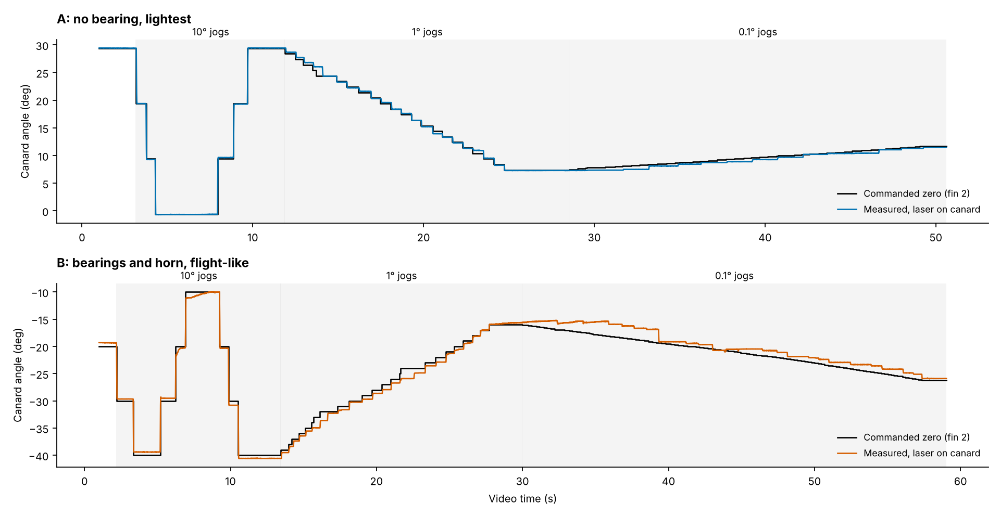
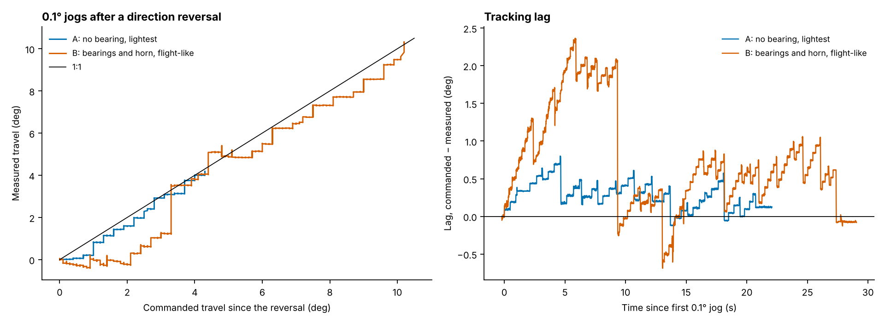
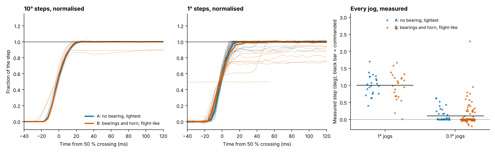

# BENCH-01 — Canard jog test with a laser on the canard (first servo bench data)

**Date:** 10 Nov 2026 (recorded 00:15–00:19). **Firmware:** `9c3cd54` (CAL-01 ALIGN phase).
**Data:** two 240 fps phone videos (not in the repo), the console log, and the derived dot tracks in `Firmware/FC-V4/Tools/bench/jog_laser/data/`. `run.sh` regenerates every number and figure here.
**Closes in part:** PLAN-01 G1 (servo bench) and G4 (canard zero), MC-01 A17–A20.

## 1. Setup

| | A (video 7983) | B (video 7984) |
|---|---|---|
| Canard drive | Lightest possible, no bearing | Bearings and servo horn fitted, flight-like |
| Fin | 2 (bottom) | 2 (bottom) |
| Jogs (`cal jog 2 …`, Canards tab) | −10 ×3, +10 ×3, −1 ×22, +0.1 ×43 | −10 ×2, +10 ×3, −10 ×3, +1 ×24, −0.1 ×102 |
| Commanded range | −0.6° to +29.4° | −40° to −16° |

- A laser on the canard throws a dot on a wall just over 3 m away. The phone films the wall at 240 fps.
- **Camera stability:** the dot jitters 0.1–0.35 px while stationary. In B a phase correlation of the static background drifts less than 0.3 px over the whole video. No stabilisation was applied.
- **Jog spacing:** jogs came 0.1–0.6 s apart, so the servo was at rest between them. **This is a quasi-static test**, not the 200 Hz in-flight command stream.

## 2. Method

1. **Dot tracking:** every frame at full resolution. The detector looks for a saturated white core inside a magenta halo, then takes the core centroid.
   - The emitter strip at the bottom of the frame is masked out.
   - A few frames where the detector jumped to the emitter are dropped, as are the first second and the last 1.3 s of B, where the operator's arm crossed the beam.
2. **Command times:** from the audio. Every jog has a mouse press–release pair, about 0.13 s apart. These were matched to the console log, which has 1 s timestamps: 71 of 71 jogs matched in A and 133 of 134 in B.
3. **Calibration:** pixels are converted to degrees from the 10° jog levels, as agreed. So the 10° steps define the scale, and their own size error is not measurable.
   - **A:** the dot position is a projective function of tan θ (the dot on a flat wall, seen by a camera). It fits all four levels to within **0.06°** at about 17 px/°. One pixel is about 0.06°, and the noise floor is about 0.01°.
   - **B:** revisits of the same 10° level scatter by 1.2–1.3° (§3.1), so no smooth fit holds. A monotone interpolation through the mean levels is used instead, so B's local scale is uncertain to about ±15 %.
   - **Check on B:** the 0.1° run commanded 10.2° of travel and measured 10.27° (1.007), so the scale holds over that range.
4. **Per-jog response:** the median position over the 0.1 s before the jog is compared with the 0.1 s before the next jog.

## 3. Results

### 3.1 Static positioning

| | A, no bearing | B, flight-like |
|---|---|---|
| Revisit scatter at the same 10° command | 0.02–0.34° | **1.2–1.3°** |
| 1° jogs, measured size | 1.01 ± 0.30° (range 0.40–1.70°) | 1.04 ± 0.52° (range 0.01–2.66°) |
| 0.1° jogs that moved the canard (≥ 0.03°) | 14 of 43; one move every 2–4 jogs | 38 of 102, including small backward creeps |
| Size of each slip on 0.1° jogs | 0.05–0.62°, mean 0.30° | 0.06–0.95°, plus one 2.29° breakaway |
| **Reversal dead zone:** command travel after a direction change before 0.2° of motion | **0.8°** | **2.1°** |
| Tracking lag in a steady one-direction run (second half) | −0.1 to +0.5° (mean 0.18°) | −0.1 to +0.95° (mean 0.54°) |
| Net travel over the 0.1° run | 4.18° measured for 4.3° commanded | 10.27° measured for 10.2° commanded |

**Stick-slip** is visible in both setups and much larger in B:
- The lag builds as the 0.1° commands stack up, then releases in one slip, often past zero.
- Straight after B's reversal, the canard **crept about 0.4° the wrong way** before it moved forward. That is consistent with elastic wind-up in the horn or bearing seat relaxing (inference).

Two things still hold on average:
- **Net tracking is good:** over a long run, the total commanded travel arrives to within about 1–3 %.
- **The `cal` zero is applied exactly:** the trial values the firmware echoes match the command, and the PWM tick is 0.019°. All of the error is in the mechanism.

### 3.2 Dynamics

| | A, 10° | A, 1° | B, 10° | B, 1° |
|---|---|---|---|---|
| Rise time, 10–90 %, median (range) | 24 ms (21–25) | 20 ms (14–38) | 23 ms (21–115) | 22 ms (14–528) |
| Overshoot, median | 0.2 % | 1.3 % | 0.1 % | 1.1 % |
| Second-order fit ω_n, ζ (median) | 109 rad/s, 0.82 | 132 rad/s, 0.79 | 117 rad/s, 0.80 | 140 rad/s, 0.83 |
| Peak rate | 430 °/s | 51 °/s | 450 °/s | 41 °/s |
| Start delay relative to a 10° step | 0 | +30–40 ms | 0 | +30–35 ms |

- **Rise time is the same for 1° and 10° steps** (about 20–24 ms), so both stay in the servo's linear region. These are not slew-limited moves: the 430–450 °/s peak is a lower bound on slew, not the slew rate.
- **Smaller errors start later.** 0.1° slips that happen promptly start 50–70 ms after the command, against about 0 ms for 10° steps. A drive that grows with the error, working against static friction, does exactly this (inference).
- **About B's long rise times:** many of B's 1° steps stop at 75–90 % and finish only later, or at the next jog (the thin lines in the figure).
- **Absolute command-to-motion latency is not measurable here.** The phone's audio-to-video offset was 0.13 s in one recording and 0.24 s in the other. Only delays relative to the 10° steps are reported.
- **Loading:** these are unloaded figures. There is no hinge moment from airflow.

### 3.3 Audio

- **The two clicks per jog are the mouse.** They are present on every jog, including the 0.1° jogs that did not move the canard.
- **Slips can't be heard in this recording.** Servo-band audio (3–8 kHz) in the 0.03–0.3 s after each 0.1° jog does not separate jogs that moved the canard from jogs that did not: ROC AUC 0.41 in A and 0.46 in B, which is chance. Mouse clicks mask the servo.
- **No continuous holding hum** was found once the clicks are excluded.

## 4. Against the models

| Parameter | Model now | Measured | Verdict |
|---|---|---|---|
| Reversal width, 2 × dead band + lash (actuator-model-reduction) | 0.34° (datasheet: dead band 2 µs = 0.225° window, lash 0.115°) | A 0.8°, B 2.1° | **2.4× (A) and 6× (B) the model.** B is also about twice the HITL-02 worst case (2 × 0.40 + 0.29 = 1.09°) |
| MC-01 A19 dead band | U(0.001, 0.004) rad, half-width | A ≈ 0.3° half-width; B is friction-dominated | Raise it, and add Coulomb friction with stick-slip on the canard shaft |
| MC-01 A18 f_N, ζ | U(52, 100) rad/s, U(0.5, 0.9) | 110–140 rad/s, 0.8 (unloaded) | The model is conservative. Keep the lower range until the loaded value is known |
| `CTRL_DITHER_AMP_RAD` | ±0.17° (1.5 × the datasheet dead band) | Static breakaway is 0.3–0.6° (A) and up to about 1–2° (B) | **Probably too small to keep the servo moving.** Confirm with a dynamic test (§6) |
| PLAN-01 G4, canard zero ≤ 0.1° | — | B can only be positioned to within about ±0.5° statically | **Not achievable with B as built.** See §5 |

## 5. What this means

1. **B's mechanism is the dominant error.** Bearings and horn add about 1.3° of reversal dead zone and about ±0.6° of positioning scatter on top of the servo's own 0.8°. The earlier ablation (ALLOC-01, limiting factors) found mechanical asymmetry dominates roll. This adds a mechanism error large enough to matter for roll on its own.
2. **Re-run the Monte Carlo** (MC-01) with:
   - the measured reversal width (A as the servo floor, B as built);
   - a stick-slip friction element.

   Then decide whether the mechanism needs rework before flight 1.
3. **Mechanical fixes to try first:**
   - check bearing preload and alignment (a binding seat or a canard shaft out of coaxial);
   - check the horn's clamp and play;
   - check the linkage geometry if the drive is not direct.

   Then repeat this test.
4. **CAL-01 procedure, until B improves:**
   - approach the jig line from one direction only, and finish with a few 0.1° jogs in that same direction;
   - after Save, back the canard off by 2° and return, and confirm the dot comes back to the line. This exposes a stuck zero.
5. **Dither:** retune only after the dynamic test. A quasi-static test cannot say whether ±0.17° at 50 Hz keeps the servo moving under real commands.

## 6. Next bench run (refines PLAN-01 G1)

- **Script the commands instead of clicking:** a small chirp or sine, plus fixed 0.05° and 0.2° staircases in both directions, sent over the link. This removes the mouse noise and fixes the timing.
- **Absolute latency:** flash an LED in the camera frame on each command (or log the frame tick), so command-to-motion delay can be measured.
- **Power:** run at flight servo voltage and record it.
- **Calibration:** put a ruler or two marked points on the wall, so B's scale does not depend on the jogs under test.
- **Loaded test:** repeat with a hanging weight on the canard to approximate the hinge moment.
- **Dither A/B:** run with dither on and off at the 200 Hz frame rate (ADR-004 §6), using the bench actuation build.

## 7. Open question

- **How is B's horn coupled to the canard: directly on the spline, or through a pushrod or linkage?** B's 10° levels are uneven: −20° to −10° gave about half the dot travel of −30° to −20°. Either a linkage ratio that changes with angle, or friction stopping the canard short of the command, could cause that. The answer changes the mechanism model.
