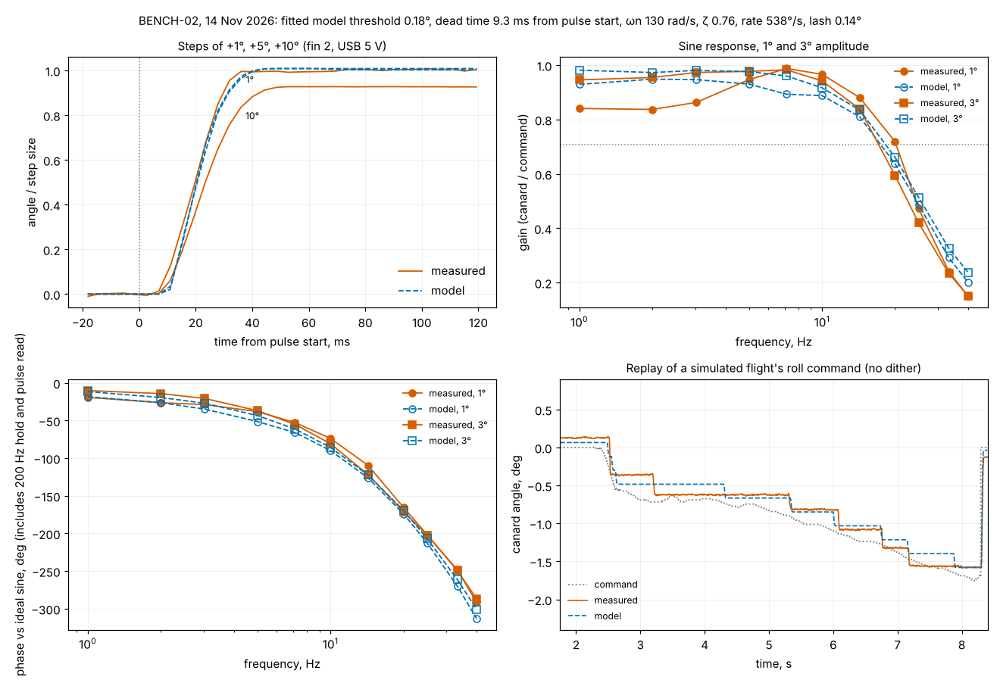
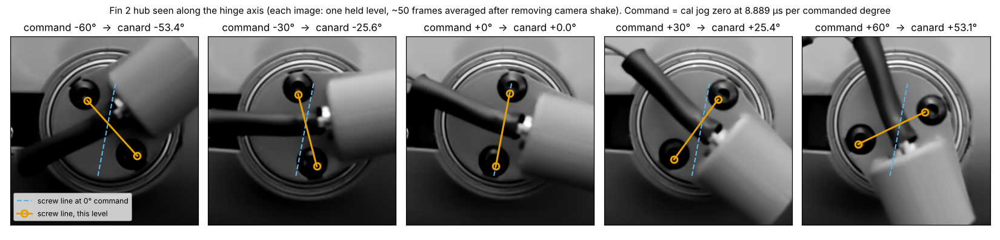
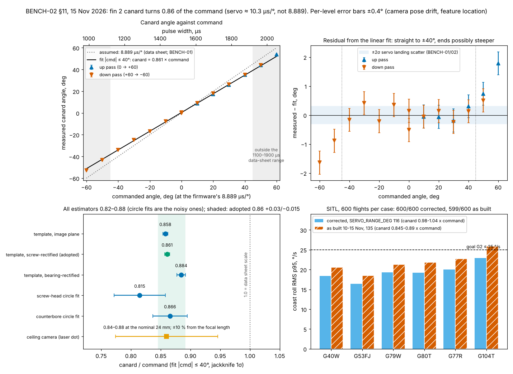

# BENCH-02: servo identification, bench procedure and tools

**Rev 3, 15 November 2026.** **Status:** first recordings analysed (§10), and the pulse scale measured on the hub (§11): the canard turned **0.86** of the command at `SERVO_RANGE_DEG 135`, so the firmware is now at 116 (§11.5). **Open:** re-align and save (CAL-01 §10); measure fins 0, 1, 3.
**Applies to:** FC-V4, Blue Bird BMS-127WV+, direct drive, 5 V servo rail from USB (this board's limit).
**Code:** `Core/hyades/svc/bench.c/h`, `bench_profiles.c` (generated), `bench` command in `Core/Src/app.c`, `CFG_BENCH_PROFILE` in `board.h`; tools in `Tools/bench/servo_id/`.
**Tests:** `Tests/test_bench.c` (6), `Tests/test_tools.py::BenchProfiles` (3).
**Supersedes for method:** BENCH-01 (hand jogs, no timing mark). BENCH-01's numbers stand until this test replaces them.

## 1. Why

BENCH-01 gave the static behaviour of the servo (0.225° threshold, landing scatter, lash) from hand jogs, and only a bound on timing (dead time < about 13 ms), because nothing tied a video frame to a command. The roll loop's margins depend on the timing and the small-signal response, and a simulated flight commands the canards within 0 to −1.8° with frame-to-frame changes of one or two timer ticks (0.014–0.028°) plus the dither. That regime, and the dynamics, are what this test measures.

| Model parameter (SITL name) | Profile | Taken from |
|---|---|---|
| Threshold `sv_sod` | `creep` | command travelled between two jumps of the canard |
| Landing error `sv_land` | `stair`, `creep` | scatter of settled levels about the command |
| Lash `sv_lash` | `stair` | same level approached from below and from above |
| Dead time `sv_tau` | `steps` | time from pulse start to 10 % of the move, less 1.5 ms pulse read |
| `sv_wn`, `sv_zeta` | `steps` 0.5–5°, `sine03/1/3` | rise, overshoot; gain and phase against frequency |
| Rate limit `sv_rate` | `steps` 20°, 30° | peak rate |
| What the dither does | `creepd`, `sine1d`, `flight` vs `flightn` | error and 50 Hz ripple with and without |
| Pulse scale (10° is 10°) | `bench hold` and a tape measure | §4 |
| The whole model, as flown | `flight` | 6 s of a simulated flight's roll command replayed |

## 2. What was built

- **Firmware.** `bench run <profile> <fin>` plays a stored command profile to the chosen canard at 200 Hz. Both board LEDs (D6, D8) become a timing mark: off for 1.5 s, then on/off every 97 frames (0.485 s) for the length of the profile, then off for 1.5 s. The LED and the servo pulse of a frame change at the same instant (`PWM_Commit`).
  - Every profile's length is 97 × a different odd number, so the count of LED half periods tells the analysis which profile a video holds.
  - Profiles are integer tick sequences at the current servo scale (9600 ticks over `SERVO_RANGE_DEG`; `bench_profiles.c` checks it). The 14 Nov recordings were played at 135, the firmware from 15 Nov plays 116 (§11.5). The firmware prints the CRC-32 of what it played (`BENCH done ... ok`); the analysis replays the same ticks from `profiles.py`. `test_bench.c` checks the two agree for every profile.
  - Only in SETTLING or READY with no HARD fault. A liftoff, a fault or an alignment session ends a run at once and the flight law's commands stand.
  - **Bench builds only:** `CFG_BENCH_PROFILE 1`. A build with `CFG_FLIGHT_BUILD` refuses it (`#error`).
- **`bench hold <fin> <deg>`** holds one angle until `bench stop` (for §4).
- **Tools** (`Tools/bench/servo_id/`): `profiles.py` (definitions, firmware table, replay), `track.py` (video to dot and LED series), `analyse.py` (timing, angle, results, figure), `synth.py` (synthetic video for checking the tools).

Cost: about 7.4 KB of flash in a cross-build (GCC 13.2): 82 288 B without, 89 640 B with. The CubeIDE image was 79 352 B on 10 Nov, so about 86.7 KB is expected against the 98 304 B USB-update limit (inference: the two compilers differ by about 3 KB on the same source).

## 3. Setup

| Item | Do this | Why |
|---|---|---|
| Airframe | Clamp it. Laser on canard 2 (bottom), dot on a flat wall 1.5–3 m away, beam roughly square to the wall at zero | Any movement of the rocket reads as canard angle |
| Dot's path | ±30° sweeps a line 1.15 × the wall distance long (2.3 m at 2 m). Keep all of it on the wall | `stair` and `steps` go to ±30° |
| Phone | Tripod or wedged solid, not hand-held. Turn it so the dot travels along the **long** side of the picture and the path fills most of it | Resolution; and see rolling shutter below |
| Board LEDs | In the picture, **on the line of the dot's path, beyond one end of it** (not on it). Out of focus is fine | The sensor reads out line by line, and a phone held upright reads across the picture, not down it. LEDs on the dot's line are read at the same moment as the dot; anywhere else they can be up to 4 ms out (14 Nov: 2.4–2.9 ms). The analysis reports the offset |
| Laser module | Keep the module itself out of the picture if you can | Its red glow moves with the canard; the analysis rejects it, but less to reject is better |
| Light | Dim the room. Lock exposure and focus on the wall (hold to lock), then pull exposure down until the dot is a small spot, not a white blob | A clipped blob loses precision |
| Camera mode | Slo-mo 240 fps, 1080p if offered | 4.2 ms per frame |
| Power | USB 5 V. Run **one fin** (`2`), not `all` | Four servos stepping together can sag the USB rail. If the board resets on a 30° step, say so |
| During a run | Do not touch the bench, the cable or the phone | |

A lit room also works (the detector was checked on the BENCH-01 video, lit and cluttered: dot found in 99.5 % of frames), but dim is better.

## 4. Scale check with a tape measure (10 minutes, once)

Closes the open item "a 10° command is 10° at the canard" (REVIEW-01 F1).

1. Tape a tape measure to the wall along the dot's path. Measure D, the distance from the canard's hinge line to the wall along the beam at zero.
2. `bench hold 2 0`, read the dot's position. Then `bench hold 2 10`, `bench hold 2 -10`, `bench hold 2 20`, `bench hold 2 -20`, reading each. `bench stop`.
3. Angle = atan(distance from the zero reading / D).

Expect each within about 1 % of the command plus the servo's ±0.15° landing scatter. At D = 2 m, 10° is 353 mm and 20° is 728 mm; 1 mm is 0.03°. Unequal + and − readings mean the wall is not square to the beam (1° of wall angle gives about 0.3 % at 10°).

## 5. Recording

One video per profile. For each: start recording, type the command, wait for `BENCH done ... ok`, stop recording. Several profiles in one video also work (each run is found from its own LED start).

| Order | Command | Run time | What it is |
|---|---|---|---|
| 1 | `bench run sync 2` | 7 s | No motion. Checks the LEDs are seen |
| 2 | `bench run stair 2` | 40 s | Levels to ±12° in 1.5° steps, twice, then ±30° in 5°. **Calibrates the picture for every later run** |
| 3 | `bench run creep 2` | 29 s | 0.4°/s triangle to ±2° |
| 4 | `bench run creepd 2` | 30 s | The same with the flight dither |
| 5 | `bench run steps 2` | 38 s | Steps of 0.1 to 30° both ways |
| 6 | `bench run sine03 2` | 31 s | 0.3° sines, 1 to 40 Hz |
| 7 | `bench run sine1 2` | 32 s | 1° sines |
| 8 | `bench run sine1d 2` | 33 s | 1° sines with dither |
| 9 | `bench run sine3 2` | 34 s | 3° sines |
| 10 | `bench run flight 2` | 12 s | Simulated flight command with dither, as flown |
| 11 | `bench run flightn 2` | 13 s | The same without dither |

- `bench` alone lists the profiles. `bench stop` ends a run.
- The console's fin readout and plots show the flight law's command, not the bench's: during a run they stay near 0 while the canard moves. The board LEDs and `BENCH done` are the indication.
- **After 1 and 2, stop and have them checked** before recording the rest. They are the first real footage through the tools (§8).
- If the phone or the rocket moves after `stair`, record `stair` again: the picture-to-angle map comes from it.
- Every profile except `sync` starts with 0, +10°, −10°, 0. The analysis uses it to check the picture against the `stair` map.
- Files: copy the **original** 240 fps files (not a version with the slow-motion effect baked in) into `Firmware/FC-V4/Tools/logs/servo_id/<date>/`. `Tools/logs/` is ignored by git. The console log saves itself in `Tools/logs/console/`.

## 6. Analysis

    python track.py   logs/servo_id/<date>/stair.mov        # about 1 min per minute of video; resumable
    python analyse.py logs/servo_id/<date>/*.track.npz

- `track.py` keeps, per frame, the eight strongest laser-like spots (red rim, white core where clipped, compact) and the brightness of a 16 px grid.
- `analyse.py`:
  1. finds the cells that blink at 0.485 s and reads each run: profile, and a straight-line fit of camera time against flight-computer frame through all LED edges (the two clocks need not agree);
  2. picks the dot: not a fixed light, not the LEDs, on the longest straight run of places a spot has been;
  3. `stair`: fits position to angle from its 88 levels, s = (p₀ + p₁u)/(1 + p₂u) with u = tan θ (exact for a flat wall and a pinhole camera), and writes `cal.json`. Other runs use `cal.json`;
  4. writes `<video>.runN.json` (results), `.npz` (aligned series) and `.png` (command, measured, error, LED).
- Times are flight-computer time from RUN frame 0, whose pulse starts with the first LED edge. A servo reads a pulse at its end, about 1.5 ms later. "Delay from pulse start" includes that.
- `fit_servo.py DIR` fits the SITL servo model to all analysed runs at once (§10.4).
- **Servo scale of a recording:** `analyse.py`, `fit_servo.py` and `synth.py` take `--range-deg` (default 116, the firmware from 15 Nov). The 14 Nov 2026 recordings need `--range-deg 135`.

## 7. Limits

- **Supply:** USB 5 V. Speed and torque are lower than on a stiff rail, and the result is for this board only (later boards: 7.4 V).
- **No air load.** The canard is free; in flight the hinge moment loads the servo.
- **Laser on the canard** adds mass and a lead. BENCH-01 setup B suspected the lead of snagging.
- **Rolling shutter:** removed only by putting the LEDs on the line of the dot's path (§3). The analysis reports the offset as a fraction of the readout; the worst case is that fraction × one frame time.
- **Frame time 4.2 ms.** Timing of a single edge is to one frame; the line fit through all LED edges brings the run's time base to about ±0.1–0.2 ms (synthetic check, §8).

## 8. What has been checked, and what has not

| Check | Result |
|---|---|
| Host tests (`make`, 17 suites, 122 tests) | pass. `test_bench.c`: the firmware replay gives the CRC `profiles.py` computed for all 11 profiles; LED timing; mask, hold, stop |
| Tool tests (`make tools`) | pass. The firmware table is the one `profiles.py` generates |
| Cross-build with the CubeIDE flags (`-Werror`), public ST HAL | compiles and links; sizes in §2 |
| Synthetic videos through `track.py` + `analyse.py`, six profiles, known servo, camera clock 80 ppm off | profile identified every time; timing error −0.1 to +0.2 ms; angle error 0.014–0.017° rms; threshold 0.225° recovered as 0.225°, rate limit 600°/s as 601°/s, lash 0.135° as 0.143° |
| Dot detection on real footage | BENCH-01 video 7983 (lit room, red LEDs and the laser module in view): found in 99.5 % of frames, 0.066 px rms at rest |
| Tools in the PC's Linux shell (ffmpeg 4.4) | run |
| CubeIDE build, flash, runs on the board (14 Nov) | CubeIDE 2.1.1 build `aa22a1e2+65fe36`: 86 864 B text, 0 warnings, flashed over USB. `bench` lists the 11 profiles with the generated CRCs. `sync` and `flight` played on fin 2 to `BENCH done ... ok`; start to done 5.865 s and 10.715 s, exactly (300 + N) frames at 200 Hz. `bench hold 2 10` gave 711 ticks; `bench stop` aborted. No overruns; WCET sense 1.24 ms, flight 0.57 ms, comms 0.75 ms (budget 4 ms). Nav held h = 0, vz = 0 throughout. **Not seen by me:** the canard actually moving and the LEDs blinking (check by eye on the first run) |
| LED detection on real footage (14 Nov) | all ten runs found and named. Edges carry a 1.0–1.7 ms rise/fall bias (camera gamma), now fitted (§10.1) |
| Phone file format (14 Nov) | H.264 720p, stored landscape with a 90° rotation tag; frame times 4.07–4.27 ms apart. Read correctly |

## 9. Files

- `Documentation/BENCH-02-servo-identification-bench-procedure.md` (this)
- `Firmware/FC-V4/Core/hyades/svc/bench.h`, `bench.c`, `bench_profiles.c`
- `Firmware/FC-V4/Core/Src/app.c` (`bench_frame`, `cmd_bench`), `pwm.c` (`PWM_SetFinTicks`), `leds.c` (`Leds_Bench`), `Core/Inc/board.h` (`CFG_BENCH_PROFILE`)
- `Firmware/FC-V4/Tests/test_bench.c`, `test_tools.py`
- `Firmware/FC-V4/Tools/bench/servo_id/`: `profiles.py`, `flight_cmd.csv`, `track.py`, `analyse.py`, `synth.py`, `README.md`
- `Firmware/FC-V4/Tools/sitl/sitl.c`: `trace_dec` and the `roll_cmd` trace column (source of `flight_cmd.csv`)
- `Firmware/FC-V4/Tools/bench/servo_id/fit_servo.py`; `Tools/sitl/mc.py --servo bench02`
- `Documentation/Images/bench02/bench02_summary.png`; per-run results in `Tools/logs/servo_id/14_11_2026/results/` (not in git)

## 10. Results, 14 November 2026

**Set-up as recorded:** fin 2 on USB 5 V; laser dot on the ceiling, 2.66 m from the laser; phone about 5 cm behind the laser, 720p at 240 fps (stored landscape, shown portrait). All ten profiles from `sync` to `flightn` were recorded, plus the `bench hold` scale check. **`stair` was run but not recorded.**

### 10.1 What worked, and the corrections made to the tools
- **Profiles and timing (fact).** Every run was found from the LEDs and named from the half-period count. The flight-computer clock runs 12–58 ppm fast of the phone's on runs of 25 s or more. The run time base is good to ±0.14–0.19 ms (standard error of the edge fit).
- **LED edges were biased (fixed).** A frame lit for part of its exposure reads above mid-grey (camera gamma), so rising edges were seen 1.0–1.7 ms early and falling edges late. `analyse.py` now fits that as a separate term.
- **Rolling shutter (bound, not removed).** The file is stored landscape, so the sensor reads out across the portrait picture. The tool now accounts for that. The dot is 57–71 % of the readout away from the LEDs, so its timing may be out by up to 2.4–2.9 ms. If the readout runs from the picture's right to its left (the usual case for a rear camera held upright; inference), the dot is read first. Measured delays are then too long by up to that much.
- **Camera moved between recordings.** `sine3` and `flight` shifted about 10 px and turned 3°; `flightn` shifted 37 px and turned 7°. So each run uses its own 0/±10° header for the picture-to-angle map. The scale of those maps agrees to ±1 % (135.5–138.6 px per 20°). Each run's absolute zero is only good to about ±0.3°, because it rests on one landing of the servo. That is why the error figures in §10.2 also carry an offset.
- **±30° leaves the picture.** The 30° steps are partly out of frame, and the +20° hold is out of frame.

### 10.2 Per-profile results (fact, from the measured angle)

| Profile | Result |
|---|---|
| `steps` | Fraction of steps that moved the canard: 0.1° 0/8, 0.2° 3/8, 0.3° 6/8, 0.5° and above 8/8. Time to 10 % from pulse start 11.5–12.4 ms (0.5–10°), 14.0–14.6 ms (20–30°). Time to 90 % 28–36 ms (0.5–10°), 43 ms (20°), 54 ms (30°). Overshoot ≤ 3 %. Peak rate 410°/s (10°), 645°/s (20°), 827°/s (30°) |
| `creep` (no dither) | Follows in 24 jumps, median 0.28°; the command moves a median 0.25° between jumps. Error 0.26° rms |
| `creepd` (dither) | Error 0.20° rms. The 50 Hz dither is 0.002° at the canard, under the 0.003–0.006° noise: **the servo does not follow the dither**, but small-signal tracking is better with it |
| `sine1` / `sine1d` / `sine3` | −3 dB near 20 Hz at 1° and 3°. Gain 0.95–1.0 up to 10 Hz with dither or at 3°, but 0.84 at 1–3 Hz for 1° without dither. Phase lag equivalent to 20–23 ms across 5–40 Hz (includes the 2.5 ms of the 200 Hz hold and the 1.5 ms pulse read) |
| `sine03` | Gain 0.16–0.63 and erratic: 0.3° is near the threshold |
| `flightn` / `flight` | Error to the command 0.17° / 0.34° rms (each includes the run's ±0.3° zero offset). Without dither the canard follows the slow flight command in jumps of 0.21–0.26° |

### 10.3 Landing scatter
Settled levels within ±10° sit 0.10–0.19° (sd) from the fitted model: 112 levels across six runs. This agrees with BENCH-01 (0.14–0.18°).

### 10.4 Fitted servo model (`fit_servo.py`, steps + sines + creep + `flightn` together)

Angles here are in **commanded** degrees (the maps assume command = true). In true canard angle multiply by 0.86 (§11); the threshold is a property of the command and stays as listed.

| Parameter | BENCH-02 | BENCH-01 | SITL `bench02` draw |
|---|---|---|---|
| Input threshold `sv_sod` | 0.18° (1.6 µs) | 0.225° (2.0 µs) | 0.165–0.195° |
| Dead time, pulse start to motion | 9.3 ms | < ~13 ms (bound) | `sv_tau` 5.3–7.8 ms (less 1.5 ms pulse read, 0–2.5 ms shutter) |
| ω_n, ζ | 130 rad/s, 0.76 | 110–150, 0.8 | 120–140, 0.72–0.80 |
| Rate limit | 538°/s (fit); 645–827°/s peak seen | — | 516–825°/s, `sv_volt_k` 1 |
| Lash | 0.139° | 0.135° | 0.12–0.155° |
| Landing scatter `sv_land` | 0.10–0.19° | 0.14–0.18° | 0.10–0.19° |

Check of the model against the data (fact):
- 10 % times within 1–2 ms and 90 % times within about 4 ms, for 0.5–20° steps.
- Gain within about 0.1 and phase within 15° for 1° and 3° sines.
- Residual 0.13–0.25° rms on the sines and `flightn`, mostly the landing scatter.
- The real servo is a little flatter to 10 Hz, then rolls off faster than the second-order model.

### 10.5 SITL with the measured servo
Six motors × 100 flights at build tolerance, same seeds as the bench01 campaign:
- **Pass rate:** `--servo bench02` passes R1–R9 in 600/600.
- **Coast roll RMS** p50 / p95 / max 9.7 / 19.3 / 33.6 °/s (goal G2 ≤ 25 at p95).
- **Peak roll** p95 / max 106 / 224 °/s (G1 ≤ 120).
- **Paired against bench01:** −0.2 °/s coast RMS. The main change is the shorter measured dead time.

### 10.6 Absolute pulse scale (superseded by §11)
The calibration maps assume a 10° command is 10° at the canard, which is the question REVIEW-01 F1 left for a physical check. The camera can only bound it.
- Take 24 mm as the 35 mm-equivalent focal length (diagonal), with the camera 5 cm behind the laser and 2.66 m to the ceiling. Then the ±10° holds give canard/command = 0.88, and the −20° hold gives 0.84.
- k = 1 would need about 21 mm equivalent. The 240 fps crop and the lens distortion are unknown, so the camera method is good to about ±10 %. It can't separate 1.0 from 0.9, or rule out 0.75 with confidence.

**Needed: one tape reading on the ceiling.**
1. `bench hold 2 10`, mark the dot.
2. `bench hold 2 -10`, mark the dot.
3. `bench stop`, then measure the distance between the marks.

At 2.66 m it should be 938 mm for k = 1 and 700 mm for k = 0.75 (flat ceiling square to the beam). 1 mm is about 0.1 % of k.

### 10.7 What changes
- **SITL:** use `--servo bench02` for new campaigns. It replaces the BENCH-01 dead-time guess (10–21 ms) with the measured value.
- **Dither:** keep it. It does not reach the canard as motion, but it improves small-signal tracking (`sine1` gain at 1–3 Hz 0.84 → 0.95; creep error 0.26 → 0.20° rms).
- **Still to measure:**
  - the canard under air load (none on the bench);
  - fins 0, 1 and 3 (only fin 2 was measured);
  - the 7.4 V rail on later boards.
- **For the next recording:** keep the phone fixed for the whole set and record `stair`. Put the LEDs on the line of the dot's path (§3); with the phone upright and the dot travelling along the long side, that means above or below the end of its path.

## 11. Pulse scale measured on the hub, 15 November 2026

**Result (fact, with the uncertainty below):** at the firmware's 8.889 µs per commanded degree (`SERVO_RANGE_DEG 135`), fin 2 turns **0.86 (+0.03 / −0.015) of the command** over ±40°. So the servo is about **10.3 µs/°** (10.1–10.6), not the data sheet's 8.889, and 1100–1900 µs is about 78°, not 90°. The data sheet scale and BENCH-01's 0.75 at the old scale are both ruled out.

### 11.1 Recording and method
- **Recording.** Phone video, 1080p at 120 fps, hand-held, looking along fin 2's hinge axis at the hub (two screw heads, the laser module and the 6704 bearing in view).
- **Commands.** `cal jog 2 ±10` in ALIGN; the flight law commands 0 there, so each level is a static pulse of 1520 + 8.889·L µs:
  - `cal set 2 0`, then up to +60° (the +70° jog was refused);
  - then down to −60° (the −70° jog was refused).
  - 19 levels, matched to the video by the console times (first jog at t = 1.36 s in both).
- **Camera shake removed.** Every frame is registered to the rocket body (ECC, rotation + translation, correlation ≥ 0.95). The frames of each level are averaged after the servo has settled: 41–236 frames per level, split odd/even for a noise estimate.
- **Angle from the screw-to-screw vector** v = S₂ − S₁, with each screw found by matching its own appearance at 0°, rotated and masked to the head (correlation 0.79–0.998).
  - Being a difference, v is free of parallax and translation from the hand-held camera.
  - Under a fixed view it traces one origin-centred ellipse, so the view tilt is removed by one shared rectification.
  - Perspective enters only at second order: the screws are 13 mm apart, about 10 cm from the lens.
- **Tilt.** From the constancy of the screw separation, the axis ratio is 0.986 ± 0.005 (about 10° of tilt), and the rectification changes k by 0.004.
  - The 6704 bearing's dark outer gap, fitted jointly over all levels, gives 0.955. Rectifying with that makes the screw separation *less* steady (1.7 % against 0.8 %).
  - Inference: the gap is a 3-D groove, seen into on one side at this tilt. It is kept as the upper bound of the tilt error.

### 11.2 Results
| Quantity | Value |
|---|---|
| canard / command, fit over \|cmd\| ≤ 40° (adopted) | **0.861** ± 0.004 (jackknife) |
| … over ≤ 10° / 20° / 30° / 60° | 0.841 / 0.864 / 0.855 / 0.874 |
| Steps of 10° within ±40° | 8.0–9.2° each; gain 0.869 ± 0.039 (12 steps), no trend: per-level scatter ≈ 0.28°, inside the ±0.4° bars |
| Down pass − up pass, same command | +0.13° mean (0.00 to +0.39°): the lash, 0.12–0.14° |
| Beyond ±45° (outside 1100–1900 µs) | **Moves to ±60° (987–2053 µs) with no saturation**, so REVIEW-01 F22's question is answered. Gain possibly higher there (residual +1.8° at +60°, −1.6° at −60°), but those screw matches are the weakest (correlation 0.79–0.83, a 4–6 px offset visible at +60°): not established |

### 11.3 Uncertainty of k (1σ unless stated)
| Source | How it was found | Effect on k |
|---|---|---|
| Measurement noise | odd/even half-averages differ ≤ 0.08° | ±0.001 |
| Servo landing scatter, fit | jackknife over levels | ±0.004–0.006 |
| Camera pose drift (hand-held) | the two 0° levels, both approached from above, differ by 0.66° | ±0.006 |
| View tilt (rectification) | image plane 0.858, screws 0.861, bearing 0.884 | −0.004 / +0.023 (bearing as the bound) |
| Feature location | template vs head-circle (0.815, noisy) and counterbore-circle (0.866) fits | about ±0.01 |
| **Combined** | | **0.86 +0.03 / −0.015** |

Cross-check: the 14 Nov ceiling-camera estimate (laser dot, nominal 24 mm lens) gave 0.84–0.88 (focal length ±10 %), consistent.

### 11.4 What it changes
- **BENCH-02 laser results (§10)** were calibrated as if the canard moved exactly ±10° for a ±10° command, so in true canard angle they are ×0.86:
  - lash 0.12°, landing scatter 0.09–0.16°, fitted rate 460°/s;
  - the input threshold stays 0.18° *of command* (1.6 µs);
  - timing, ω_n and ζ are unchanged.
- **SITL `--servo bench02`** now carries these true-angle values and `sv_gain` 0.845–0.89. Six motors × 100 flights at build tolerance:
  - **599/600 pass.** One G104T flight peaks at 262 °/s against R5a's 240.
  - **Coast roll RMS** p95 21.5 °/s (was 19.3 with k = 1). G104T alone reaches 25.9, against G2's 25.
  - **Peak roll** p95 118 °/s (was 106). G77R and G104T reach 123–124, against G1's 120.
  - Correcting the firmware scale restores the k = 1 result (600/600).
- **Firmware:** changed on 15 Nov (§11.5).
- **REVIEW-01 F1:** the 10 Nov hand check (0.75 at 6.667 µs/°) disagrees with this measurement, which predicts 0.645 at that scale. A ruler or tape check at ±20° would decide it independently: at 2.66 m the dots should be 1.67 m apart if k = 0.86, and 1.94 m if k = 1.
- **The other three fins** were not measured.

### 11.5 Firmware scale corrected, 15 November 2026
- **Change (decided by James, 15 Nov).** `SERVO_RANGE_DEG` 135 → **116**: 10.34 µs/°, 82.76 ticks/°, one tick 0.012°. A 30° command is 310.3 µs (2 483 ticks). The measured 116.2 (= 135 × 0.861) rounds to 116, so the canard should now turn 1.00 of the command (0.98–1.04 with §11.3's uncertainty).
- **Zero limits** from the 580 µs to the nearer pulse limit: ±56° storable (`FINCAL_LIMIT_MDEG`), ±26° for full authority (`FIN_ZERO_FULL_AUTH_MDEG`); were ±65° and ±35°.
- **Stored calibrations.** Record version 4. Version 3 (135) is read × 116/135 and version 2 (180) × 116/180, which is the same pulse to within 5 ns (CAL-01 §10).
- **Bench profiles.** `profiles.py` builds the set at any known scale (`use_range`). The firmware table is regenerated at 116, so the CRCs differ from 14 Nov. A tool test checks that the 135 set still reproduces the 14 Nov CRCs, so those recordings can be re-analysed (`--range-deg 135`). The bench dither is ±14 ticks (±1.75 µs), the flight dither's ±0.17° at the new scale.
- **Dither and trim dead band** are in radians of canard angle, so they are unchanged in angle. In pulse width the dither is now ±1.74 µs (3.5 µs peak to peak) against the measured 1.6–2.0 µs threshold.
- **Checks.**
  - Host tests: 123 pass (a version 3 conversion test added; align, alloc, bench and fincal updated to the new limits and scale).
  - Tool tests: 20, all pass (1 skipped).
  - CubeIDE build `a5dc2489+1093e7`: 86 952 B, 0 warnings, flashed over USB.
  - On the board: the stored version 3 record read and converted (fin 2: −15.500° at 135 → −13.319° at 116, both 137.8 µs below centre), READY reached, `bench hold 2 10` = 828 ticks.
- **SITL `--servo bench02`** now models the corrected firmware: `sv_gain` 0.983–1.036 and the 1.6 µs threshold as 0.142–0.168° of command. `--servo bench02_135` keeps the as-built case. Build tolerances, 600 flights, paired seeds: **600/600**, coast roll RMS p50/p95/max 9.4/19.1/34.0 °/s, peak roll p95/max 106/220 °/s; worst motor G104T 22.9 / 115 °/s, so G1 and G2 hold for every motor. Against the as-built 135 (599/600, 21.5, 118): paired median −1.1 °/s coast RMS, −4.9 °/s peak.
- **Not done:** a check that 10° is now 10° at the canard (the §4 tape check, or a repeat of the hub video); re-alignment; fins 0, 1, 3.
