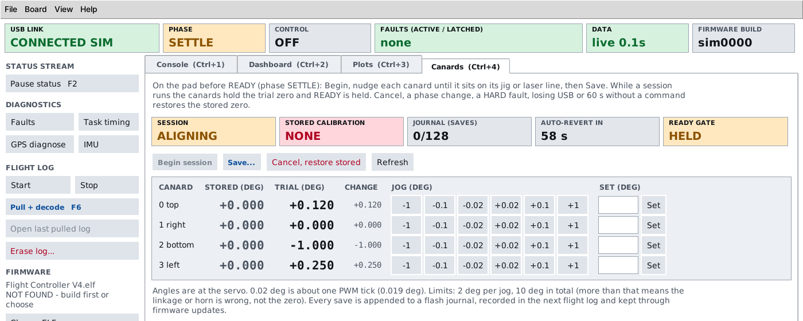

# CAL-01 — Canard zero alignment (firmware and ground station)

**Status:** implemented 9 Nov 2026. Host tests, simulator end-to-end tests and the target build all pass. **Not yet run on the board** (§8).

**Why.** A 0.5–3° zero error on one canard costs +27 % coast roll RMS p95 and pushes the worst peak roll past the 240 °/s requirement (ALLOC-01 §4). Servo spline indexing and linkage set each canard's zero, so it has to be measured on the assembled vehicle, not set in the code.

**Decisions (9 Nov):**
- the zero is found by jogging each canard onto a jig or laser line;
- it is stored in a flash journal;
- commands are allowed on the pad before READY, in all builds;
- READY is held while no valid calibration is stored.

## 1. Design

| Part | File | Role |
|---|---|---|
| Record and journal format | `Core/hyades/svc/fincal.c/.h` | 32-byte record with magic, sequence number, version and CRC-32. Scans for the newest valid record. Pure, host-tested. |
| Alignment session | `Core/hyades/mission/align.c/.h` | Gating, limits, idle timer, auto-revert, angle parser. Pure, host-tested. |
| Flash storage | `Core/Src/calstore.c/.h` | Appends records to the journal and rewrites it after a log erase. |
| PWM zero | `Core/Src/pwm.c` | `PWM_SetZeroMdeg`: millidegrees to whole ticks, clamped to ±10°. The only way the zero changes. |
| Integration | `Core/Src/app.c` | `cal` command, READY inhibit, log event, status token, boot report. |
| Ground station | `Tools/fc_console.py` (Canards tab, Ctrl+4), `fc_link.py`, `fc_sim.py`, `fc_pull.py` | Operator UI, reply parser, simulator, log decode. |

**The control path is untouched.**
- The session only edits the per-fin zero that `PWM_SetFin` adds to every command.
- Before READY the flight loop commands every fin to 0, so the canard sits exactly on the trial zero being jogged.
- No servo override exists and nothing writes the PWM directly.
- In flight the zero is the stored calibration, loaded once at boot.

**Storage.**
- The journal is 4 KB at the start of log sector 5, which is 128 records.
- A save appends one record: 8 word writes, with the CPU stalled about 0.13 ms. It never erases.
- The newest valid record wins. A torn or foreign record is skipped and never trusted.
- A firmware update only erases sectors 0–4, so the calibration survives reflashing.
- A log erase wipes sector 5, so the app writes the stored calibration back as the first record straight after the erase.
- The log now starts 4 KB later and holds 389 088 B (8 106 records).

## 2. Safety case

| Hazard | Mitigation | Where |
|---|---|---|
| A canard moves during flight | A session can only begin in BOOT, CALIBRATE or SETTLING. It ends at once on any other phase. READY is held while it runs. | `align.c`, `app.c` task_flight |
| A session left half-done | It reverts to the stored zero on cancel, a phase change, a HARD fault, USB link loss, or 60 s without a command. Only an explicit save keeps the trial values. | `Align_Poll` |
| A wild value from a typo or a corrupt link | Each jog is limited to ±2° and the total to ±10°. Out-of-range input is refused, not clamped. Angles are parsed as integers, with no float parsing. | `Align_Jog/Set/ParseMdeg` |
| A corrupt or torn calibration used in flight | CRC-32 plus magic, version and range checks on every read. After a save, the record is read back from flash before it is used. | `FinCal_Unpack`, `CalStore` |
| Flying uncalibrated | READY is held while no valid record exists (`CFG_REQUIRE_FIN_CAL 1`). The flight build fails to compile with it off. | `board.h`, `app.c` |
| Not knowing what flew | The calibration is written into every flight log at arming, as an `EV_CAL` event. `fc_pull.py` decodes it. | `log_cal()` |
| The log erase also erases the calibration | The stored calibration is rewritten straight after the erase. A power cut between the two leaves no calibration, which holds READY: a safe failure that needs re-alignment. | `maintenance()` |

## 3. Commands (firmware console)

```
cal                     show
cal begin               start a session (SETTLING, no HARD fault)
cal jog <fin> <deg>     nudge one canard's trial zero, |deg| <= 2
cal set <fin> <deg>     set it outright, |deg| <= 10
cal save                store the trial zeros, end the session
cal cancel              restore the stored zeros, end the session
```

Fins: 0 top, 1 right, 2 bottom, 3 left. Angles are in degrees at the servo, up to 3 decimals. One 8 MHz PWM tick is 0.019°.

Every reply ends with one machine-readable line:

```
CAL state=ALIGN stored=OK seq=3 zero=+0.120,-0.040,+0.000,+0.310 trial=+0.140,-0.040,+0.000,+0.310 journal=3/128 idle_s=55 ready=held
```

The 5 Hz status line now ends with `cal=OK|NONE|ALIGN`.

## 4. Procedure (PLAN-01 G4)

1. Fit the alignment jig or laser line to each canard root. Restrain the airframe and keep the fin arc clear.
2. Power the flight computer, connect the ground station and wait for SETTLE.
3. Open the Canards tab (Ctrl+4) and press Begin session. The canards move to the stored zero, or to 0 if none is stored.
4. Jog each canard onto its reference. Use ±1° and ±0.1° to get close, then ±0.02° (about one tick). If a canard needs more than a few degrees, refit the horn on the spline instead.
5. Press Save and check the before and after table in the confirmation. The tab shows the stored sequence number and READY allowed.
6. Re-check by power-cycling. The boot line prints the stored zeros, and the canards return to the jig line.
7. Polarity check (FDS-01 §6.6) as before.

## 5. Ground station



- **Tiles:** session state, stored calibration, journal use, auto-revert countdown, and READY gate.
- **Controls:**
  - jog buttons and a Set field per canard, enabled only while a session runs;
  - Begin, enabled only on the pad;
  - Save, which asks for confirmation and lists every change.
- **On connect:** with no calibration stored, the console warns that READY is held.
- **Simulator:** `python fc_console.py --sim` starts with no calibration. It runs the same rules and replies as the firmware (`fc_sim.py`), so the whole workflow can be rehearsed without a board.

## 6. Verification

| Check | Result |
|---|---|
| `test_fincal` | 7 tests: round trip; every single-bit flip rejected; range; empty journal; torn record skipped; foreign data reported full and invalid; append position |
| `test_align` | 7 tests: phase and fault gating; no command without a session; step and range refusal; save keeps, cancel reverts; each auto-end reason reverts; idle timer; parser accept and reject table |
| Full host suite | 15 suites pass |
| `test_tools.py` | `CanardAlignment`: parser, status token, simulator session (READY held until save, limits, cancel, refused after READY). 16 tests pass. |
| GUI | Driven under Xvfb against the simulator: begin, jog, refused 5° jog, set, save, READY reached (figure) |
| Target build | arm-none-eabi -O2, -Werror, clean. The flight-build guard rejects `CFG_REQUIRE_FIN_CAL 0`. |
| SITL | Unchanged: the SITL drives `Flight` directly and does not use the app layer |

## 7. Migration (read before flashing this firmware)

1. **Pull the flight log with the old firmware first.** The log now starts 4 KB later, so records written by older firmware no longer line up and cannot be decoded after the update.
2. Flash, then run **`log erase`**. Until then the old log data sits where the journal lives: the journal reads as full, and a save is refused with that message.
3. Align and save (§4). READY is held until you do.

## 8. Open items

- **Bench run on the board.** Check that:
  - save, power-cycle and reload work;
  - `log erase` rewrites the calibration;
  - a USB unplug during a session reverts the zero;
  - the jog step is visible on a protractor or laser.
- **Firmware image size.** At -O2 the image is 95 880 B against the 96 KB USB-update staging buffer, leaving 2.4 KB. CAL-01 added about 4.6 KB. The same code at -Os is 88 944 B. Before the next feature, either build at -Os or move the bench-only code (`boot_verify`, `servo_sweep`, the IMU capture) behind `CFG_FLIGHT_BUILD`.
