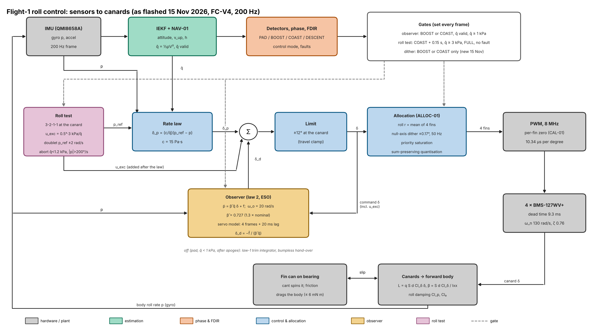
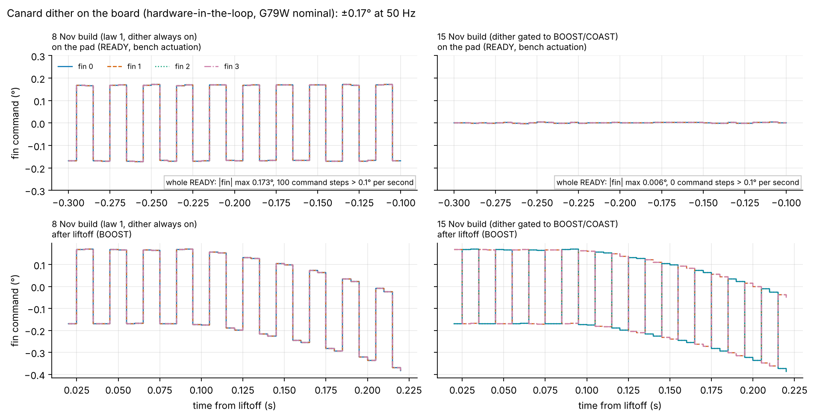
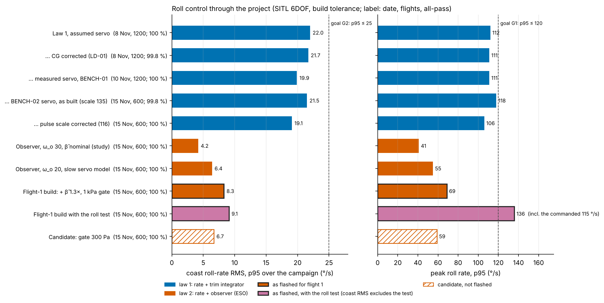
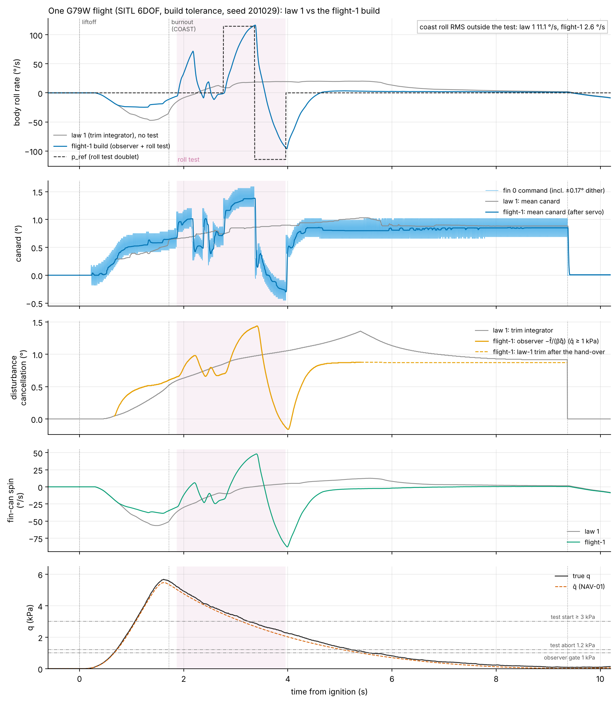
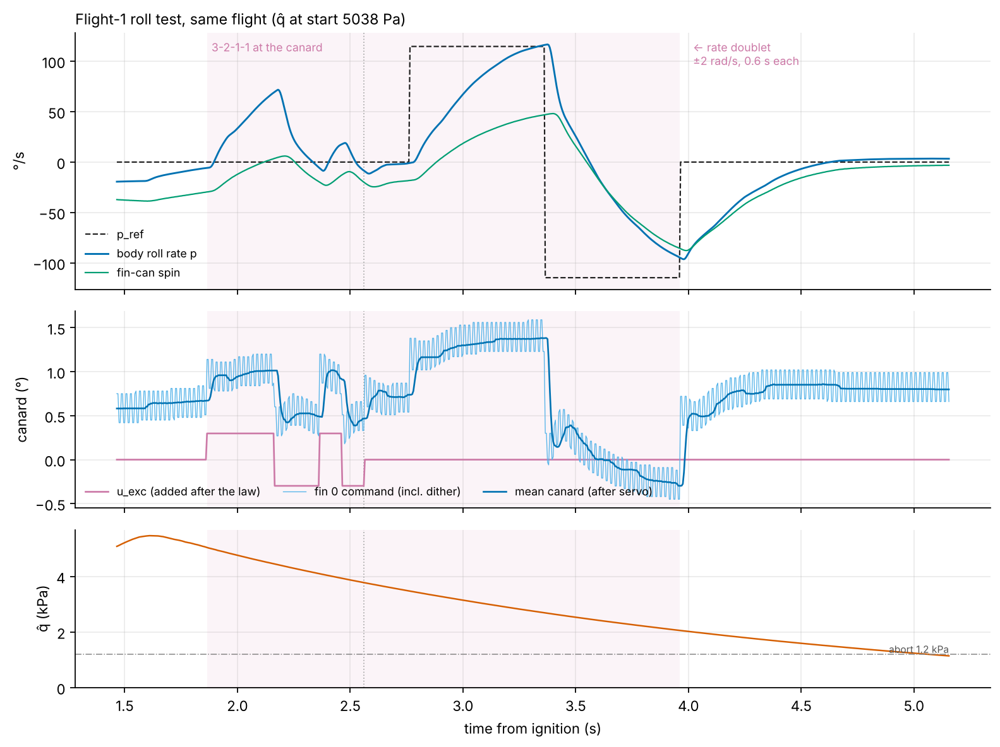
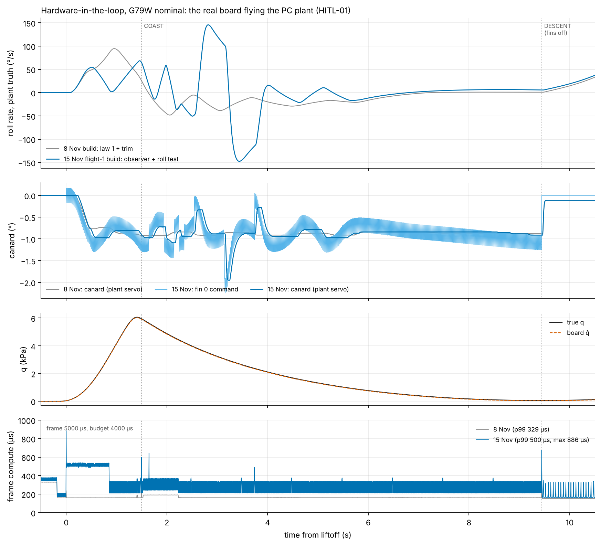
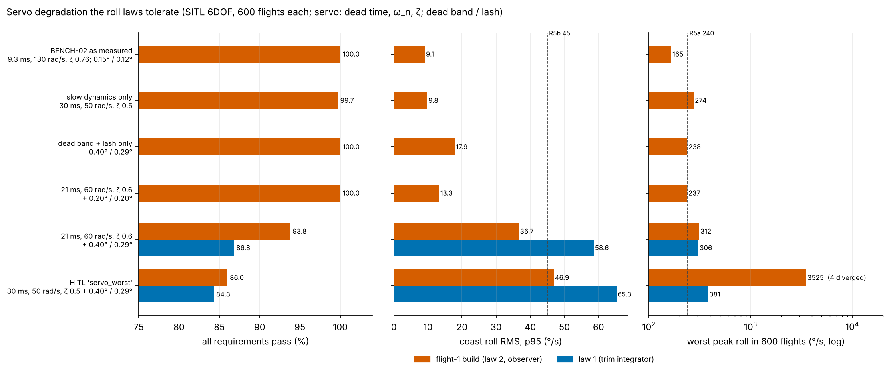
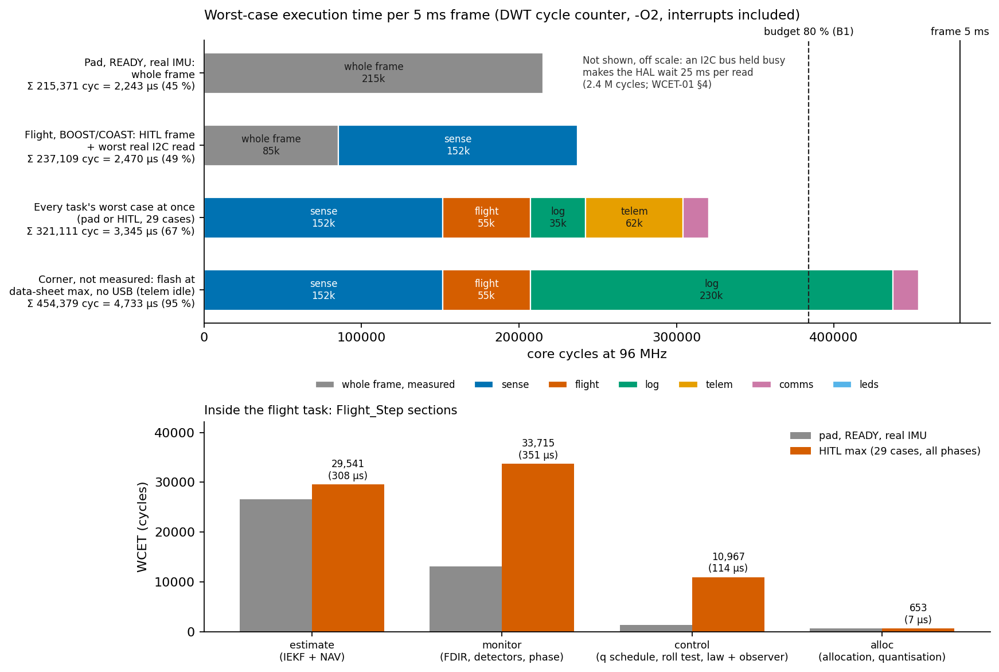

# FIG-02: key figures for roll control, actuation and verification (to flight 1)

**15 November 2026.**

**Purpose.** One place for the figures that document the roll-control work so far, in the order of the chain: actuator → allocation → law → test → verification.
- New figures are in `Images/fig02/`.
- Existing figures are referenced where they live.

**Labels:**
- **[F]** measured or simulated result;
- **[I]** inference;
- **[A]** analytical (data sheet or HAL source).

**Source of every number:** the docs and runs named under each figure. Nothing here has flown.

**Changes made on 15 Nov alongside this note:**
- **Canard dither gated to BOOST and COAST** (it had run on the pad and bench too).
- **The flight-1 build re-verified in hardware-in-the-loop (HITL):** 29 cases.
- **Robustness to a degraded servo mapped in SITL.** This produced the one new decision (§8).
- **Worst-case execution time measured in core cycles** on the pad and across a second HITL campaign (§9, WCET-01).

## 1. The flight-1 roll-control chain

**F1** `fig02_roll_chain.png` (`.svg`). Every block is taken from the code as flashed:
- `flight.c`, `control.c`, `rolltest.c`, `alloc.c`;
- `board.h` constants;
- the BENCH-02 servo;
- the SITL plant, with the body and the free fin can coupled by bearing friction.

The dashed lines are the per-frame gates:
- **observer:** BOOST or COAST, q̂ valid, q̂ ≥ 1 kPa;
- **roll test:** COAST + 0.15 s, q̂ ≥ 3 kPa, mode FULL, no fault;
- **dither:** BOOST or COAST only.

## 2. Actuator

| Figure | Shows | Source |
|---|---|---|
| `Images/bench02/bench02_summary.png` | Servo steps, sine response and replay against the fitted model: threshold 0.18°, dead time 9.3 ms, ω_n 130 rad/s, ζ 0.76, lash 0.14° | BENCH-02 §10 |
| `Images/bench02/bench02_hub_scale.png` | The canard turns 0.861 (+0.03/−0.015) of the command at the old scale, so the servo is 10.3 µs/°. Corrected to `SERVO_RANGE_DEG 116` | BENCH-02 §11 |
| `Images/adr004/delay_budget.png` | Loop delay 41.7 → 24.4 ms after the 200 Hz synced frame (ADR-004; assumed servo τ_d) | ADR-004 §2 |
| `Images/adr004/loop_margins.png` | Phase and gain margin against c on the forward-body inertia; c = 15 chosen | ADR-004 §3 |

These are all **unloaded** servo data. The loaded servo is the open item that matters most (§8).

## 3. Allocation and dither

| Figure | Shows | Source |
|---|---|---|
| `Images/alloc01/alloc01_mechanism.png` | (a) Sum-preserving quantisation; (b) the odd tick alternates between fins; (c) null-axis dither: each canard moves ±a, and the net roll, pitch and yaw are zero | ALLOC-01 |
| **F5** `Images/fig02/fig02_dither_gate_hitl.png` | **New.** Board fin commands in HITL, on the pad (READY with bench actuation) and just after liftoff, for the 8 Nov build and the 15 Nov build | §3.1 |

### 3.1 Dither only in flight (15 Nov) [F]

**Before.** The ±0.17° 50 Hz square wave ran whenever control was active, so it also ran on the pad and on the bench. That is about 100 reversals a second on every servo for as long as the board sat in READY:
- about 360 000 in an hour on the pad;
- for no benefit, since the dither only linearises the servo threshold while the law is flying.

**Change.**
- `Alloc_Apply(…, dither, …)` takes a flag. `Ctrl.dither_en` gates the law-1 path.
- `flight.c` sets the flag true only in BOOST and COAST.
- The bench servo profiles (`bench.c`) keep their own dither for the A/B tests.

**Checks.**
| Check | Result |
|---|---|
| Host tests | 136 / 136 (3 new: `test_dither_off_holds_still`, `test_dither_disabled_holds`, `test_dither_only_in_flight`) |
| SITL | Bit-identical outputs on 18 paired flights, since the dither was always on in flight |
| Board (console, READY) | Fins read 0.00 0.00 0.00 0.00, where they had read +0.01 −0.01 +0.01 −0.01 (normalised; ±0.0056 = ±0.17°) |
| HITL, 29 cases | Max \|fin\| in READY 0.006° (was 0.173° on 8 Nov), and null-axis dither present from the first BOOST frame |

**Vibration cases.**
- In `vib_nominal` and `vib_worst`, READY fins reach 0.09° and 0.35°. That is not dither: it is the bench-only READY actuation responding to vibration noise on the gyro.
- The flight build compiles READY actuation out (`CFG_BENCH_ACTUATE_READY 0`).

**Build.**
- `d1c8818f+0a0e0f`: 88 880 B of text (9.4 KB left under the USB-update limit). Flashed 15 Nov 11:29.
- `d1c8818f+9b9f4b`: the same code plus the cycle counters, 89 648 B (8.6 KB left). Flashed 13:58. This is the build in §9 and the build now on the board.

## 4. Roll performance through the project

**F2** `fig02_roll_progress.png`: coast roll RMS p95 and peak roll p95 at build tolerance, from each campaign as recorded:
- MC-01, LD-01, REVIEW-01;
- MC-01 §2 (BENCH-02);
- SYSID-01 §2, §4, §9.

**Read it with care [I].** Each step changed the plant as well as the controller: CG correction, measured servo, pulse-scale fix. So the bars are a record of the design, not a controlled comparison.
- The controlled comparisons are SYSID-01 §2 (same plant: law 1 against the observer), §9.3 (with and without the test) and §9.4 (the flight settings).
- The 136 °/s peak of the flight-1 build includes the commanded 115 °/s doublet.

## 5. Why the observer, and what the flight settings cost

| Figure | Shows | Source |
|---|---|---|
| `Images/sysid01/sysid_bounds.png` | Coast RMS for law 1, a perfect actuator, no friction, c = 22, and the observer: an actuator-aware controller is worth about 1 %, cancelling the disturbance 4–5× | SYSID-01 §2 |
| `Images/sysid01/sysid_step.png` | 0 → 2 rad/s → 0 on law 1 (trim wound up) and on the observer | SYSID-01 §5 |
| `Images/sysid01/sysid_schedules.png` | β identified from each candidate manoeuvre | SYSID-01 §6 |
| `Images/adr004/mc_lockin.png` | Body-roll and can-spin lock-in against pitch frequency; the build tolerance on fin cant | MC-01 FM3 |

## 6. Flight 1 in the SITL

**F3** `fig02_flight1_time_history.png`: one G79W flight at build tolerance (seed 201029, Cl_δ ×0.85, Ixx ×1.04, wind 3.8 m/s). Law 1 against the flight-1 build [F]:
- **Coast roll RMS outside the test:** 11.1 °/s on law 1, 2.6 °/s on the flight-1 build.
- **The observer's cancellation term (orange)** settles in about 0.5 s where the trim integrator takes 4 s.
- **Below 1 kPa (q̂ gate)** the law-1 trim takes over (dashed).
- **The fin can** follows the body through the bearing: up to −88 °/s in the doublet.
- **The dither** shows on the fin-0 command in BOOST and COAST only.

**F4** `fig02_roll_test_zoom.png`: the roll test in the same flight.
- The 3-2-1-1 is 0.30° at the canard (0.5° × 3 kPa / 5.04 kPa).
- The doublet is ±2 rad/s for 0.6 s each.
- q̂ falls from 5.0 to 2.1 kPa over the 2.1 s.
- The second step does not reach −115 °/s before the reference returns to 0. That is the cost of the 0.6 s hold (SYSID-01 §9.2).

**`Images/sysid01/sysid_flight1_beta.png`:** completion of the test by motor, and how well β is known from each source (SYSID-01 §10).

## 7. Hardware-in-the-loop on the flight-1 build (15 Nov)

**Set-up.**
- The real board runs the HITL build (flight code + `CFG_HITL` seam), in lockstep with the PC plant `hitl_model.py` (HITL-01).
- 29 cases from `fc_hitl_campaign.py`.
- Data: `Tools/logs/hitl/campaign-20261115-113108/` (not in git). `summary.md` was written by `hitl_fl1_summary.py`.
- Campaign figures from `hitl_figures.py`: `Images/fig02/hitl_20261115/`.

**The HITL plant is not the SITL plant [F].**
- Roll inertia is OpenRocket's whole-vehicle 4.75 × 10⁻⁴ kg m², with the fin can locked to the body. So the true β is 0.26 and β̂ is 2.8× too high.
- The servo is MATLAB `P.Servo`: f_N 80 rad/s, τ_d 14 ms, dead band and lash about 0.11°.
- There is no fin-can friction.

This makes HITL a stress case for an over-estimated β̂, not a fidelity check.

**F6** `fig02_hitl_flight1.png`: G79W nominal, the 8 Nov law-1 build against the 15 Nov flight-1 build [F].
- **The roll test ran on the board:** event `rt done - dbl 5588`.
- **With β̂ 2.8× high,** the observer overshoots the doublet (148 against 115 °/s) and rings at about 1 Hz for 2 s.
- **Coast RMS after the test** is 8.4 °/s, against 13.6 on law 1.
- **q̂ error:** −0.9 % mean.
- **Frame compute:** p99 500 µs, max 886 µs, against the 4000 µs budget. The 500 µs block after liftoff is the pre-trigger log commit, and the 200/340 µs alternation in COAST is the log writer. The 8 Nov build showed neither [I].

**Per case [F]:**

| Outcome | Cases |
|---|---|
| Phase sequence as expected | 28 / 29. `pad_knock_extreme` is the known probe: a 10 g / 200 ms knock reads as liftoff (PLAN-01 S5) |
| Roll test **done** | 19: nominal, cl0 1σ, wind 9 + gust, Cl_δ ±30 %, Ixx −30 %, thrust +10 %, accel SF ±3 %, vibration nominal and worst, 5-frame boost dropout, NaN sample, three GPS faults, short and long pad knock, pad sway |
| **Abandoned**, guard as designed | 5: `cl0_09_3sig` (rate), `servo_worst` (rate, in the gap), `combined_worst` (rate), `gyro_spike_coast` (rate), `sat_10fr_coast` (q̂ invalid) |
| **Skipped** | 3: open loop (fault: `gyro_rng` in BOOST), I205W ×2 (q̂ invalid: IMU saturation) |
| Not reached | 2: `drop_15fr_boost` (CATO, fins centred), `pad_knock_extreme` |
| Peak roll | nominal and dispersions 134–194 °/s; `cl0_09_3sig` 364; `servo_worst` 271; **`combined_worst` 2 799 (diverged)**; open loop 4 942; I205W 453 / 1 016 |

`Images/fig02/hitl_20261115/hitl_campaign_matrix.png` shows roll RMS, peak roll and q̂ error by case. The other seven `hitl_*` figures are the HITL-02 set re-drawn for this build.

**What HITL found [F/I].**
- Every roll-test guard fired on the board as designed: done, skip on fault, skip on q̂, abort on rate, abort on q̂.
- **`servo_worst`** (τ_d 30 ms, f_N 50 rad/s, ζ 0.5, dead band 0.40°, lash 0.29°) puts the observer loop into a ±150–217 °/s limit cycle through coast.
- **`combined_worst`** diverges: `servo_worst` plus Cl_δ +30 %, Cl_p −30 %, Cl₀ 0.06, wind 9 m/s, worst vibration.
- These two led to §8.

## 8. Robustness to a degraded servo (SITL, 15 Nov)

**F7** `fig02_servo_robustness.png`: 600 flights per bar at build tolerance, the HITL `servo_worst` actuator split into its parts [F].

| Servo (dead time, ω_n, ζ; dead band / lash) | Flight-1 build (law 2) | Law 1 |
|---|---|---|
| As measured (BENCH-02) | 100 %; worst peak 165 °/s | — |
| Slow dynamics only (30 ms, 50 rad/s, 0.5) | 99.7 %; 274 | — |
| Dead band and lash only (0.40° / 0.29°) | 100 %; 238 | — |
| 21 ms, 60 rad/s, 0.6; 0.20° / 0.20° | **100 %**; 237 | — |
| 21 ms, 60 rad/s, 0.6; 0.40° / 0.29° | 93.8 %; 312 | 86.8 %; 306 |
| HITL `servo_worst` | 86.0 %; **3 525: 4 flights diverge** | 84.3 %; 381 |

**Other variants on the `servo_worst` actuator**, none of which removes the divergent tail:

| Variant | All pass | Worst peak |
|---|---|---|
| Slower actuator model in the observer (5 frames + 30 ms) | 90.7 % | 2 658 °/s |
| ω_o 15 | 89.8 % | 3 118 °/s |
| No roll test | 82.3 % | 3 517 °/s |
| Latched hand-over to law 1 when \|p\| > 300 °/s for 50 ms | 86.0 % | 3 129 °/s |

On the latched hand-over: the trace shows law 1 cannot pull a canard-saturated limit cycle back at 7 kPa. The hand-over was not kept.

**Reading [I].**
- **The divergence needs a slow servo *and* a large dead band together.** Each alone passes.
- **It needs the upper half of the β range:** the true β was 1.2–1.8× nominal in the diverged flights.
- **The roll test does not cause it.**
- **Law 1 degrades more in the mean but stays bounded.**
- **The measured servo has a wide margin:** 9.3 ms against 21–30, 130 rad/s against 50–60, and 0.15° / 0.12° against 0.40° / 0.29°.
- **But that is unloaded.**

**Decision for James (PLAN-01 D4).** The loaded servo (G1 under a representative hinge moment, at 6.0 and 8.4 V) decides the flight law:
- if dead time ≤ 21 ms, ω_n ≥ 60 rad/s, and dead band and lash ≤ 0.2°: law 2 as flashed (100 % above);
- if worse: law 1 for flight 1 (`CTRL_ROLL_LAW 1`), or a retune checked against this figure.

## 9. Worst-case execution time (15 Nov)

**F8** `fig02_wcet.png`: worst-case execution time from the DWT cycle counter. The build is `-O2` and interrupts are included. Details in **WCET-01**.

**Data:**
- the pad with the real IMU;
- a second 29-case HITL campaign, `20261115-140954`, with the flight log erased before each case so the log writer runs as in flight.

**That campaign repeated every outcome of §7** [F]:
- 28 / 29 as expected;
- the same 19 roll tests done, 5 abandoned, 3 skipped.

| Frame | Cycles | % of 5 ms (480 000) |
|---|---|---|
| Pad, READY, real IMU | 215 371 | 44.9 |
| BOOST / COAST (HITL) | 85 357 / 72 107 | 17.8 / 15.0 |
| **Flight bound:** worst BOOST/COAST + worst real I2C read | **237 109** | **49.4** |
| Every task's worst at once | 321 111 | 66.9 |
| Budget, guideline B1 | 384 000 | 80 |

**Not measured:**
- **Flash at its data-sheet maximum** gives 454 379 cycles (95 %), inside the frame [A].
- **A stuck I2C bus** makes the HAL wait 25 ms per read. Fix before flight: PLAN-01 S23 [A].

**Inside the flight task, HITL maxima:**

| Section | Cycles |
|---|---|
| estimate | 29 541 |
| monitor | 33 715 |
| control (law, observer and roll test) | 10 967 |
| alloc | 653 |

## 10. Reproduce

All scripts are in `Firmware/FC-V4/Tools/sitl/` and run from there. `sysid_fl1_campaigns.sh` lists every campaign above.

| Figure | Command |
|---|---|
| F1 | `python fig02_arch.py OUT` |
| F2 | `python fig02_progress.py OUT` (values in the script, from the docs) |
| F3, F4 | `python fig02_sitl.py runs/traces/fig02 OUT` (re-runs seed 201029 on both laws if the traces are missing) |
| F5, F6 | `python fig02_hitl.py ../logs/hitl OUT` (needs campaigns `20261108-103621` and `20261115-113108`) |
| F7 | `python fig02_servo.py OUT` (runs `G1`, `W1`–`W7`, `X1`, `X3`, `X3L`) |
| F8 | `python ../wcet_report.py ../logs/hitl/campaign-20261115-140954 --pad ../logs/console/20261115-121838.txt --out OUT` (WCET-01 §6) |
| HITL set | `python ../hitl_figures.py ../logs/hitl/campaign-20261115-113108 --out …/Images/fig02/hitl_20261115`; table: `python ../hitl_fl1_summary.py …` |

`OUT` = `../../../../Documentation/Images/fig02`.
