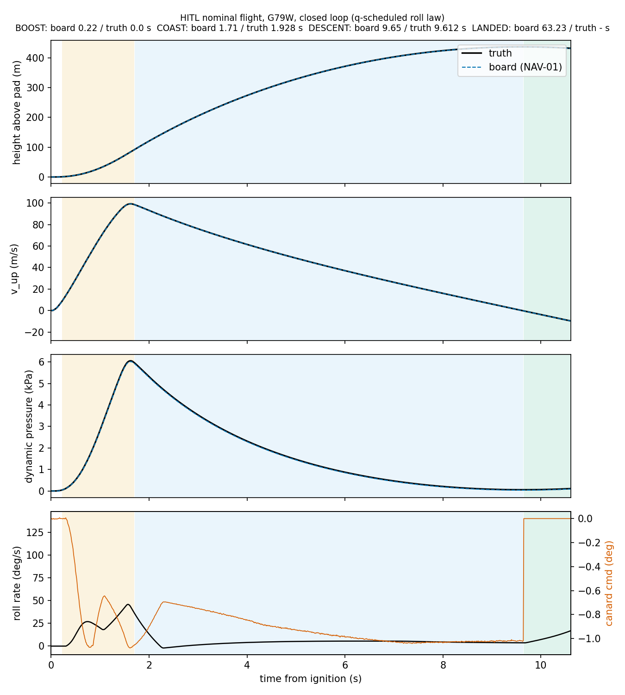
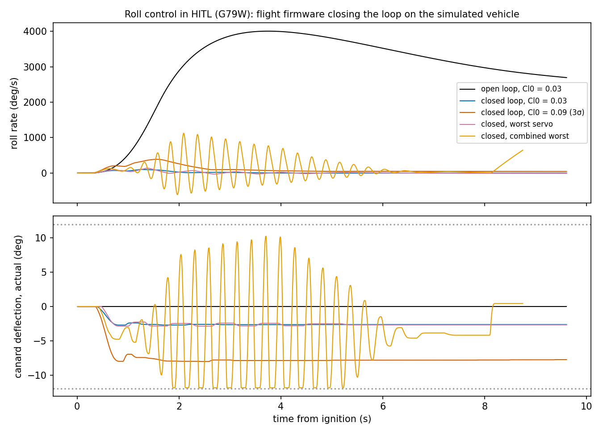
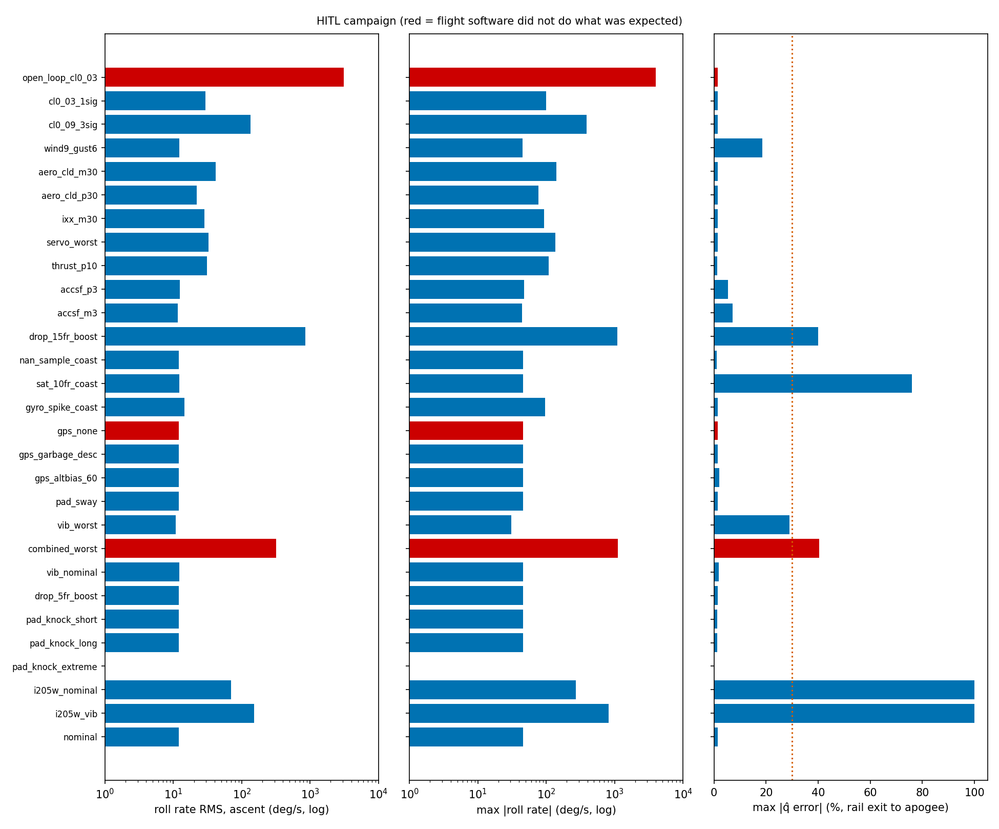
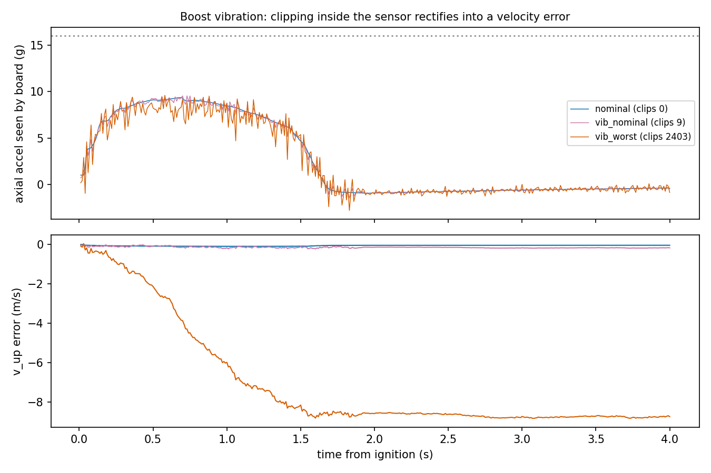
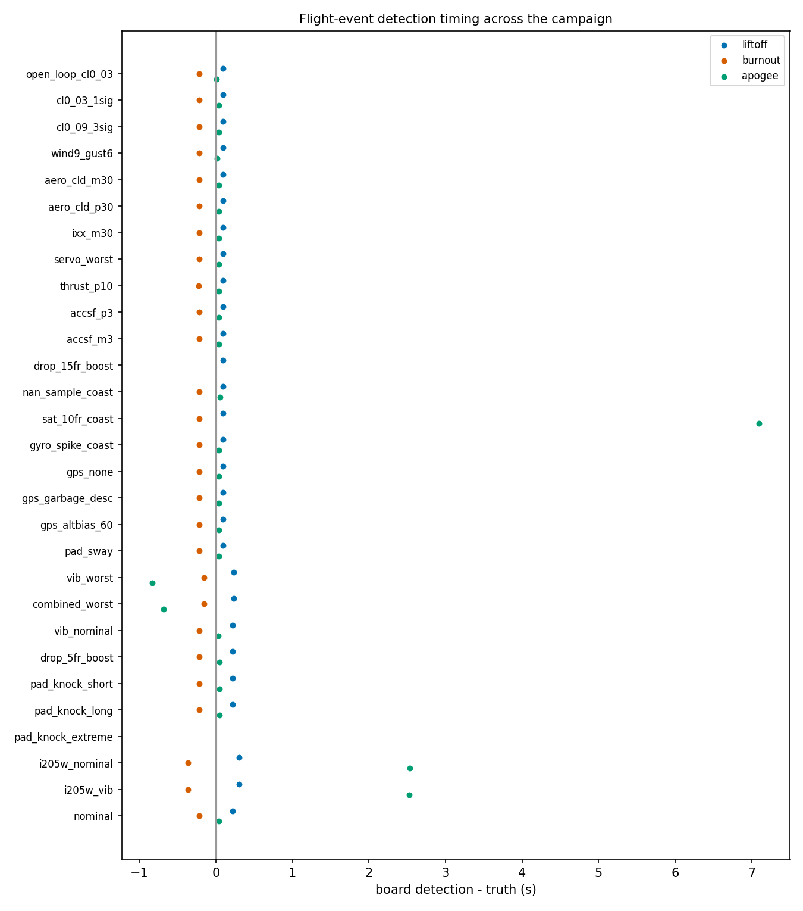
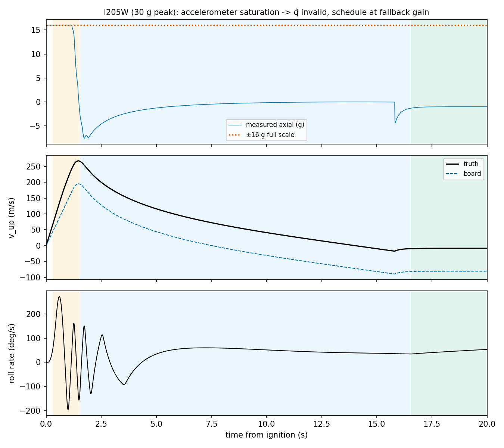
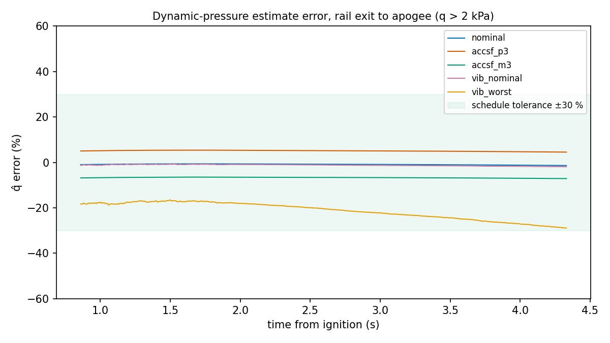

# HITL-02: Worst-case HITL campaign: results and failure modes

**Date:** 7 November 2026.
**Hardware:** FC-V4 (STM32F411 + QMI8658A), running the real flight firmware in lockstep with the PC plant (HITL-01).
**Vehicle:** OpenRocket `62mm Canard Control V1.0.0`, motor G79W unless stated, closed loop.
**Data:** `Firmware/FC-V4/Tools/logs/hitl/campaign-20261107-201239/`. That folder holds one csv/json/txt per case plus `campaign.json`; `campaign_before_fixes.json` is the first pass.
**Tools:** `fc_hitl_campaign.py` runs the cases and `hitl_figures.py` makes the figures in `Images/hitl/`.

**Purpose.** The campaign is meant to break things. Cases go past the expected envelope and each one states what the flight software *should* do. A red case in the matrix figure means the software did something other than that.

## What changed in the firmware for this campaign (H3)

**Roll law.** `CTRL_ROLL_LAW 1` makes the MATLAB-designed law (`controller.m`, mode 1) the roll channel:

$$\delta = -\frac{c}{q_e}\,p + \delta_\text{trim}$$

where:
- \(\delta\) is the canard deflection (rad);
- \(p\) is the body roll rate (rad/s);
- \(c\) = 70 Pa·s, the schedule constant (`P.Controller.c`);
- \(q_e\) = clamp(q̂, 2 kPa, ·) (Pa), using the NAV-01 dynamic pressure estimate. If q̂ is invalid it falls back to 40 kPa, which is the lowest gain;
- \(\delta_\text{trim}\) is the bounded trim integrator, with a dead band, a 3 °/s rate limit, a ±6° clamp, and a freeze while the output is saturated.

Output is limited to ±12° of canard travel. RATE_DAMP mode uses the same law, without trim, at the fallback q. The 125 Hz dither is not carried over, because a 100 Hz loop cannot produce it. The INDI roll channel (`CTRL_ROLL_LAW 0`) is kept but not used. Its fixed effectiveness of 160 rad/s² per unit fin compares with a true range of 270–5500 across the envelope.

**Fixes found by this campaign:**
- **Liftoff detection.** The rule was axial acceleration above 3 g for 50 ms. It now needs 100 ms above 3 g **and** NAV v_up above 8 m/s. If the nav solution is saturated, it needs 300 ms of acceleration alone.
  - READY is held, rather than demoted, while liftoff is still being confirmed. Otherwise a fast motor's `accel_rng` trip, which fires within 5 frames, would demote the board before the 10-frame confirmation.
- **IMU read gaps in flight.** For up to 8 frames, NAV integrates the last good specific force.

## Plant additions (`hitl_model.py`)

- **Vibration.** **The levels are assumed, not measured.**
  - Band-limited broadband 20–1500 Hz, plus a ±5 % resonance at 180 Hz, generated at the sensor's internal 7.17 kHz rate.
  - Clipped at ±16 g **before** decimation (32:1 boxcar), then passed through the 30 Hz output low-pass filter.
  - Clipping inside the sensor is invisible to the firmware. The board only sees the filtered output.

  | Profile | Broadband (boost / coast) | Resonance | Gyro |
  |---|---|---|---|
  | `VIB_NOM` | 2 g / 0.3 g RMS | 1 g | 10 dps |
  | `VIB_WORST` | 6 g / 1.5 g | 4 g | 40 dps |

- **Aerodynamic and structural dispersions:** C_lδ and C_lp ×0.7 / ×1.3; I_xx ×0.7; thrust ×1.1.
- **Servo override, worst case:** f_N 50 rad/s, ζ 0.5, delay 30 ms, dead zone 0.40°, lash 0.29°.
- **Wind and gusts:** a 1-cosine gust.
- **Pad handling:** half-sine knocks and rail sway.
- **Injections:**
  - Read failures, NaN samples, accelerometer saturation, gyro spikes.
  - GPS off, garbage bytes, altitude bias.

## Results

**Nominal (G79W, Cl₀ = 0.01).**
- q̂ error −0.9 % mean, 1.4 % max.
- Apogee detected 0.04 s after truth; height at apogee within 0.5 m.
- Roll peaks at 46 °/s around burnout, where q is low, and settles to about 4 °/s in coast.
- The canard command never exceeds 1.1°.

| Case | Roll RMS / max (°/s) | Max canard command | q̂ error mean / max | Apogee, board − truth | Verdict |
|---|---|---|---|---|---|
| nominal | 12 / 46 | 1.1° | −0.9 / 1.4 % | +0.04 s | OK |
| open loop, Cl₀ = 0.03 | 3128 / 4003 | — | — | +0.01 s | gyro saturated (> 2048 °/s); landing not detected |
| Cl₀ = 0.03 (1σ) | 30 / 100 | 2.9° | −0.9 / 1.4 % | +0.04 s | OK |
| Cl₀ = 0.09 (3σ) | 133 / 387 | 8.2° | — | +0.04 s | **standing roll of 46 °/s in coast**: the trim clamp (±6°) limits authority |
| wind 9 m/s + 6 m/s gust | 12 / 45 | 1.1° | −11 / 19 % | +0.02 s | OK; q̂ error is ground speed vs airspeed |
| C_lδ ×0.7 / ×1.3 | 42 / 142; 22 / 78 | 4.1°; 2.3° | — | +0.04 s | OK |
| I_xx −30 % | 28 / 94 | 2.9° | — | +0.04 s | OK |
| worst servo | 33 / 137 | 3.4° | — | +0.04 s | OK, 9 °/s residual |
| thrust +10 % | 31 / 109 | 2.9° | −0.8 / 1.3 % | +0.04 s | OK |
| accel scale factor ±3 % | 12 / 47 | 1.1° | +5.1 / −6.7 % | +0.04 s | OK (inside the ±30 % schedule tolerance) |
| vibration nominal | 12 / 46 | 1.1° | −1.2 / 1.9 % | +0.03 s | OK |
| **vibration worst** | 11 / 31 | 1.3° | **−21 / 29 %** | **−0.83 s (early)** | clipping rectifies to −8.7 m/s |
| **combined worst** | **317 / 1124** | **12° (sat.)** | −26 / 40 % | −0.69 s | **4 Hz roll limit cycle**; landing not detected |
| IMU dropout 5 frames, boost | 12 / 46 | 1.1° | −0.9 / 1.5 % | +0.05 s | OK (was −12.7 % before bridging) |
| IMU dropout 15 frames, boost | 855 / 1094 | 0.4° | — | — | CATO_SAFE, fins centred: as designed |
| single NaN sample | 12 / 46 | 1.1° | −0.7 / 1.0 % | +0.06 s | OK |
| accel saturated 100 ms, coast | 12 / 46 | 1.1° | — | **+7.1 s (timer)** | nav invalid → apogee only from the 15 s backup |
| gyro spike (2047 °/s, 1 frame) | 15 / 96 | 12° for 1 frame | — | +0.04 s | recovers |
| no GPS | 12 / 46 | 1.1° | — | +0.04 s | landing only from the 300 s timer |
| GPS garbage / +60 m bias | 12 / 46 | 1.1° | — | +0.04 s | OK; descent height RMS 3.9 m / 2.3 m |
| pad knocks 6 g/60 ms, 8 g/40 ms, 5 g/120 ms | — | — | — | — | **false liftoff before the fix**; OK after |
| pad knock 10 g / 200 ms (≈12 m/s) | — | — | — | — | **false liftoff** (probe beyond any velocity gate) |
| rail sway 3° | 12 / 46 | 1.1° | — | +0.04 s | OK |
| I205W (30 g) | 69 / 273 | 1.3° | invalid | +2.5 s (timer) | nav saturated → fallback gain → 40 °/s standing roll |
| I205W + vibration nominal | 151 / 824 | 2.9° | invalid | +2.5 s | as above, worse |

Notes on the table:
- "—" in the q̂ column means the same as nominal, or not applicable.
- Cases run before the liftoff and bridging fixes show liftoff at 0.09 s; cases run after show 0.22 s (G79W). The roll law was identical in both passes.

## Failure modes found, ranked

1. **Accelerometer clipping inside the sensor under boost vibration.**
   - **Observed:** at 6 g RMS plus a 4 g resonance on an 8 g boost, the board's velocity was −8.7 m/s low at burnout, q̂ was −21 % low, and **apogee was declared 0.83 s early**. The firmware cannot see this clipping: the output samples never reach full scale.
   - **Why it matters:** on the H743 with pyro recovery, an early apogee means an early deployment at about 8 m/s upward speed.
   - **Next steps:**
     - Measure the real vibration PSD first (static fire, or a flight log at full ODR).
     - Mechanical isolation of the IMU.
     - Fix the H743 IMU choice: the ICM-42688-P is also ±16 g. Options are a higher-g axial accelerometer, or blending in a ±24/32 g part.
     - Add an apogee consistency check: v_up must cross zero within a window of the ballistic prediction from burnout.
2. **Roll limit cycle when gain errors stack (combined worst).** Plant C_lδ ×1.3, a vibration-biased q̂ (−26 %, which raises Kp by about 35 %), and the worst servo (30 ms delay) together give a 4 Hz limit cycle saturating the canards.
   - Each one alone is stable. This is a gain-margin issue, compounded by the 100 Hz implementation: the MATLAB design ran the controller at 2 kHz with dither.
   - **Next steps:** re-run `optimise_roll_schedule` with a 10 ms zero-order hold plus a 5 ms compute delay, and add q̂ error to the robustness set. Or cap Kp with a minimum q_e above 2 kPa.
3. **Accelerometer saturation disables velocity-based apogee for the rest of the flight.**
   - A 100 ms saturation in coast led to apogee from the backup timer, 7 s late. The I205W led to the same, 2.5 s late.
   - **Next steps:**
     - Set the apogee backup timer per motor: currently 15 s; G79W needs about 9.2 s (7.7 s coast + 20 %).
     - Add a ballistic apogee estimate from the last valid velocity.
4. **False liftoff from pad handling.**
   - **Fixed** for knocks up to 5 g / 120 ms and 6–8 g / 60 ms.
   - A 10 g / 200 ms axial event (≈12 m/s) still passes any velocity gate.
   - Once triggered, the board is in a flight phase: fins actuate, and reboot and log pull are refused.
   - **Next steps:** an operational arming step (READY only after an explicit arm on the rail), and the flight READY hold of 30–60 s instead of the bench 1 s.
5. **Standing roll at 3σ Cl₀.**
   - The ±6° trim clamp holds Cl₀ = 0.03 (coast 0.7 °/s); at 0.09 the coast roll settles at 46 °/s.
   - **Next steps:** a larger clamp (it costs damping travel), or tighter rigging (CDS-01 notes σ(Cl₀) is assumed).
6. **Landing not detected without GPS, or after gyro saturation.**
   - Landing then comes only from the 300 s timer, and the board stays in DESCENT (USB locked) for 5 minutes.
   - Acceptable for flight. The plant has no parachute swing, so an accel/gyro-only landing detector cannot be validated here yet.
7. **Expected behaviour, confirmed:**
   - IMU loss over 100 ms in boost → CATO_SAFE with fins centred.
   - The I205W runs at the conservative fallback gain (stable but under-damped).

## Limits of this campaign

- **Vibration levels are assumptions.** The qualitative failure (rectification) is robust; its size is not.
- **Pitch/yaw are a weathercock stand-in.** There is no roll–pitch coupling, so the 4000 °/s open-loop spin is not physical.
- **Single seed per case;** no Monte Carlo yet.
- **H5 (real-time timing) not done:** the lockstep suppresses overrun detection.
