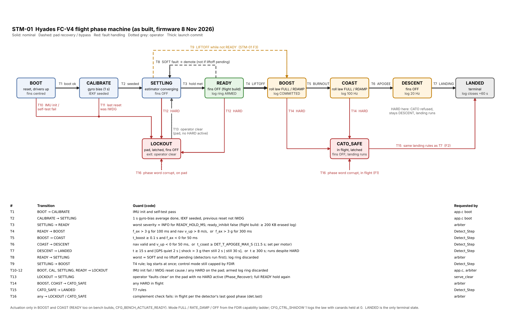

# STM-01: flight phase machine, written out and verified by hand

**Date:** 8 November 2026. Revised 8 Nov: grid diagram with T-numbered transitions; three text corrections (§6).
**Code:**
- `Core/hyades/mission/phase.c` (allowed-transition table `k_allowed`, protected word);
- `detect.c` (event detectors);
- `flight.c` (arbiter, `monitor_and_arbitrate`, `serve_clear`);
- `app.c` (boot sequence, logger reactions in `log_on_phase`).

**Diagram:** `Images/adr004/stm01_phase_machine.png` (and `.svg`), generated by `stm01_phase_machine.py` in the same folder. It replaces the earlier Graphviz `.dot`. The T-numbers in the figure match §2.

## 1. Method

1. Each phase's allowed exits were copied from `k_allowed`, and each guard from the code that requests the transition. The paths are `Detect_Step`, the worst-severity branch of the arbiter, the operator clear and the `app.c` boot sequence.
2. For every (phase, event) pair: is the transition allowed, is it requested, and is the result what FDS-01 §3 intends?
3. Every disagreement became a finding (F1–F3), with a code change and a test.
4. The same paths were then exercised by:
   - host tests (`test_phase`, `test_detect`, `test_flight`);
   - SITL: 7 680 flights (MC-01), then 3 840 more with corrected mass properties (LD-01). R1 (phase sequence) passed in 100 % of both sets;
   - hardware HITL (8 Nov: 9 / 9 sequences correct on the pre-dither build, 4 / 4 on the final build).

**Protected phase word.** It is stored with its complement. The 16-bit phase codes have a pairwise Hamming distance of at least 6 (checked: minimum 6). Any read that fails the complement check, or that decodes to no phase, is treated as corrupt (T16).

## 2. Transition table (as built)

| # | From → To | Guard (code) | Requested by | Side effects |
|---|---|---|---|---|
| T1 | BOOT → CALIBRATE | IMU init and self-test pass | `app.c` boot | |
| T2 | CALIBRATE → SETTLING | 1 s gyro-bias average, IEKF seeded, previous reset not by IWDG | `app.c` boot | |
| T3 | SETTLING → READY | worst severity = INFO for `READY_HOLD_MS`, and `ready_inhibit` false (flight build: ≥ 200 KB of erased log) | arbiter | Log ring arms (if `LOG_AUTOSTART`, log space OK, no firmware update) |
| T4 | READY → BOOST | f_ax > 3 g for 100 ms and nav v_up > 8 m/s, **or** f_ax > 3 g for 300 ms | `Detect_Step` | Log commits; drain starts |
| T5 | BOOST → COAST | t_boost ≥ 0.1 s and f_ax < 0 for 50 ms | `Detect_Step` | |
| T6 | COAST → DESCENT | nav valid and v_up < 0 for 50 ms, **or** t_coast ≥ `DET_T_APOGEE_MAX_S` (11.5 s; set per motor, MC-01 §4) | `Detect_Step` | Log drops to 20 Hz; fins OFF |
| T7 | DESCENT → LANDED | t ≥ 15 s and (GPS quiet for 2 s, **or** shock > 3 g then still for 2 s, **or** still for 30 s), **or** t ≥ 300 s. Runs despite HARD. | `Detect_Step` | Log closes 60 s later |
| T8 | READY → SETTLING | worst = SOFT and no liftoff pending (the detectors run first) | arbiter | Ring discarded; the full hold is needed again |
| T9 | SETTLING → BOOST | the T4 rule | `Detect_Step` | **F3.** Log starts directly; control mode still capped by FDIR |
| T10 | BOOT → LOCKOUT | IMU init or self-test fails | `app.c` | |
| T11 | CALIBRATE → LOCKOUT | previous reset was the IWDG | `app.c` | FDS-01 §5.2 |
| T12 | SETTLING, READY → LOCKOUT | any HARD on the pad | arbiter | Armed ring discarded |
| T13 | LOCKOUT → SETTLING | operator `faults clear`: on the pad, no HARD active, `Phase_Recover` | `serve_clear` | Full READY hold again |
| T14 | BOOST, COAST → CATO_SAFE | any HARD in flight | arbiter | Fins OFF |
| T15 | CATO_SAFE → LANDED | the T7 rules | `Detect_Step` | **F2** |
| T16 | any → LOCKOUT or CATO_SAFE | phase word corrupt → `Phase_ForceSafe(in_flight)`, with in_flight taken from `det.last` | arbiter | **F1.** Bypasses `k_allowed` by design |

**Stillness**, as used in T7, means all three of the following over an EWMA with τ = 0.5 s:
- sd(|f|) < 0.05 m/s² (5 mg);
- mean |ω| < 0.05 rad/s (2.9 °/s);
- |mean |f| − g| < 1 m/s².

**GPS quiet** means |f| within 1 m/s² of g, |ω| < 0.2 rad/s, GPS-aided nav, and |v_up| < 1.5 m/s.

**Terminal state:** LANDED only. LOCKOUT is left only by T13 on the pad. CATO_SAFE is left only by T15.

**Actuation:** BOOST and COAST only, plus READY on bench builds (`CFG_BENCH_ACTUATE_READY`; flight builds refuse to compile with it). The mode is FULL, RATE_DAMP or OFF from the FDIR capability ladder. `CFG_CTRL_SHADOW 1` runs and logs the law with the canards held at 0.

**Not phase transitions:**
- `boot_verify` only prints the mixer directions.
- The bench `imucap` mode leaves the flight loop with the fins centred and the LEDs showing LOCKOUT, but it does not change the phase word. It ends only by reboot.
- `inject` (fault injection, bench builds) is refused in flight. On the pad it leads to T11, T16 or T12 as designed.

## 3. Findings

### F1: a corrupt phase word in flight went to LOCKOUT

`Phase_ForceSafe(&ph, false)` was called unconditionally, and LOCKOUT has no in-flight exits. A single corrupted word in coast would have:
- frozen the board in LOCKOUT;
- left the canards OFF (correct);
- never declared LANDED, so the log was never closed and the beacon never came on.

**Fix:** flight versus pad is now taken from `det.last`, the detector's last good phase, held in separate RAM. A corrupt word in flight goes to CATO_SAFE, which can reach LANDED (T16 → T15).

**Test:** `test_corrupt_word_in_flight_goes_cato_then_lands`.

### F2: CATO_SAFE could never reach LANDED

The table allowed CATO_SAFE → LANDED, but `Detect_Step` had no CATO_SAFE case. The detector call was also skipped whenever a HARD fault was present, which is the usual reason for being in CATO_SAFE.

**Fix:** CATO_SAFE uses the DESCENT landing rules, and the detector runs despite HARD in CATO_SAFE, as it already did in DESCENT.

### F3: a launch from SETTLING was never sequenced

If ignition happened while the board was in SETTLING, the whole flight stayed in SETTLING: no BOOST, no log commit, no landing. That happens, for example, when a SOFT fault resets the hold just before the button is pressed. FDS-01 P5 makes "not READY" a NO-GO indication, but the vehicle cannot stop the club's ignition, and P4 says to protect the data.

**Fix:** T9, SETTLING → BOOST on the same liftoff rule.

**Tests:** `test_liftoff_from_settling_is_sequenced`, plus updated `test_phase` and `test_detect`.

**Not extended to LOCKOUT:** a board in LOCKOUT has impeached itself, so it neither actuates nor sequences.

## 4. Pairs checked and found correct

- **Liftoff while READY with a SOFT fault in the same frame:** the detectors run before the demotion, so liftoff wins (HITL-01 defect 1, still pinned).
- **HARD in DESCENT:** the arbiter requests CATO_SAFE, `k_allowed` refuses it, so the board stays in DESCENT and landing still runs (HITL-01 defect 3).
- **READY demotion during a pending liftoff:** held (`Detect_LiftoffPending`, now also for SETTLING).
- **Pad knocks:**
  - 6 g / 60 ms, 8 g / 40 ms and 5 g / 120 ms are rejected by the velocity gate.
  - A 10 g / 200 ms knock gives about 12 m/s of real velocity, so it **passes the velocity-gated 100 ms path of T4** and is indistinguishable from a launch on IMU data alone. This is a known limit (HITL-02).
- **Operator clear in flight:** refused (`FCLR_IN_FLIGHT`).
- **Reboot, firmware update or fault injection in flight:** refused by the console.
- **Burnout chuffing:** the 50 ms persistence plus t ≥ 0.1 s gave no false burnouts in 11 520 SITL flights.
- **Apogee without nav (saturated):** the timer path was exercised by the I205W HITL case.
- **Deployment and snatch shocks in DESCENT:** they happen within about 4 s of apogee (REC-01 §7), inside the 15 s landing arm time, so they cannot latch the T7 shock rule.

## 5. Open

- SPRT detectors (FDS-01 §5.3) remain a planned upgrade over the persistence counters.
- The LED state patterns (FDS-01 §5.3) are not yet implemented on FC-V4.
- Pad-knock false liftoff at ≥ 10 g / 200 ms (§4). Mitigations to evaluate:
  - a barometer agreement check (FC-V4 has none; V6);
  - requiring the motor's thrust signature (≥ 3 g sustained for longer than any handling event, at the cost of liftoff latency).

## 6. Revision notes (8 Nov, later)

- New grid diagram with T-numbers. The old Graphviz layout was unreadable.
- §4 pad knock corrected: the earlier text said a 10 g / 200 ms knock passes the 300 ms acceleration-only path. It cannot (200 < 300 ms). It passes the velocity-gated path.
- "Terminal states" corrected: LANDED only.
- Non-phase modes listed (`boot_verify`, `imucap`, `inject`).
- Stillness and GPS-quiet definitions written out.
- SITL counts include the LD-01 re-run.
