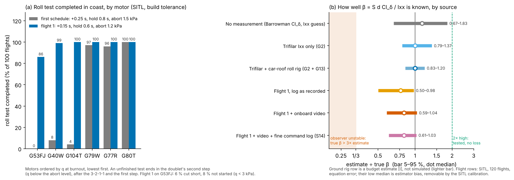

# SYSID-01: actuator-aware roll control, and the in-flight roll test

**15 November 2026, rev 3.** Labels: [F] simulated or measured result, [A] analytical (data sheet or HAL source), [I] inference, [S] speculation. Nothing in this note has flown.

- **Rev 1:** SITL study. Would an actuator-aware or MPC law help? Step test; best in-flight schedule.
- **Rev 2, James 15 Nov:** "How well can we estimate β from ground tests? Flash the new observer law; the first flight should carry the test manoeuvre, as long as it's not too extreme. No fin-can sensor; video from the first flight, inboard, for offline analysis."
  - The observer law (law 2) is the flight law. The roll test is in the flight-1 build. Both were built and flashed on 15 Nov (build `4a68a924`). See §9.
  - The ground-test β budget is in §10. The onboard video is in §11.
  - The fin-can spin sensor is dropped (§7).
- **Rev 3, James 15 Nov:** "Stop the servos dithering when not in flight phases or relevant tests; run any relevant HITL; provide the key figures; check worst-case clock-cycle execution time."
  - The dither now runs only in BOOST and COAST (§9.1).
  - The flight-1 code ran the 29-case HITL campaign (§9.5).
  - A servo-degradation map gives a new decision, D4 (§9.6).
  - Worst-case execution time is measured in core cycles (§9.7, WCET-01).
  - The figures are collected in FIG-02.

**Questions (rev 1):**
1. Would an MPC-like controller that knows the actuator (delay, threshold, lash, rate limit) gain much? It must keep the current property of having no aerodynamic model.
2. Simulate an in-flight step test, 0 → 2 rad/s → 0.
3. What in-flight roll schedule gets the most useful data about the system?

**Basis.**
- Plant: SITL 6DOF with the flight code compiled in, BENCH-02 servo at the corrected scale (`--servo bench02`).
- Dispersions: build tolerance (cant 0.1°, fin 0.1°, bearing ≤ 6 mN m). Unless stated, each campaign is 600 flights (6 motors × 100, paired seeds).
- Every number in this note comes from that model. They are simulated results, not flight results.

## 1. Answers

1. **An actuator-aware controller of the MPC kind gains almost nothing here.**
   - A perfect actuator (no delay, threshold, lash or lag) improves coast roll RMS p95 by 1 %, 19.1 → 18.9 °/s [F].
   - The loop crosses over near 8 rad/s, and the servo is 15 times faster.
   - The canard limits never bind in normal flight, so MPC's constraint handling would not be used.
   - Without a canard angle measurement, no controller can correct the servo's landing error.
2. **The disturbance torque is what matters.**
   - Its main sources:
     - bearing friction from the free-spinning fin can;
     - fin cant and body Cl₀ torques, which change with q;
     - the burnout transient.
   - The current trim integrator follows it too slowly. A higher gain helps only a little: c = 22 gives 17.2 °/s.
   - **A q-scheduled extended state observer (ESO) cut coast roll RMS p95 from 19.1 to 4.2 °/s, and peak roll p95 from 106 to 41 °/s [F].**
     - It needs only one number: canard effectiveness per unit dynamic pressure, β = S d Cl_δ / Ixx.
     - The c/q gain already assumes that number, so no aerodynamic model is added.
   - **Actuator awareness helps inside the observer, not in an MPC.**
     - If the observer assumes a faster servo than the real one, 1.5 % of flights go unstable at ω_o = 30 rad/s.
     - With ω_o = 20 rad/s and a conservative (slower) actuator model, every flight passes, even with a servo twice as slow (§4).
3. **Step test 0 → 2 rad/s → 0 (§5).**
   - On the current law, the rate reaches 90 % in a median 0.19 s and overshoots a median 10 % (up to 48 %). The trim is left wound up afterwards.
   - Under the ESO, the step settles cleanly.
4. **Schedule (§6, flight-1 timing §9).**
   - The excitation is a torque-scaled canard 3-2-1-1, then a ±2 rad/s doublet, guarded.
   - One flight gives the closed-loop step response, the friction asymmetry, and β to about ±19 % (1 sd, after removing a known estimator bias).
5. **β from ground tests (§10, rev 2): about ±11 % (1 sd), range 7–16 % [I].**
   - Two tests are needed: a trifilar Ixx and a car-roof roll rig that measures β directly with the flight computer.
   - The Reynolds-number gap between rig and flight dominates the budget. Trifilar Ixx alone gives ±18 %, against ±30 % with no measurement.
   - This is better than one flight, and independent of it. Combined with flight 1, the estimate is about ±9 %.
   - **None of this is needed for flight-1 safety:** the observer as flashed passes every flight over the whole prior range of β (§9.3).
6. **Onboard video (§11, rev 2).**
   - Video adds little to β: median 0.76 → 0.81, 5–95 % 0.50–0.98 → 0.59–1.04.
   - Its value is direct sight of what nothing else on board measures: the canard's real angle under air load, the fin can's slip and lock-in, and any flutter.
   - Fit the video canard angle to a servo model before using it. Regressing on the raw angle drops the median to 0.58.
7. **A degraded servo is the observer's weak point (§9.6, rev 3) [F].**
   - With a servo at 30 ms dead time, 50 rad/s, ζ 0.5, a 0.40° dead band and 0.29° lash, 4 of 600 SITL flights diverge to 1 800–3 500 °/s. This is the HITL `servo_worst` actuator, 2–3× the measured one on every count.
   - Law 1 stays bounded (381 °/s) but fails coast RMS more often.
   - At 21 ms, 60 rad/s and 0.2° / 0.2°, the observer passes 600 / 600.
   - The loaded-servo bench test now decides the flight law (PLAN-01 D4).

## 2. Why an actuator-aware or MPC law has little to gain

| Item | Value | Consequence [I] |
|---|---|---|
| Roll loop crossover | ω_c = c·β ≈ 15 × 0.56 = 8.4 rad/s (1.3 Hz) at nominal β | slow next to the servo |
| Servo (BENCH-02) | ω_n 130 rad/s, ζ 0.76, dead time 9.3 ms from pulse start, plus 2.5 ms frame hold | about 11° of phase at crossover, against a phase margin of about 70° |
| Canard in normal flight | p95 of the maximum 2.9°, never at the ±12° limit (R8: 0 %) | MPC's constraint handling would not be used |
| Threshold 1.6 µs (0.15°), lash 0.12°, landing scatter 0.09–0.16° | not observable without a canard angle sensor | A predictor would act only on a model of them. The dither already linearises the threshold. The landing error acts like a slowly changing torque bias, which a disturbance observer absorbs |

**Bounds, from 600 flights each** (`sysid_bounds.png`, [F]):

| Case | Coast roll RMS p50 / p95 / max (°/s) | Peak roll p95 / max (°/s) | All requirements |
|---|---|---|---|
| Current law, BENCH-02 servo | 9.4 / 19.1 / 34.0 | 106 / 220 | 100 % |
| … perfect actuator | 9.1 / 18.9 / 32.8 | 104 / 222 | 100 % |
| … no bearing friction | 8.8 / 17.7 / 28.8 | 95 / 165 | 98.7 % (R6: can lock-in) |
| … c = 22 | 7.9 / 17.2 / 31.8 | 90 / 158 | 100 % |
| … c = 22, perfect actuator | 7.8 / 17.1 / 30.8 | 91 / 170 | 100 % |
| … perfect actuator, no friction | 8.6 / 17.6 / 28.2 | 92 / 158 | 98.5 % (R6) |
| ESO law (§4) | 2.1 / 4.2 / 8.1 | 41 / 64 | 100 % |

- **[I]** No controller acting on the actuator alone can gain more than the perfect-actuator row, about 1 %. That holds at c = 22 too.
- **[I]** Removing friction gains about 7 %, but brings more can coupling: without friction the can spins more freely, and lock-in failures rise. The large error is in how fast the slowly changing torque is cancelled.
- **[F]** An MPC is computationally feasible on the F411 (a 2-state model, a 10-step horizon). It would add tuning, a horizon and a cost function for no benefit here.

## 3. What the error is

From 12 traced flights [F]:
- The coast RMS is spread over high, middle and low q. It is not concentrated near apogee.
- The fin can spins at 20–170 °/s RMS because of its cant, and drags the body through the bearing.

The trim integrator in the current law is deliberately slow: Ki 0.0234, rate limited to 3°/s, with a dead band. So it lags this torque. **[I]** The fix is a fast estimate of the total disturbance, not a better model of the actuator.

## 4. The observer law (CTRL_ROLL_LAW 2: the flight law from rev 2)

**Model and law.**
- The plant is taken as ṗ = β q̂ δ + f, where f is the lumped disturbance acceleration.
- A 2-state ESO (Han 2009; Gao 2003) estimates p̂ and f̂ with bandwidth ω_o, using l₁ = 2ω_o and l₂ = ω_o².
- The law is δ = (c/q̂)(p_ref − p) − f̂ / (β̂ q̂).
  - The first term is the current law.
  - The second term replaces the trim integrator.
- **Actuator model in the observer:** the observer's input is the commanded canard, delayed `CTRL_ESO_DN` + 1 frames and passed through a first-order lag `CTRL_ESO_TA`.
- **What it is not:** it uses no Cl_p, cant, Cl₀, friction or can model.
- **[I]** It is INDI by another route. Law 0 failed in HITL because its effectiveness was fixed instead of scheduled with q (ADR-004).

| Campaign (600 flights unless stated) | Coast RMS p50 / p95 / max | Peak p95 / max | Pass |
|---|---|---|---|
| ESO, ω_o 30, β̂ nominal, actuator model 15 ms + 12 ms | 2.1 / 4.2 / 8.1 | 41 / 64 | 100 % |
| … β̂ 2× too high | 2.3 / 4.7 / 8.4 | 46 / 82 | 100 % |
| … β̂ 2× too low | 2.1 / 5.5 / 249 | 36 / 296 | 99.3 %: 4 unstable, true β 3.1–3.6× β̂ |
| … slow servo (21 ms, ω_n 60, ζ 0.6) | 3.0 / 10.3 / 671 | 48 / 2117 | 98.5 %: unstable flights |
| ESO ω_o 20, BENCH-02 servo | 2.9 / 6.2 / 12.8 | 53 / 87 | 100 % |
| ESO ω_o 20, slow servo | 3.7 / 8.4 / 66 | 56 / 141 | 99.5 % |
| **ESO ω_o 20, actuator model 20 ms + 20 ms, slow servo** | 3.6 / 7.7 / 40.7 | 58 / 91 | **100 %** |
| **ESO ω_o 20, actuator model 20 ms + 20 ms, BENCH-02 servo** | 3.0 / 6.4 / 13.0 | 55 / 94 | **100 %** |
| Wide tolerance: current law / ESO ω_o 30 | 13.6 / 30.8 / 83.4 ; 3.3 / 6.7 / 31.1 | 197 / 312 ; 79 / 117 | 95.8 % ; 97.3 % (ESO fails only R6, can lock-in) |
| Hard-over, 240 flights: current law / ESO ω_o 30 | 62 / 120 / 138 ; 20 / 52 / 61 | 457 / 598 ; 375 / 533 | 27.5 % ; 66.2 % |

**Robustness [F].**
- The ESO tolerates β̂ too high easily: 2× costs 0.5 °/s.
- It goes unstable when the true β is more than about 3× β̂. Start with β̂ at 1.3× nominal until flight data narrows it.
- It is sensitive to an actuator slower than its model. A conservative (slow) model at ω_o = 20 costs almost nothing (6.2 → 6.4 °/s) and covers a servo twice as slow. **This is where the actuator model belongs.**

**Not tested [I/S]:**
- unmodelled structural or aeroelastic modes, and IMU mount resonance near ω_o;
- the servo under air load;
- gyro vibration that differs from the synthetic model.

An observer at 20 rad/s is low enough that these are unlikely to matter. HITL and a bench run come first.

## 5. Step test 0 → 2 rad/s (1 s) → 0

**Set-up.**
- The step starts 0.25 s after detected burnout.
- Median q̂ is 4.7 kPa at the start and 3.2 kPa at the end.
- 120 flights; `sysid_step.png` shows one of them.

| | Current law | ESO law |
|---|---|---|
| Time to 90 %: median (5–95 %) | 0.19 s (0.10–0.81) | 0.37 s (0.23–0.66) |
| Overshoot | 10 % (−18 to +48 %) | 1 % (−7 to +9 %) |
| Error over the last 40 % of the hold | 4 % (−21 to +20 %) | 3 % (−3 to +10 %) |
| \|p\| 1 s after the reference returns to 0 | 10 °/s (1.5–27) | 1.7 °/s (0.2–5.0) |
| Peak roll p95 / max | 170 / 220 °/s | 125 / 130 °/s |
| Canard, largest in the manoeuvre | 0.86° (0.27–1.85) | 0.87° (0.27–1.79) |
| Fin-can spin, largest | 88 °/s median, 265 p95 | 91 / 265 |

**What the trace shows [F].**
- The body drags the can along through the bearing. When the reference returns to 0, the can drags the body back.
- **Current law:** the trim integrator wound up during the step, so the body holds about −12 °/s for several seconds.
- **ESO:** it settles cleanly.

**For a flight on the current law [I]:**
- use a doublet (±) rather than a single step, so the trim unwinds; or
- freeze the trim integrator while `p_ref` ≠ 0 and for 0.3 s after.

The rise time is a poor measure of β. It correlates only 0.38 with the truth, because friction and the trim shape it.

## 6. The schedule that tells you most

**What one flight can identify.** The equation-error model is ṗ = β q̂ δ + k_p q̂ p/V + φ tanh(slip/0.5) + g q̂ + b, with these terms:

| Term | Meaning |
|---|---|
| β | sets c and the ESO |
| φ | bearing friction |
| g, b | cant and Cl₀ torque, offset |

**Design rules [I].**
- **Information on β grows with (q̂·δ)².** δ must vary independently of p. In closed loop δ follows p, so an independent excitation is needed: a rate-reference change, or a canard input added after the law.
- **Size canard excitation in torque units** (δ ∝ 1/q̂).
  - At q = 5 kPa, a fixed 0.5° 3-2-1-1 drives the body to 337 °/s, above R5a.
  - Scaled to 0.5° at 3 kPa, peak p95 is 164 °/s.
- **A ± rate doublet separates friction from the cant/Cl₀ torque.** Friction is odd in slip; the cant/Cl₀ torque is not. A single step mixes them.
- **Time window:** from detected burnout + 0.15 s while q̂ stays above the abort level. The window is about 3 s on G79W and under 2 s on G53FJ (§9.2).
- **Guard:** return to the zero-rate law at once if q̂ < 1.2 kPa, |p| > 200 °/s, or any fault.

**Results** (current law, 120 flights each; `sysid_schedules.png`).
- β̂/β is the median (5–95 %).
- "As logged" uses today's log. "+ fine cmd" logs the command at full resolution. "+ can sensor" adds a fin-can spin sensor (dropped, §7).

| Schedule | β̂/β as logged | + fine cmd | + can sensor | Peak roll p95 / max |
|---|---|---|---|---|
| None (natural excitation) | not identifiable | 0.33 (0.06–1.22) | 0.38 | 98 / 220 |
| Rate step +2 rad/s, 1 s | 0.74 (0.44–1.05) | 0.87 (0.59–1.11) | 0.89 (0.52–1.10) | 170 / 220 |
| Rate doublet ±2 rad/s, 0.8 s each | 0.75 (0.53–0.96) | 0.80 (0.59–1.01) | 0.91 (0.63–1.08) | 180 / 220 |
| Canard 3-2-1-1 0.5° (unscaled) | 0.85 (0.66–0.99) | 0.88 (0.68–1.02) | — | 235 / **337** |
| Canard multisine 0.4°, 2 s | 0.81 (0.58–0.99) | 0.84 (0.63–1.01) | — | 137 / 220 |
| **Combined: 3-2-1-1 torque-scaled, then doublet, guarded** | 0.79 (0.61–0.99) | 0.82 (0.64–1.03) | 0.91 (0.52–1.05) | 164 / 220 |

**[F]**
- **The choice of input moves β̂ by only a few per cent.**
- **What the data records matters more.**
  - Logging the command at full resolution raises the median from 0.74–0.79 to 0.80–0.87.
  - A can-spin sensor raises it to about 0.90. With the true slip, a noise-free fit is unbiased (median 0.97). So the remaining bias is friction confounded with control torque.

**[I]**
- The schedule still pays for itself. It gives the step response, the friction sign and size, and β to within the ESO's tolerance, and so turns a design assumption into a measurement.
- A better estimator is the next lever after sensing: output error with a fin-can state, or a Kalman smoother.

**The schedule as flown on flight 1 (§9.1)** follows rev 1 with shorter timing.
- The start is 0.15 s after detected burnout instead of 0.25 s.
- The doublet holds 0.6 s instead of 0.8 s.
- The abort is at 1.2 kPa instead of 1.5 kPa.
- The rev-1 timing finished on only 4 % of flights on the three low-q motors (§9.2).

## 7. What to change, and decisions

| # | Item | Why | Status |
|---|---|---|---|
| 1 | Log the roll command at full resolution in ascent (PLAN-01 S14), and log at 200 Hz during the manoeuvre | Identification bias (§6). At high q the 3-2-1-1 amplitude (0.2° at 7.5 kPa) is below the log's 0.24° step. The excitation can be rebuilt from the start event, but the law's part cannot | Proposed, not in flight 1 |
| 2 | ~~Fin-can spin sensor~~ | — | **Dropped (James, 15 Nov).** Video carries the can's slip offline (§11) |
| 3 | ESO roll law: ω_o 20, β̂ 1.3× nominal, actuator model 20 ms + 20 ms | 4–5× lower coast roll, robust in SITL | **Done (rev 2): the flight law, flashed 15 Nov.** HITL on the flight-1 code done (rev 3, §9.5); the `CFG_FLIGHT_BUILD` build on the chosen motor is still to run (G10) |
| 4 | Roll test in the flight code | §5–6 | **Done (rev 2): flight 1, §9** |
| 5 | Output-error estimator with a fin-can state, using the video slip | Next step for β and φ | Later, after flight 1 |
| 6 | Ground β: trifilar Ixx (G2) and car-roof roll rig (G13), §10 | β to about ±11 % before flight, independent of the flight test | Proposed |
| 7 | Rig support in firmware: a bench-only `rig` command (§10.3) | Runs the roll-test excitation at a console-set q̂, with onboard logging | Proposed (PLAN-01 S19) |
| 8 | Onboard video, flight 1 (§11) | Canard angle under load, can slip and lock-in, flutter | Proposed (PLAN-01 S20) |
| 9 | `RT_HOLD_S` by motor on the pre-flight sheet: 0.8 s for G77R, G79W and G80T; 0.6 s for G40W, G53FJ and G104T | A longer hold gives a complete step response where q allows (§9.2) | **Decision: James**, with D3 |
| 10 | Observer gate `CTRL_ESO_Q_ON` from 1 kPa to 300–500 Pa | Coast roll p95 8.3 → 6.7 °/s, maximum 22.8 → 13.4 (§9.4) | **Decision: James.** Needs the robustness campaigns and HITL first |
| 11 | Dither only in BOOST and COAST | Avoid wearing the servos on the pad and bench (§9.1) | **Done (rev 3), flashed** |
| 12 | Flight law by the loaded servo (PLAN-01 D4): law 2 if dead time ≤ 21 ms, ω_n ≥ 60 rad/s, and dead band and lash ≤ 0.2°; otherwise law 1 | §9.6 | **Decision: James**, after the loaded bench test |

## 8. Files

**Flight code**
- `Core/hyades/gnc/control.c/h`
  - `p_ref` (roll-rate reference) and `u_exc` (additive canard excitation), both 0 outside the test.
  - Law 2 (ESO), on only in BOOST/COAST with q̂ valid and ≥ `CTRL_ESO_Q_ON`.
  - Bumpless entry from the trim integrator and hand-back to it.
- `Core/hyades/mission/rolltest.c/h` (rev 2): the schedule, its guards, and `st_end` (how far it got).
- `Core/hyades/mission/flight.c/h`: gating and the `EV_ROLLTEST` event.
- `Core/hyades/svc/logrec.h`: `LOGF_ROLLTEST`.
- `Core/Src/app.c`: the log flag.
- `Core/Inc/board.h`: `CTRL_ROLL_LAW 2`, `CTRL_ESO_*`, `CFG_ROLL_TEST 1` and `RT_*`, all overridable with `-D`.
- Rev 3:
  - `alloc.c/h`: `Alloc_Apply(…, dither, …)`.
  - `control.c/h`: `dither_en`.
  - `Core/Src/prof.c`, `Core/Inc/prof.h`: DWT cycle counters.
  - `app.c`: `tasks [reset]` reports task, frame-by-phase and Flight_Step-section WCET in cycles.
  - `phase.c/h`: `Phase_NameAt`.

**Tests**
- `Tests/test_rolltest.c`: 5 tests, with timings taken from `board.h`.
- `Tests/test_control.c`: 4 ESO tests.
- `Tests/test_flight.c`: the roll test runs once in a flight and ends with zero outputs.
- Host tests: 133 / 133 (rev 3: 136 / 136).

**SITL**
- `Tools/sitl/sitl.c`: roll-test outputs (`rt_state`, `rt_end`, `rt_q`, `rt_q_end`, `rt_t0`, `rt_t1`, `rt_p_max`). R5b excludes the test and the second after it.
- `Tools/sitl/man.py`: rev-2 video variants (`video_slip`, `video_raw`, `video`, `video_fine`).
- Campaign scripts: `sysid_campaigns.sh` (rev 1) and `sysid_fl1_campaigns.sh` (rev 2; rev 3 adds the servo campaigns `W*`, `X*`).
- Figure scripts: `sysid_figs.py`, `sysid_fl1_figs.py` and `fig02_*.py` (FIG-02).

**HITL tools (rev 3)**
- `Tools/fc_hitl.py` stores the board's `tasks` reply in each case summary.
- `Tools/hitl_fl1_summary.py`: per-case table.
- `Tools/wcet_report.py`: the WCET tables and figure (WCET-01).

**Results**
- `Tools/sitl/runs/{O*,E*,K*,F*,G*,N*,M_fl1*}/summary.json`.
- `Documentation/Images/sysid01/`.

## 9. Flight-1 build (rev 2)

### 9.1 What is flashed

Build `4a68a924`: CubeIDE Debug, 0 warnings. 88 832 B of text against the 98 304 B USB-update limit, so 9.5 KB is left (PLAN-01 S12).

**Rev 3 builds.**
- `d1c8818f+0a0e0f` (11:29): the dither gate, 88 880 B.
- `d1c8818f+9b9f4b` (13:58): plus the cycle counters, 89 648 B (8.6 KB left).

The CubeIDE "Debug" configuration compiles at `-O2`, so the WCET is measured at the release optimisation (guideline E1).

**Dither (rev 3).** The ±0.17° 50 Hz null-axis dither runs only in BOOST and COAST. It used to run whenever control was active, including READY with bench actuation: about 100 reversals per second on each servo while on the pad. The bench servo profiles keep their own dither for A/B tests.

**Roll law.**
- Law 2 (ESO): ω_o 20 rad/s, β̂ 0.727 1/(Pa s²) (1.3× nominal), actuator model 3 + 1 frames of delay and a 20 ms lag.
- The observer runs only in BOOST and COAST with q̂ valid and q̂ ≥ 1 kPa.
- Elsewhere (pad, low q, after apogee) law 1 runs with its trim. Entry and hand-back are bumpless.

**Roll test** (`CFG_ROLL_TEST 1`, once per flight):

| Step | Value |
|---|---|
| Wait | COAST entry (detected burnout) + 0.15 s |
| Start if | q̂ valid and ≥ 3 kPa, control FULL, no fault above INFO. Otherwise skipped for the flight |
| 3-2-1-1 | Added to the canard after the law. Unit 0.1 s. Amplitude 0.5° × 3000 Pa / q̂, latched at the start, at most 1.5° |
| Gap | 0.2 s |
| Doublet | p_ref +2 rad/s (114.6 °/s) for 0.6 s, then −2 rad/s for 0.6 s, then 0 |
| Total | 2.1 s |
| Abandon at once (back to zero rate) | q̂ < 1.2 kPa, \|p\| > 200 °/s, any fault, mode change or phase change |

**Logging.**
- Event `EV_ROLLTEST` (code 10) is written at start, done, skip and abandon.
  - The text is `rt <start|done|skip|abort> <why> <stage> <q>`, e.g. `rt abort q dbl 4826`.
  - The arg is `event | why<<8 | stage<<12 | (q_start/2)<<16`.
- The state-log flag `LOGF_ROLLTEST` is set while the test is active.
- The start event's time and q_start give the excitation exactly, so the analysis does not depend on the 0.24° log quantum for `u_exc`.

**Checks on 15 Nov [F].**
- Host tests 133 / 133; tool tests 20 / 20 (1 skipped).
- Flashed over USB. The board booted through CAL → SETTLE → READY with control FULL.
- Worst-case task times on the pad (frame 5000 µs, budget 4000 µs): flight 577 µs, sense 1568 µs, telemetry 647 µs.
- In READY the canards held 0.00–0.01° for over a minute. The observer is off on the pad, so it cannot integrate its own command there.
- **In-flight path on the board:** done in HITL, rev 3 (§9.5). The observer ran, the test completed, and the guards fired on hardware. WCET in COAST is in §9.7.
- **Still open:** the boot message "fin zero read from a version 3 record" (S18). Re-align and save before any further bench or flight work.

### 9.2 Timing: why it changed from rev 1 [F]

The rev-1 timing finished the test on only 4 % of flights with G40W, G53FJ and G104T. On those motors q̂ falls below 1.5 kPa 1.9–2.2 s after the start, in the doublet's second step. The 3-2-1-1 and the first step were complete in every case.

| Variant (600 flights, build tolerance) | Completed | Low-q three | Step reaches 90 % in the hold |
|---|---|---|---|
| Rev 1: +0.25 s, hold 0.8 s, abort 1.5 kPa | 51 % | 4 % | 89 % |
| Hold 0.5 s | 85 % | 69 % | — |
| Hold 0.5 s, +0.15 s | 90 % | 79 % | — |
| Hold 0.5 s, +0.15 s, abort 1.2 kPa | 99 % | 97 % | 55 % |
| Hold 0.8 s, +0.15 s, abort 1.2 kPa | 80 % | 60 % | 88 % |
| **Flight 1: hold 0.6 s, +0.15 s, abort 1.2 kPa** | **97.5 %** (1.2 % cut short, 1.3 % not started) | 95 % | 66 % |

- The abort level of 1.2 kPa stays above the observer's 1.0 kPa gate, and a host test enforces that order.
- Cut-short tests all end in the doublet's second step. At the end, q̂ is 1.2–3.3 kPa (median 2.1).
- **Per motor [I]:** on G77R, G79W and G80T, a 0.8 s hold completes 100 % and the step reaches 90 % in 90 % of flights. Set `RT_HOLD_S` with the motor choice (D3; §7 item 9).

### 9.3 Not too extreme: criteria and results

Paired seeds, flight-1 build against the same build with `CFG_ROLL_TEST 0` [F]:

| Criterion | Limit | Result |
|---|---|---|
| Peak roll in the test | ≤ 200 °/s (guard), R5a 240 | p50 115, p95 136, max 165 °/s; slow servo max 184 |
| Canard in the test | ≤ 6° (half travel) | median 1.4°, p95 2.5°, max 3.5° |
| Lock-in ratio (R6 ≤ 0.6) | ≤ 0.45, no worse than without | 0.40 / 0.36: unchanged |
| Trajectory | apogee ±1 m, tilt ±2°, AoA ±1° | −0.4 / +0.3 m, ≤ 1.7°, ≤ 0.8° |
| Loads (LD-01 stations) | no new maximum | Maxima unchanged. The largest per-flight increase is +10 % (shear, aft coupler), still below the campaign maximum |
| Roll after the test | \|p\| 1 s later: p95 < 20 °/s | median 2.3, p95 7.5, max 27 °/s (one flight in 120) |
| Requirements R1–R9 | as without the test | 100 % (600 / 600) |

| Campaign | With the test | Without | Note |
|---|---|---|---|
| Build tolerance | **100 %**; coast RMS p95 9.1, peak p95 136 °/s | 100 %; 8.3, 69 | Peak p95 is the commanded 115 °/s plus about 20 % |
| Slow servo (21 ms, ω_n 60, ζ 0.6) | 100 %; peak max 184 °/s | — | |
| Wide tolerance | 96.7 % | 97.2 % | 5 more flights over R5b (residual roll after the test). The build tolerance stays mandatory |
| Servo hard-over, 240 | 48.3 %; peak p95 485 °/s | 55.4 %; 480 | A hard-over during the test adds to its roll: 8 more flights over 240 °/s. The guard stops the test; AoA max 15.1° either way, no pitch-over. Hard-over remains a residual hazard (MC-01) |

**[I]** On these numbers the test is not extreme. Its cost is concentrated in the hard-over case, which is a residual hazard with or without it.

### 9.4 What the flight settings cost [F]

All three runs have no test, 600 flights each, and all pass 100 %.

| Run | Coast roll RMS p50 / p95 / max (°/s) | Peak p95 / max (°/s) |
|---|---|---|
| Flight-1 law: β̂ 1.3×, observer gate 1 kPa | 3.4 / 8.3 / 22.8 | 69 / 124 |
| β̂ nominal | 3.4 / 8.1 / 22.5 | 67 / 121 |
| Gate 300 Pa | 3.1 / **6.7 / 13.4** | 59 / 100 |

- The 1.3× margin on β̂ costs almost nothing.
- **The 1 kPa gate costs about 20 % on coast RMS p95 and doubles the maximum.** Near apogee, the slow trim integrator takes over from the observer.
- **[I]** A gate at 300–500 Pa is worth having. It needs the wide-tolerance, slow-servo and hard-over campaigns, and HITL, before it is flashed, so it is not in the flight-1 build (§7 item 10).
- The roll test's abort level must stay above the gate.

### 9.5 Hardware-in-the-loop, rev 3 [F]

The flight-1 code (HITL build) ran 29 cases against the PC plant. FIG-02 §7 has the figures and the per-case table.
- **28 / 29 as expected.** `pad_knock_extreme` is the known false-liftoff probe (PLAN-01 S5).
- **Roll test:**
  - done in 19 cases;
  - abandoned by its guards in 5: rate ×4, q̂ invalid ×1;
  - skipped in 3: fault in BOOST ×1, q̂ invalid with I205W ×2;
  - not reached in 2: CATO ×1, false liftoff ×1.
- **The HITL plant has β̂ 2.8× too high:** whole-vehicle roll inertia, with the fin can locked.
  - The observer overshoots the doublet: 148 against 115 °/s.
  - It then rings for about 2 s.
  - Coast RMS after the test is 8.4 °/s, against 13.6 on law 1 (G79W nominal).
- **`servo_worst`** gives a ±150–217 °/s limit cycle through coast.
- **`combined_worst`** diverges to 2 799 °/s. In HITL-02, law 1 at c = 70 had a 4 Hz limit cycle in this case.
- **Dither on the pad:** max \|fin\| in READY is 0.006° (it was 0.173° on 8 Nov).
- **Repeat for WCET (campaign `20261115-140954`, flight log erased before each case):** every outcome above was reproduced [F].

### 9.6 Robustness to a degraded servo, rev 3 [F]

SITL, 600 flights per case; FIG-02 §8 and `fig02_servo_robustness.png`.

| Servo | Law 2 (flight-1) | Law 1 |
|---|---|---|
| As measured (BENCH-02) | 100 % | — |
| 30 ms, 50 rad/s, ζ 0.5 only | 99.7 % | — |
| 0.40° dead band, 0.29° lash only | 100 % | — |
| 21 ms, 60 rad/s, ζ 0.6; 0.20° / 0.20° | **100 %** | — |
| 21 ms, 60 rad/s, ζ 0.6; 0.40° / 0.29° | 93.8 %, worst 312 °/s | 86.8 %, worst 306 °/s |
| HITL `servo_worst` (30 ms, 50 rad/s, 0.5; 0.40° / 0.29°) | 86.0 %, **4 diverge (≤ 3 525 °/s)** | 84.3 %, worst 381 °/s |

**Variants that do not remove the divergence:**
- a slower observer actuator model (5 frames + 30 ms);
- ω_o 15;
- no roll test;
- a latched hand-over to law 1 at \|p\| > 300 °/s (law 1 cannot recover a canard-saturated limit cycle at 7 kPa). The hand-over code was not kept.

**[I]** The divergence needs a slow servo and a large dead band together, plus the upper half of the β range. **Decision D4 (James):** the loaded servo test sets the flight law (§7 item 12).

### 9.7 Worst-case execution time, rev 3

Measured with the DWT cycle counter on the board (96 MHz, the `-O2` build, interrupts included), on the pad with the real IMU and across a second HITL campaign with the flight log active. Frame: 480 000 cycles; budget (B1, 80 %): 384 000. Tables and margins are in **WCET-01** [F]:

| Item | Cycles | % of frame |
|---|---|---|
| Pad, READY, worst frame | 215 371 | 44.9 |
| COAST, worst frame (HITL) | 72 107 | 15.0 |
| BOOST, worst frame (HITL) | 85 357 | 17.8 |
| Flight bound: worst BOOST/COAST frame + worst real IMU read | 237 109 | 49.4 |
| `control` section (law, observer, roll test), HITL max | 10 967 | 2.3 |

- The observer and roll test cost about 11 k cycles (114 µs) at most. The blocking I2C read of the IMU (up to 152 k cycles) dominates the frame.
- **Two unmeasured paths break the budget on analysis [A]:**
  - The log writer at the data-sheet flash time reaches 95 %, still inside the frame.
  - A stuck I2C bus makes the HAL wait 25 ms per read. Fix before flight: PLAN-01 S23 (WCET-01 §4).

## 10. β from ground tests (rev 2)

β = S d Cl_δ / Ixx = 0.559 1/(Pa s²) at the nominal values: S = π d²/4, d = 62 mm, Cl_δ 0.657 /rad (CDS-01), Ixx 2.2 × 10⁻⁴ kg m².

**Before any measurement**, the SITL carries Cl_δ ×U(0.7, 1.3) and Ixx ×U(0.68, 1.6). That puts β within 0.55–1.49 of nominal (5–95 %), ±30 % as 1 sd of the log.

### 10.1 Two tests

**G2, trifilar pendulum (Ixx).**
- I = m g R² T² / (4π² L), less the platform's own inertia, which is measured empty.
- Measure the forward body flight-ready: battery, FC, servos and canards fitted, no fin can. The SITL takes Ixx as constant, with the motor not in it. If the motor case turns with the forward body, measure with a loaded and a spent case.
- Time at least 20 periods, five times, at under 10° amplitude. The FC's own gyro can log the swing.

| Term | 1 sd on Ixx |
|---|---|
| Thread radius R (±0.5 mm on about 60 mm, squared) | 1.7 % |
| Axis offset of the CG, e ≤ 2 mm (adds m e²) | 0.9 % (bias; centre it) |
| Period, length, mass | < 0.3 % |
| **Ixx** | **about 2 %** |

**G13, car-roof roll rig (β directly).**
- The forward body runs on a low-friction roll axle on a mast at least 0.6 m above the roof, nose into the flow.
- The FC commands the canards and logs the gyro. q comes from a pitot-static probe at the model's height, read by a differential pressure sensor.
- Then ṗ = β q δ + damping + friction + Cl₀ terms. The same equation-error fit as in flight gives β directly, with the flight servos, calibration and Ixx included.
- Use the car rather than a fan: a fan's swirl puts a roll torque on the model of the same order as the canards'.

Rig sizing (nominal values; Cl_p from CDS-01, rig damping not included):

| V (m/s) | q (Pa) | Re on the MAC | Torque per degree | ṗ per degree | Steady roll per degree | Spin-up time constant |
|---|---|---|---|---|---|---|
| 15 | 135 | 19 k | 0.29 mN m | 75 °/s² | 346 °/s | 4.6 s |
| 20 | 240 | 25 k | 0.52 mN m | 134 °/s² | 462 °/s | 3.4 s |
| 25 | 375 | 31 k | 0.80 mN m | 210 °/s² | 577 °/s | 2.8 s |
| 30 | 540 | 37 k | 1.16 mN m | 302 °/s² | 693 °/s | 2.3 s |

**What the sizing means [I].**
- The rig axle needs friction ≤ 0.3 mN m: two open (unsealed) ball bearings, checked by spin-down.
- **The flight fin-can bearing (≤ 6 mN m) would equal 5–20° of canard and swamp the test.**
- Use 0.5–1° steps. The body spins up fast (a 2° step at 25 m/s heads for 1 150 °/s), so the test needs a spin guard. The firmware's |p| guard applies.

**Procedure.**
- Run at three speeds (about 15, 22 and 30 m/s), both directions on the same stretch (to cancel wind), at least 10 sequences per run.
- Mirror every input (±δ) to separate friction and Cl₀ from β.
- At each speed, a run with a boundary-layer trip (zig-zag tape at 10 % chord) and one without show whether laminar separation is present.
- A private road or airfield, two people, and a mast rated for the load.

### 10.2 Budget (1 sd on β) [I]

| Term | Rig β | Note |
|---|---|---|
| q at the model | 3 % | Pitot and DP sensor calibrated against a manometer; both directions averaged |
| Flow quality (gusts, car wake, upwash) | 2 % | After at least 10 sequences per run. Upwash shifts Cl₀, not the slope |
| Mast and sting interference | 2 % | |
| Canard angle per command | 1 % | Cancels to first order, because the law uses β per commanded angle and the rig uses the same servos and calibration. Residual: deflection under air load (hinge at 0.20 c, small) |
| Estimation (friction, damping, Cl₀ regressors) | 2 % | |
| Rig against flight rotating inertia | 1 % | Same forward body; the axle adds < 0.5 % |
| **β at rig conditions** | **≈ 5 %** | |
| Mach: rig M 0.07, test window M 0.15–0.34, boost to M 0.8 | ≤ 1 %; +4 % at M 0.8 | Low-AR (A = 1) lift slope with Prandtl–Glauert in the DATCOM/Helmbold form. Computable |
| **Reynolds: rig 19–37 k, flight test window 60–145 k (MAC 18.7 mm)** | **5–15 %** | Unknown size and sign. A thick section (t/c ≈ 0.21) below Re 50 k may lose lift slope to laminar separation. Low-AR wing data across 70–200 k (Torres & Mueller 2004) is for thin plates and is not a substitute. The speed sweep and the trip test bound it: if β is flat with V and the trip changes nothing, take 5 % |
| **β for flight** | **≈ 11 % (7–16 %)** | |

### 10.3 What it buys, compared [F where simulated, I otherwise]

| Source | β̂/β (5–95 %) | 1 sd |
|---|---|---|
| No measurement | 0.67–1.83 (nominal ÷ true) | 30 % |
| Trifilar Ixx only | 0.79–1.37 | 18 % |
| **Trifilar + roll rig** | 0.83–1.20 (estimate) | **11 %** |
| Flight 1, log as recorded (SITL) | 0.50–0.98, median 0.76 | 19 % after the bias correction |
| Flight 1 + video (SITL, §11) | 0.59–1.04, median 0.81 | 17 % after the bias correction |
| Ground + flight 1, combined | — | about 9 % |

**Findings.**
- **[I]** The trifilar is cheap and removes most of the prior's spread on its own. It is already G2.
- **[I]** The roll rig is the only ground test that measures Cl_δ. Its limit is the Reynolds gap, not the instruments.
- **[F]** For flight 1 none of this changes safety. The MC draws cover β̂ from 0.7× to 2.9× the true β, and all of them pass. With β̂ at 1.3× nominal, the true β never exceeds 1.5× β̂; instability needs 3×.
- What a measured β buys:
  - lowering β̂ to the measured value (a few per cent of roll RMS);
  - choosing c with a known crossover;
  - a validated plant for the attitude-control work.
- **Firmware support (S19, not implemented):** a bench-only command, compiled out under `CFG_FLIGHT_BUILD`, that runs the 3-2-1-1 and doublet at a console-set q̂ and logs to flash at 200 Hz. The rotating body then needs no cable. Without it, a USB slip ring and manual `cal jog` steps with the console's IMU capture would work, but more crudely.

## 11. Onboard video for flight 1 (rev 2)

### 11.1 What it measures and what it is worth

| Target | Gives | View |
|---|---|---|
| Fin-can roll relative to the body | Slip, so friction and lock-in, separate from control torque; whether the can locks in | Camera on the forward body looking aft at the fin can, one fin marked a distinct colour |
| One canard's angle | The real canard angle under air load: servo gain, offset, lash and dead time in flight | Camera close to a canard, looking along the body at the panel, with a chordwise stripe on the canard and a reference line on the body |
| Anything unmodelled | Flutter, canard or can damage, the can's behaviour at deployment | Either |

**SITL check [F]** (`man.py`, 120 flights).
- Assumed: video at 60 fps, can angle ±1° and canard angle ±0.2° per frame (1 sd), sync ±8 ms.

| Data used for β | β̂/β median (5–95 %) |
|---|---|
| Log only | 0.76 (0.50–0.98) |
| Log + video can slip | 0.76 (0.51–0.97) |
| Log + video can slip + **raw** video canard angle | **0.58 (0.26–0.84)**: biased |
| Log + video can slip + servo model fitted to the video canard | 0.81 (0.59–1.04) |
| … + fine command log (S14) | 0.81 (0.61–1.03) |
| Reference: a 1 °/s can-spin sensor (dropped) | 0.89 (0.50–1.05) |

**Findings.**
- **[F] Do not put the video canard angle straight into the regression.**
  - 0.2° of frame noise against a 0.3–1° excitation biases β low (errors in variables): median 0.58 against 0.81 with the fitted model.
  - Fit the servo model (gain, offset, dead time, lag) to the video first, and regress on its output. The fitted gain was recovered to 0.88–1.07.
- **[F]** Video slip at ±1° per frame is too noisy to replace a spin sensor for β.
- **[I]** Video's main value is not β. It is direct sight of the actuator and the can in real air, which nothing else on board measures. A higher frame rate and a lens calibration improve the slip.

### 11.2 Recommended set-up [I]

**Camera.**
- 1080p at 120 fps preferred (60 fps minimum), exposure 1/1000 s or shorter.
- Known rolling-shutter readout, or a global shutter. At 500 °/s of slip, a 20 ms readout skews a fin by up to 10°, so correct it per row.
- Its own battery and card; not on the servo rail. About 20 g or less.

**Mount.**
- Rigid, in a small streamlined pod, aligned with the axis to within 0.5°. Halfway (45°) between two canards so that it is out of their wake.
- Re-check the static margin and drag in OpenRocket with the pod (G12). Add the pod's mass to the CG.
- An asymmetric pod adds a steady roll torque. The observer absorbs it, but put its estimated Cl₀ in the next MC.

**Canard view.**
- A second, smaller camera aimed along a canard.
- Alternatively, the same camera with a small mirror in the pod, if a test shows the image is sharp enough.

**Sync.**
- Cross-correlate the horizon's rotation in the aft view with the integrated gyro roll: about ±1 frame.
- For the servo's dead time in flight, add an LED in view that the FC flashes at logged times. That gives under 1 ms, but needs a spare output.
- Keep the camera's audio track: ignition is a coarse check.

**Before flight.**
- Film a 10° canard jog (as BENCH-02 §11) with the flight camera in its pod. This calibrates image angle to true angle.
- Do a checkerboard lens calibration with the same camera and settings.

**Processing.**
- Track the marked fin and the canard stripe per frame (OpenCV) and convert to angles with the lens calibration.
- Then run `man.py`'s `video` path on the flight log. The same code was used in the SITL check above.

**References.**
- Han, J. (2009). From PID to active disturbance rejection control. *IEEE Trans. Industrial Electronics* 56(3), 900–906. https://doi.org/10.1109/TIE.2008.2011621
- Gao, Z. (2003). Scaling and bandwidth-parameterization based controller tuning. *Proc. American Control Conference*, 4989–4996. https://doi.org/10.1109/ACC.2003.1242516
- Smeur, E. J. J., Chu, Q. P., de Croon, G. C. H. E. (2016). Adaptive incremental nonlinear dynamic inversion for attitude control of micro air vehicles. *J. Guidance, Control, and Dynamics* 39(3), 450–461. https://doi.org/10.2514/1.G001490
- Morelli, E. A., Klein, V. (2016). *Aircraft System Identification: Theory and Practice*, 2nd ed. Sunflyte Enterprises. ISBN 978-0-9974306-1-5. (Input design, 3-2-1-1 and multisine inputs, equation-error identification.)
- Torres, G. E., Mueller, T. J. (2004). Low-aspect-ratio wing aerodynamics at low Reynolds numbers. *AIAA Journal* 42(5), 865–873. https://doi.org/10.2514/1.439
