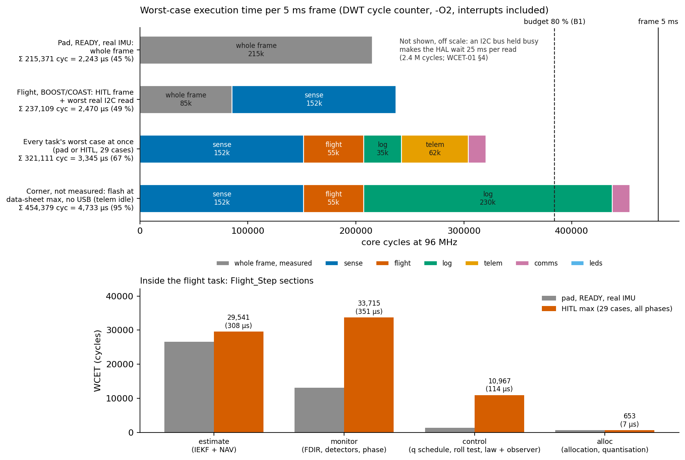

# WCET-01: worst-case execution time of the FC-V4 frame

**15 November 2026.** Build `d1c8818f+9b9f4b` (flight-1 code with cycle counters; CubeIDE "Debug" configuration, `-O2`; 89 648 B of text; `CFG_HITL 1`, the seam dormant unless the host drives it).

**Labels:**
- **[F]** measured on the board;
- **[A]** analytical, from the data sheet or the HAL source;
- **[I]** inference;
- **[S]** speculation.

**Scale.** 96 MHz core, 200 Hz frame: 5 000 µs = **480 000 cycles**. The budget in guideline B1 (WCET ≤ 80 % of the period) is **384 000 cycles**.

## Summary

| Quantity | Cycles | µs | % of frame | Basis |
|---|---|---|---|---|
| Pad, READY, real IMU: worst whole frame | 215 371 | 2 243 | 44.9 | [F] |
| BOOST, worst whole frame (HITL) | 85 357 | 889 | 17.8 | [F] |
| COAST, worst whole frame (HITL) | 72 107 | 751 | 15.0 | [F] |
| **Flight-frame bound:** worst BOOST/COAST frame + worst real IMU read | **237 109** | **2 470** | **49.4** | [F] + [I] |
| Every task's worst case in one frame (pad or HITL) | 321 111 | 3 345 | 66.9 | [F], conservative |
| Corner, not measured: log writer at the data-sheet flash time | 454 379 | 4 733 | 94.7 | [A] |
| I2C bus held busy at the start of a read | ≥ 2.4 M per frame | ≥ 25 000 | ≥ 500 | [A] |

**[I] Reading:**
- **Everything measured is inside the B1 budget.** Even every task's worst case at once stays 13 % of the frame below it. The realistic flight bound is 49 %.
- **The IMU read dominates.** Blocking, polled I2C costs 609 µs per frame typically and 1 581 µs at worst: about two-thirds of the flight bound.
- **Two paths were not measured, and on analysis they exceed the budget:**
  - The log writer at the data-sheet maximum flash time stays inside the frame. **Accept**, or halve it (§4.2).
  - A stuck I2C bus blocks for 25 ms per frame. **Fix before flight** (PLAN-01 S23, §4.3).

## 1. Method

**Counter.** DWT `CYCCNT` (`prof.c`), enabled at boot. It is 32-bit at 96 MHz and wraps every 44.7 s; unsigned differences are correct across the wrap.

**What is timed (`app.c` scheduler).**
- **Each task:** cycles around `t->run()`, last value and maximum.
- **Each frame:** from the top of the frame (after the wait for the deadline) to the end of the last task. The maximum is kept per flight phase.
- **Inside `Flight_Step`:** four marks split the flight task into four sections:
  - `estimate`: IEKF and NAV;
  - `monitor`: detectors, FDIR, arbitration, phase;
  - `control`: q̂ schedule, roll test, law and observer;
  - `alloc`: allocation and quantisation.
- `tasks` prints the figures and `tasks reset` clears them.

**Not in the frame figure:**
- `maintenance()`: the ground-only `log erase`. It re-bases the deadline and is excluded from the overrun count.
- In HITL, the seam's wait and reply, which are pacing, not work.

**Interrupts are included.** The USB OTG, GPS UART and SysTick handlers run inside whatever they interrupt, so every figure is the time the frame actually took [F].

**Optimisation.** `-O2`, as guideline E1 requires. The CubeIDE "Release" configuration is `-Os`. If it ever becomes the flight configuration, re-measure.

**Two sources.**
1. **Pad.** Real IMU over I2C, USB connected, 5 Hz text status on. The `tasks` reply was taken in READY, 72 s after boot (console log `20261115-121838.txt`, 13:59:54).
2. **HITL.** 29 cases (`fc_hitl_campaign.py --erase-log`, campaign `20261115-140954`):
   - 540 245 frames in total;
   - the board reboots for each case, so each case's counters start clean, and the report takes the maximum over cases;
   - the flight log is erased before each case, so the pre-trigger commit and the log writer run as in flight. Case 1 is the exception: it ran on the full log left by the previous campaign.
   - In HITL the IMU comes from the host, so the flight-phase frames do not contain the real I2C read. **§3 adds it back.**

**Measurement-based, not a proof [I].**
- The figures are the largest values seen, not a guaranteed bound.
- Coverage is the 29 cases plus the pad run. §4 treats the paths those runs cannot reach.

## 2. Results

### 2.1 Tasks [F]

| Task | Rate | Pad, real IMU (cyc) | HITL, max over 29 cases (cyc) | Worst (µs) | What it is |
|---|---|---|---|---|---|
| sense | 200 Hz | 151 694 | 151 752 ¹ | 1 581 | IMU read (blocking I2C) and GPS parsing |
| flight | 200 Hz | 42 857 | 55 435 | 577 | `Flight_Step` |
| log | 200 Hz | 120 | 35 158 | 366 | Flash programming of 2 records (24 words) per frame, plus record packing |
| telem | 5 Hz | 61 974 | 61 713 | 646 | Text status over USB (`snprintf` of floats). Idle in flight: no USB |
| comms | 200 Hz | 13 548 | 16 302 | 170 | Console or HITL frame parsing, USB task |
| leds | 200 Hz | 416 | 490 | 5 | |

¹ The HITL `sense` maximum is the real I2C read in CAL and SETTLE, before the host takes over.

**On the pad, typically [F]:**
- sense 609 µs and flight 331 µs: the loop is 950 µs;
- 1 561 µs in the frame that carries the status line.

### 2.2 Inside the flight task [F]

| Section | Pad (cyc) | HITL max (cyc) | µs | Case |
|---|---|---|---|---|
| estimate | 26 614 | 29 541 | 308 | `wind9_gust6` |
| monitor | 13 132 | 33 715 | 351 | `i205w_nominal` |
| control | 1 377 | 10 967 | 114 | `gyro_spike_coast` |
| alloc | 603 | 653 | 7 | `vib_nominal` |

**[I] Why the flight sections cost more than on the pad:**
- `control` grows eightfold in flight. The observer and the roll test only run in BOOST and COAST.
- `monitor` grows with the in-flight detectors. Its maximum comes from the I205W cases, where NAV saturates.

### 2.3 Whole frame, by phase [F]

| Phase | Worst frame (cyc) | µs | % of frame | Case |
|---|---|---|---|---|
| SETTLE (pad) | 190 633 | 1 986 | 39.7 | pad |
| READY (pad) | 215 371 | 2 243 | 44.9 | pad |
| SETTLE (HITL) | 209 609 | 2 183 | 43.7 | `thrust_p10` |
| READY (HITL) | 175 269 | 1 826 | 36.5 | `thrust_p10` |
| BOOST | 85 357 | 889 | 17.8 | `pad_knock_short` |
| COAST | 72 107 | 751 | 15.0 | `combined_worst` |
| CATO | 62 093 | 647 | 12.9 | `drop_15fr_boost` |
| DESCENT | 68 627 | 715 | 14.3 | `vib_nominal` |
| LANDED | 73 633 | 767 | 15.3 | `drop_15fr_boost` |

**[I] Reading the phases:**
- **SETTLE and READY** carry the real I2C read and the USB status line.
- **BOOST** carries the pre-trigger commit at liftoff and the log writer at full rate.
- **The earlier HITL loop time** (FIG-02 §7: p99 500 µs, max 886 µs) is the same work seen through the coarser µs timer. This campaign gives max 890 µs.

## 3. The flight frame against the budget

**What changes in real flight [I]:**
- The real I2C read comes back in place of the host copy.
- USB is unplugged, so `telem` returns at once and `comms` has less to parse.

**Bounds, three ways:**

| Bound | Cycles | % of frame | Margin to B1 |
|---|---|---|---|
| (a) Worst HITL BOOST/COAST frame + worst real read | 237 109 | 49.4 | 146 891 cyc (1.53 ms) |
| (b) (a) with all four torn-read retries (§4.1) | ≈ 310 000 | ≈ 65 | ≈ 74 000 cyc |
| (c) Every task's worst case in one frame (telem included) | 321 111 | 66.9 | 62 889 cyc |

**Notes on (a) [I]:**
- It keeps the host-copy `sense` cost inside the HITL frame, a few hundred cycles, so it is conservative by that much.
- It also keeps `Hitl_Poll` in `comms`.

**PLAN-01 gate 5, "WCET in COAST":**
- COAST measured 72 107 cycles in HITL;
- with the real read added, 223 859 cycles (46.6 %).

## 4. Paths the measurement does not reach

### 4.1 The IMU read on a healthy bus [A, F]

**Bus time per read (`QMI8658_ReadLatest`):**
- Each `HAL_I2C_Mem_Read` puts (3 + n) bytes on the bus, at 9 bits per byte and 400 kHz: 22.5 µs a byte.
- One attempt is a 17-byte burst (20 bytes on the bus) plus a 3-byte timestamp re-read (6 bytes): **585 µs, 56 160 cycles**.
- The pad's typical `sense` is 609 µs [F]. That matches, with the rest being GPS parsing and the conversion.

**Torn-read retries:**
- If the timestamp changed between the two reads, the read is repeated, up to `TORN_RETRIES` 3 times: 4 attempts in all. That would be 2 340 µs (224 640 cycles) [A].
- **[I]** A tear needs a new 448 Hz sample (every 2.23 ms) to land inside one 0.59 ms attempt, so about 1 read in 4 retries once.
- **[I]** Two tears in a row would need two samples within about 1.2 ms, which cannot happen at 448 Hz. In practice, then, at most two attempts (1 170 µs) occur.
- The measured worst of 1 581 µs fits two attempts (1 170 µs) plus about 0.4 ms of other work. **[S]** That remainder was not split out: a GPS burst (up to 256 bytes per call) or USB interrupts.
- **Even four attempts keep the flight frame at about 65 %:** bound (b) in §3.

### 4.2 The log writer at the data-sheet flash time [A]

**What the writer does.**
- `log_drain` programs up to `LOG_DRAIN_PER_FRAME` = 2 records of 48 B per frame, at ×32 parallelism: 24 word writes.
- Code runs from the same flash, so the CPU stalls for each write. The measurement includes the stall.

**Measured against data sheet:**
- Measured: 366 µs, about 15 µs per word [F].
- That matches the typical 16 µs.
- The STM32F4 data sheets give a 100 µs maximum per word, measured after 100 k erase cycles. Source: STM32F412 data sheet, DocID028087, Table 49; the F411 data sheet was not checked.

**At that maximum:**
- the log task is 2.4 ms (230 400 cycles);
- the frame is 454 379 cycles (94.7 %), with the IMU read at its measured worst and `telem` idle.
- That breaks B1 but stays inside the frame, so no frame is lost.

**[I] Likelihood.** It needs worn flash. The log sectors see one erase per flight, against an endurance of 10 k cycles.

**Options:**
1. Accept it, and record it against B1.
2. Set `LOG_DRAIN_PER_FRAME` to 1. The corner becomes 339 179 cycles, 3.53 ms (71 %).
   - Ascent STATE records are written at 100 Hz, half a record per frame. So one per frame still drains the 256-record pre-trigger backlog, in about 2.6 s instead of about 0.9 s [I].
   - Check the backlog queue depth before changing it.

### 4.3 I2C error paths [A]

From the STM32F4 HAL source (`stm32f4xx_hal_i2c.c`, `HAL_I2C_Mem_Read`):

| Failure | What the HAL does | Time per read |
|---|---|---|
| Address NACK (device absent) | Returns at the acknowledge failure | µs |
| Transfer stalls after it starts | Every wait uses the caller's timeout from one start tick. `rd()` passes 3 ms; the tick is 1 ms | ≤ about 4 ms |
| **Bus busy at the start** (a device holding SDA low, e.g. after a glitch or a brown-out mid-transfer) | Waits on BUSY with the HAL's own `I2C_TIMEOUT_BUSY_FLAG`, **25 ms**, whatever timeout the caller passed | **≈ 25 ms** |

**A stall partway through [I]:**
- The frame takes about 0.6 ms (one clean attempt) + 4 ms + the rest.
- That overruns one frame.

**A bus held busy [I]:**
- Every frame takes at least 25 ms, so the loop runs at about 40 Hz.
- Fin commands and logging run at 40 Hz too.
- There is no bus recovery in flight: `i2c1_bus_recover` runs only in `IMU_Init`. So this lasts until reset.
- FDIR declares the IMU lost (HARD) after `FDIR_IMU_READ_N` = 20 failed frames. That is meant to be 100 ms but takes 0.5 s here.
- The watchdog (100 ms) is kicked on every completed frame, so it does not reset the board.
- **Severity: modest.** The IMU is lost either way, and the outcome is the same (`EFF_NO_IMU`). What changes is the delay, 0.5 s instead of 0.1 s, and the slowed frame meanwhile.

**[I] What it breaks.** Guideline A3 (no blocking in real-time code) and B1 (every task analytically bounded within 80 %) are not met on this path.

**Recommended fix: PLAN-01 S23. Not implemented.** It changes the flight IMU driver and needs a host test and a bench check.
1. Before each read, check the I2C BUSY bit and fail at once if it is set.
2. After any failed read, run the 9-clock bus recovery in the next frame (about 0.1 ms) and re-initialise I2C.
3. Lower the per-read timeout to 1 ms.

Worst failing read then: about 1–2 ms, inside B1.

**The B1-clean alternative:** an interrupt or DMA read started at the top of the frame. It is a larger change.

**Bench check.** Hold SDA to ground through a push-button for about 1 s while in READY. Expect the IMU fault, recovery, then READY again; read `tasks` before and after.

### 4.4 Other limits [I]

- **Cache and flash wait states.** The ART accelerator hides flash wait states, but a rarely taken branch can miss. The 29 cases cover every phase and every roll-test outcome, but not every combination of inputs.
- **Overruns in HITL say nothing.** HITL runs lockstep, so `app.c` forces the overrun flag false. The HITL "overruns 0" is not evidence; the cycle counts are. On the pad (real-time pacing) the count was 0 [F].
- **Stack.** Not covered here. Guideline E2 (`-fstack-usage`) is a separate check.

## 5. Conclusions

1. **Measured worst flight frame is 237 109 cycles (2.47 ms, 49 %)** with the real IMU read, against a 384 000-cycle budget. The pad's worst is 215 371 cycles (45 %). B1 is met on every measured path [F/I].
2. **The IMU read is the cost to cut.** The CPU waits on I2C for 585 µs of a typical frame and up to about 1 200 µs at worst. A DMA read would remove most of that. Not needed for flight 1 [I].
3. **The log writer at the data-sheet flash time (95 %)** stays inside the frame. Accept it, or drain one record per frame (§4.2).
4. **A stuck I2C bus blocks for 25 ms per frame.** Fix it before flight: PLAN-01 S23 (§4.3).

## 6. Reproduce

1. **Pad.** Connect, wait in READY, then run `tasks reset`, wait at least 60 s, and run `tasks`. The console log keeps the reply.
2. **HITL.** From `Firmware/FC-V4/Tools`, run `python fc_hitl_campaign.py --erase-log` (about 32 min). Each case's `tasks` reply is stored in `campaign.json` as `tasks_text`.
3. **Report and figure.** Run `python wcet_report.py logs/hitl/campaign-<time> --pad logs/console/<file>.txt --out ../../../Documentation/Images/fig02`. It writes `wcet.md`, `wcet_summary.json` and `fig02_wcet.png`.
