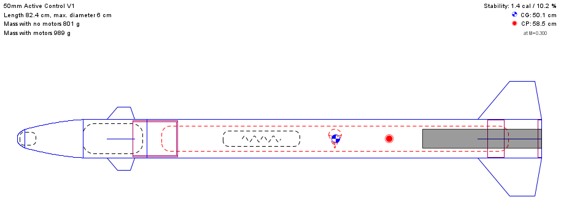
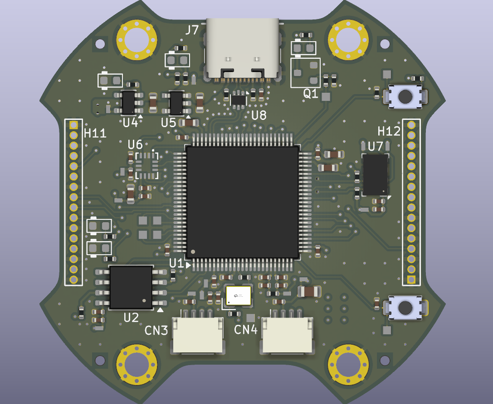
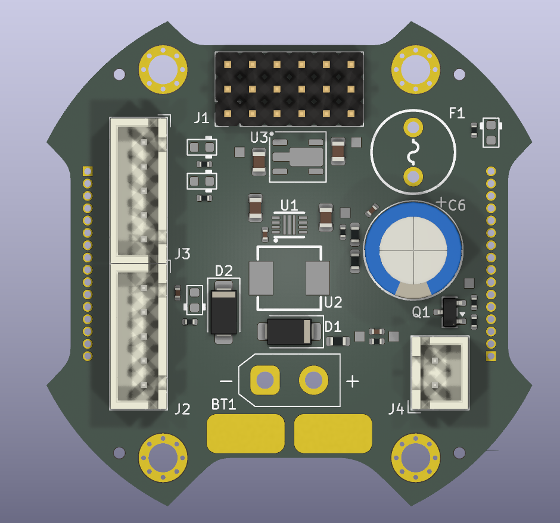
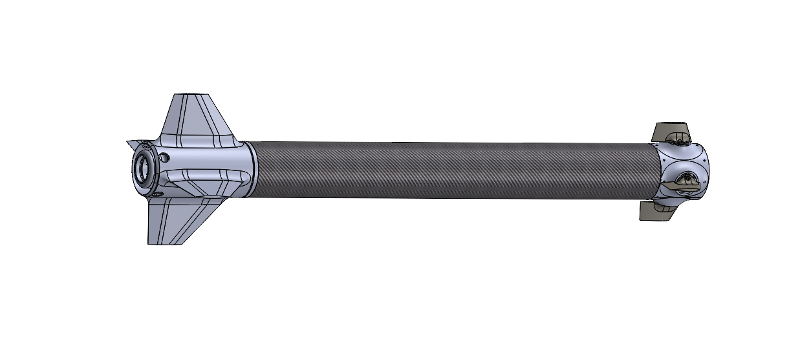
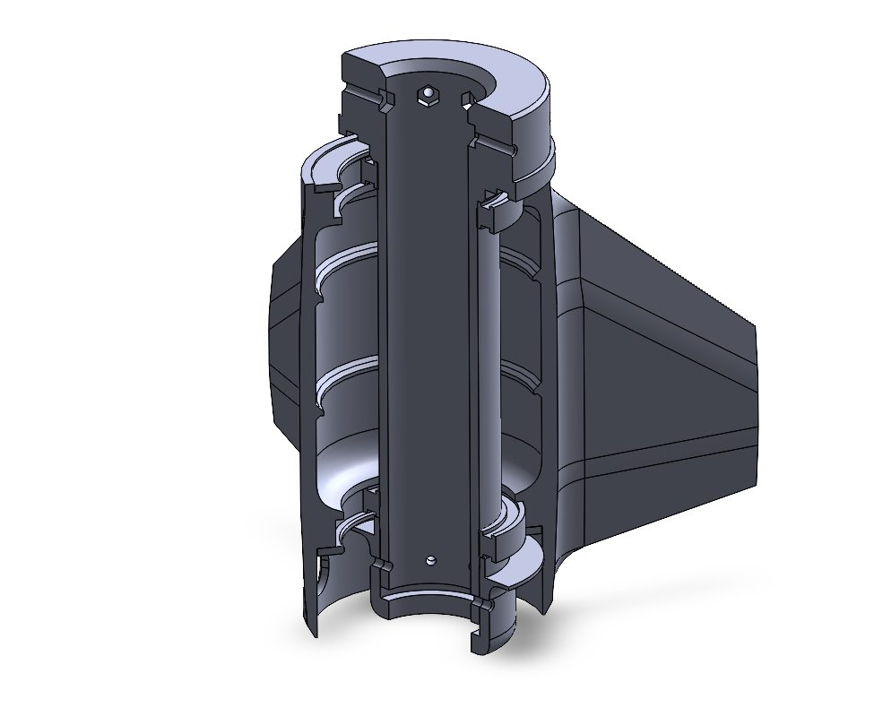
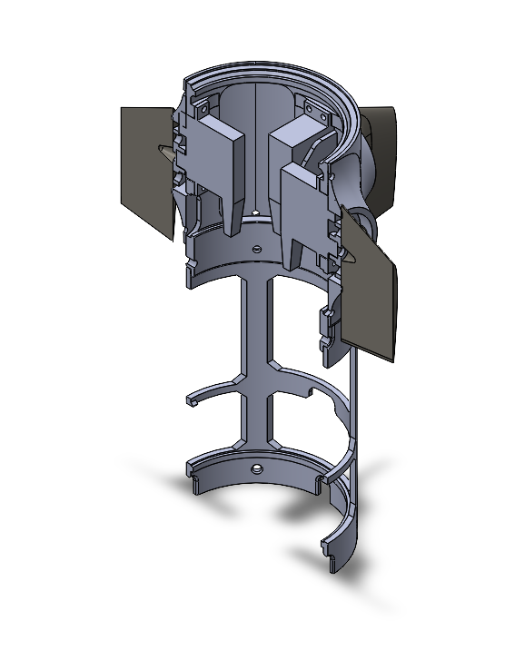

<p align="center">

</p>

---

# Hyades Flight Computer

Custom STM32H743 flight computer and GNC software for a roll-rate-stabilised high-power rocket.


*This is an engineering project, not a product. The safety case, regulatory compliance, and airworthiness of any vehicle built from this material are the builder's sole responsibility.*

The project is designed to:
- Provide a modular active roll-rate damping system suitable for a wide range of high-power rockets.
- Improve flight data quality by reducing excessive vehicle roll.
- Improve parachute deployment reliability by limiting roll-induced line twist.
- Provide a reusable avionics platform for future guidance, navigation and control research.
- Maintain compliance with applicable rocketry regulations through both hardware and software design decisions.
- Release all hardware, firmware and simulation tools as open source.

**Control scope.** The flight controller closes a loop on roll *rate*, not roll *angle*. It damps rate transients and cancels the standing roll moment produced by build asymmetry. It holds no commanded heading and has no outer attitude loop. Roll-angle hold and full three-axis attitude control are planned work and are not implemented.

This repository contains the hardware design, embedded software, simulation models, and analysis tools used during development.

---

## Specification

| Parameter | Specification |
|-----------|---------------|
| Purpose | Active roll stabilisation for mid- and high-power rockets |
| Flight Computer | STM32H743 ARM Cortex-M7 |
| Control Surfaces | Four independently actuated canards |
| Control System | Proportional roll-rate damper, dynamic-pressure gain scheduled, with a slow bounded trim path for bias rejection |
| Control Scope | Roll rate damping and bias rejection. No attitude loop |
| Interfaces | I²C, UART and 6× PWM outputs |
| Data | On-board logging with optional telemetry |
| Simulation | MATLAB, Simulink, 6DOF modelling and Monte Carlo analysis |
| Architecture | Modular flight computer, sensor board and power distribution board |
| Design Goals | Low mass, modular, reliable and adaptable |
| License | Apache 2.0 |

---

## Project Progress

| Feature                         | Status |
|---------------------------------|:------:|
| Flight Computer Design          | Complete |
| Flight Computer Testing         | In Progress |
| Flight Software                 | In Progress |
| Flight Hardware Design          | In Progress |
| Flight Hardware Testing         | In Progress |
| Simulink Roll Model             | Complete |
| Simulink 6DOF Model             | Complete |
| MATLAB Monte Carlo Analysis     | Complete |
| System Integration              | Not Started |
| HITL Testing                    | Not Started |
| Flight Testing                  | Not Started |

---

## Repository Structure

```text
Hyades-Flight-Computer
│
├── Firmware/
├── Hardware/
│   ├── PDB/
│   └── MCU Board/
├── Simulation/
│   ├── Buck Regulator/
│   ├── HSE Clock/
│   └── Roll Tuning/
├── Images/
└── Documentation/
```

---

## Flight Computer Design

The main PCB, containing all the computation and data gathering.

<p align="center">

</p>

The PDB board, provides power and distributes PWM signals to the servos, as well as providing a clean 3V3 to the sensor board.

<p align="center">

</p>

---

## Flight Computer Testing

0 Ohm Series Termination vs 47 Ohm Series Termination for the 24Mhz HSE Oscillator, unnecessary? Yes, but a good opportunity to learn SPICE Simulations, plus it looks cool.
Below the schematic that the simulations where derived from.

<p align="center">


</p>


---

## Flight Hardware Design

Full assembly, front section and nose cone are missing in action.

<p align="center">

</p>

Spinning Rear Fin Can designed to avoid the roll reversal phenomenon where upstream control surfaces tip vortices interact with the downstream fixed fins, causing a difficult to predict moment in the opposite direction.
Front avionics assembly, WIP
<p align="center">


</p>

---

## Flight Hardware Testing

%words

---

## Flight Software

%words

---

# Simulation

---

## Roll Control Architecture

The loop closes on roll rate, along two paths.

**Damping** is proportional and gain scheduled on dynamic pressure, `Kp = c / q_e`. The 1/q schedule holds the open-loop crossover constant across the envelope.

**Trim** is a slow bounded integrator that cancels the standing roll moment `Cl_0` from fin cant and build asymmetry. It is kept out of the damper because the deflection that cancels a standing bias, `-Cl_0 / Cl_delta`, is independent of q and V - one fixed deflection works everywhere, so it can be learned slowly and stay clear of the loop dynamics. Four gates bound it: bandwidth, a dead zone subtracted from the integrator input, a saturation freeze, and a clamp with a rate limit. It accepts an external `Cl_0` estimate, so a future MEKF can supply the value directly.

Putting integral action in the damper instead produces a limit cycle against the servo dead zone. That dead zone sits inside the servo's own position loop, so command-side compensation does not reach it; dither on the command does. Flown at 1.5x the modelled dead zone, 125 Hz.

**Open items.** The trim saturation gate tests the pre-dither command while the travel clamp acts post-dither, so it can miss a saturation event within one dither amplitude of the stop. The dither frequency also needs checking against the servo's maximum frame rate.

---

## Simulink Roll Model

%words

---

## Simulink 6DOF Model

%words

---

## MATLAB Monte Carlo Analysis

400 dispersed runs per design point. Aerodynamic coefficients, vehicle properties, actuator parameters and the disturbance bias are sampled per run. The controller's dynamic-pressure estimate is drawn about the sampled truth rather than the nominal, so scheduling error compounds with aerodynamic dispersion instead of cancelling against it.

| Metric | Definition |
|---|---|
| `rms_err` | RMS of (p - ref) over the steady tail |
| `bias` | mean(p) - ref over the tail |
| `ripple_pp` | max(p) - min(p) over the tail; limit-cycle amplitude |
| `activity` | RMS surface rate; catches stick-slip |
| `growth` | RMS of the last half of the tail over the first half; the stability test |
| `travel_peak` / `travel_steady` | Travel used over the whole run / over the tail |

Dither amplitude was swept over four campaigns at matched dispersion. Limit-cycle amplitude falls sharply at the flown setting with no rise in surface activity; the cost shows up as a small steady rate bias.

<!-- FIGURE SLOT A: settling-time and rate-error distributions, regenerated against
     the current canard geometry and the flown gainset. -->

<!-- FIGURE SLOT B: parameter-vs-outcome correlation structure, regenerated. -->

---

## MATLAB Gain Optimisation

`c` is set analytically from a 4 Hz crossover target; the numerical work confirms the margins near it survive parameter uncertainty rather than searching for an optimum. Margins come from the open-loop frequency response with the transport delay treated exactly, evaluated over paired (q, V) flight conditions spanning q = 2-40 kPa, with independent +/-30% on `Cl_delta` and `Cl_p`, accepted at phase margin >= 35 deg, gain margin >= 6 dB and peak sensitivity <= 2.0 at the worst corner. Constants are read from the parameter file rather than restated here.

A separate grid search over `c` and the trim parameters scores candidates on settling time, hang-off, limit-cycle amplitude and actuator demand, using the Monte Carlo campaign at each point.

`Ti` applies only to the legacy PI mode kept for A/B comparison.

<!-- FIGURE SLOT C: stability-margin and failure-probability maps over c, regenerated
     against the current canard. The previously published heatmaps are from the legacy
     PI controller and the earlier canard geometry. -->

---

## System Integration

%words

---

## HITL Testing

%words

---

## Flight Testing

%words

---
